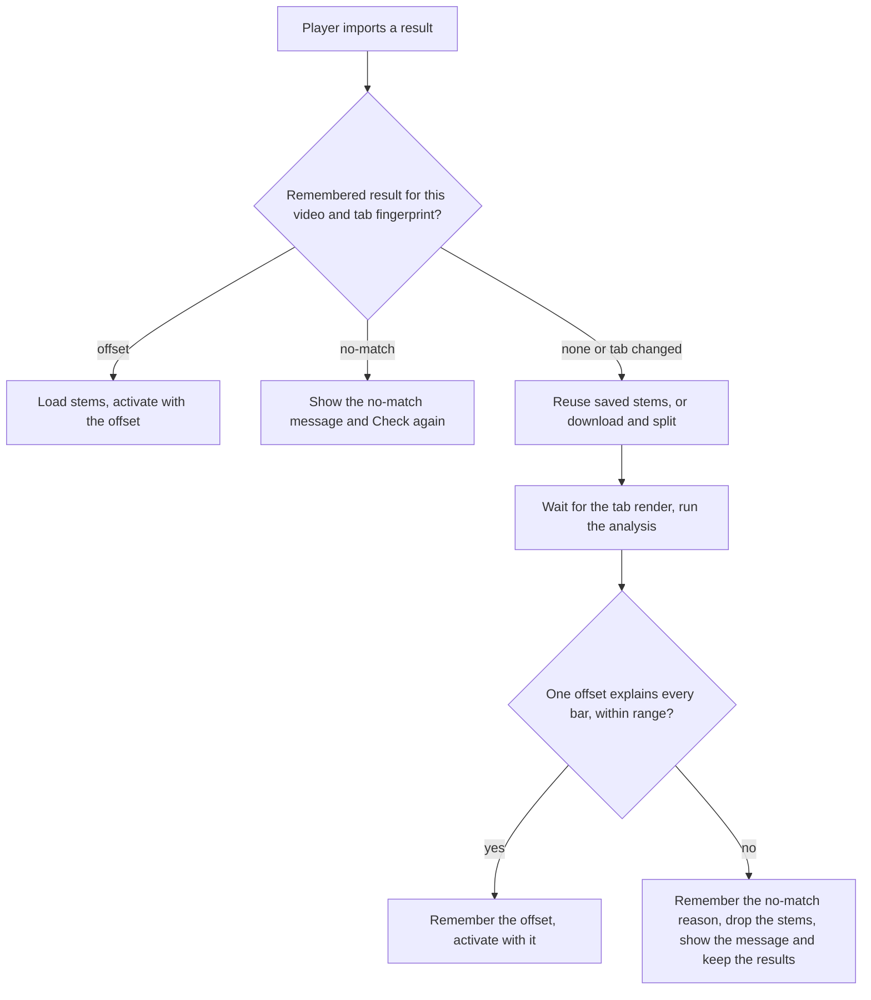
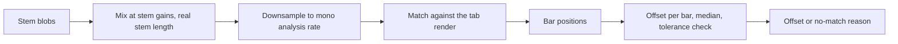

# YouTube Take Auto-Align - Plan

## Goal Capsule

- **Objective:** A player who imports a YouTube take hears it start in sync with the tab without adjusting anything, or is told plainly that the take does not match and can pick another result.
- **Means:** Judge the take before it is switched on, reading one constant offset from the existing alignment analysis and rejecting any take that one offset does not explain (KTD1, KTD5).
- **Product authority:** The user, in the brainstorm and planning dialogue. Entries marked session-settled are not reopened by planning.
- **Execution profile:** Code, TypeScript. Build the pure decision logic test-first; the screen wiring has no automated tests in this repo and gets a by-hand check.
- **Stop conditions:** Stop and report if U1 shows the analysis cannot match a stem mix against the tab on synthetic shifted audio, or if U4 cannot keep a take's offset out of the loaded recording's saved profile.
- **Open blockers:** None.
- **Tail ownership:** The implementer finishes and ships, then rebuilds the desktop package for the by-hand check in the Verification Contract.

Product Contract preservation: restructured, no scope change. R-IDs, Key Decisions and Acceptance Examples are unchanged. Outstanding Questions were resolved in place: the 30-second range stays (now an assumption, KTD2), and the rest became KTDs or implementation-time unknowns.

---

## Product Contract

### Summary

After a YouTube take is imported and split into stems, the app works out how far the take starts ahead of or behind the tab and plays it aligned by that single offset. If it cannot find a confident offset, it says "This doesn't line up with the tab. Try the next result." and does not play the take against the tab. The player never has to touch an offset to get a take in sync.

### Problem Frame

Imported YouTube takes get no automatic alignment today. Detection runs only for a recording file the player loads, so a take that starts with an intro, a count-in or talking plays out of sync until the player finds it and fixes it by hand. The nudge control that exists is a manual workaround, not a fix. A wrong take (live version, cover, different arrangement) also costs a full download and split before the player finds out it never fit.

### Key Decisions

- KD1. **A take that cannot be matched is reported and not played.** The panel says "This doesn't line up with the tab. Try the next result." and offers the other results. (session-settled: user-directed — chosen over playing a best-guess offset with a warning, and over falling back to a manual slider: the goal is that nothing is adjusted by hand.) Governs R4.
- KD2. **Constant offset only for this version.** The take is placed by one offset, not followed bar by bar as the player's own recordings are. (session-settled: user-directed — chosen over a full bar-level timeline, and over offset-first-then-timeline: smallest version that counts as done.) Governs R2, R3.
- KD3. **Doubt means no match.** When the app is unsure, it rejects the take instead of playing a possibly wrong offset. (session-settled: user-directed — chosen over accepting a best guess to avoid false rejections: a quietly wrong offset is the worse mistake.) Governs R3, R5.
- KD4. **The take is judged after import, on the split stems.** (session-settled: user-directed — chosen over an early check on the raw download before splitting, and over pre-checking search results from audition clips: reuses existing alignment with the least new machinery.) Governs R1.
- KD5. **Exports match playback.** Exported audio and video of an aligned take use the same offset the player heard. (session-settled: user-directed — chosen over shipping playback only and blocking or leaving export as-is: otherwise the saved file would disagree with what was practised against.) Governs R8.

### Requirements

**Automatic alignment**

- R1. After a YouTube take is imported and split, the app determines automatically how far the take starts ahead of or behind the tab, with no player action.
- R2. When a confident offset is found, the take plays in sync with the tab from the start, positioned by that offset alone.
- R3. A take whose bars do not stay consistent with a single offset counts as not matching, even when its start looks plausible.

**When there is no match**

- R4. When no confident offset is found, the panel states that the take does not line up with the tab and offers the other search results; the take does not play against the tab.
- R5. The message names the cause when it is known: the tab or take is too long to analyse, one has no sound, or the take starts too far from the tab.

**Player control**

- R6. A player is never required to adjust anything for a take that lined up. The existing nudge control for a lined-up take is kept as an optional fine-tune.

**Memory**

- R7. The result for a given video and tab, an offset or a no-match, is remembered, so reopening the same video on the same tab does not repeat the analysis. A changed tab, or a player's request to re-check, runs it again.

**Export**

- R8. Audio and video exports of an aligned take place the take at the offset the player heard.

**Unchanged behavior**

- R9. The player's own loaded recordings keep today's alignment behavior. Search results, their ranking, and what the YouTube option may import are unchanged.

### Key Flow

- F1. Import a YouTube take
  - **Trigger:** The player picks a search result and imports it.
  - **Steps:** The take is downloaded and split into stems; the app compares the stems with the tab; a confident offset is applied, or the no-match message is shown with the other results still listed.
  - **Outcome:** The player practises along in sync, or picks another result. No adjustment step exists in either path.
  - **Covered by:** R1, R2, R4

### Acceptance Examples

- AE1. **Covers R1, R2.** Given a studio take with a 12-second intro, when it is imported, it plays with the first bar of the tab landing on the first bar of the song and the player touches no control.
- AE2. **Covers R3, R4.** Given a live version with an extra section, when it is imported, the panel says it does not line up with the tab and offers the next result; the take is not played against the tab.
- AE3. **Covers R5.** Given a take that starts more than the allowed range away from the tab, the message says the take starts too far from the tab, not just that alignment failed.
- AE4. **Covers R7.** Given a take that lined up last session, when the same video is opened on the same tab, it plays aligned without a new analysis.
- AE5. **Covers R7.** Given the tab was edited since the last check, when the same video is opened, the take is checked again.
- AE6. **Covers R8.** Given an aligned take, when the player exports the practice audio or video, the take sits at the same offset against the tab as in playback.

### Success Criteria

- Popular studio takes line up on the first import without the player touching a control.
- A take that was played as aligned sits close enough to the tab that the player does not hear it as off. This borrows the existing bar-level alignment target of about 50 ms (`docs/plans/2026-10-05-1838-feat-bar-level-alignment-plan.md`, R2) as the working bar and is an assumption to confirm during U2.
- A wrong take is rejected rather than played. Rejection is acceptable on a take that was actually fine; a wrong offset played as correct is not (KD3).

### Scope Boundaries

**Deferred for later**

- A bar-by-bar timeline for YouTube takes, so extra sections, repeats and tempo changes are followed.
- Tap-to-sync points as a manual fallback.
- Trying the next result automatically after a no-match.
- Checking search results against the tab before import, from the audition clips or the raw download.
- Search-side work from the same ideation: query seeding from the tab, trust-scored ranking, and a search health check.
- Per-song memory of the chosen video, mix and rejected takes beyond the alignment result.

**Outside this work**

- Any change to how stems are separated or to what the YouTube option may import.
- YouTube search on the website; it stays desktop-only.

#### Deferred to Follow-Up Work

- Restoring the loaded recording's alignment on the stem clock after a YouTube take is removed. Today the recording's alignment sits in one shared slot; this plan keeps the take out of the recording's saved profile (KTD7) but does not build a full swap-back.
- Widening the offset range for YouTube takes (KTD2).

### Dependencies / Assumptions

- The existing automatic alignment for loaded recordings is the basis. Today it always finds bar positions, not a bare offset, so the single offset is read from that result and the bar detail is discarded. The consistency requirement in R3 relies on that detail.
- A loaded recording and an active YouTube take do not play together today. Loading stems pauses the recording, and replacing a recording discards the stems. This work keeps that and does not make them coexist.
- The offset range stays at today's 30 seconds either way (KTD2). A video with a longer intro is reported as starting too far from the tab (R5).
- The analysis caps of 30 minutes for the take and 15 minutes for the tab stay.
- Remembering the result per video and tab (R7) was proposed in the dialogue and accepted without change.

### Outstanding Questions

**Deferred to Implementation**

- Which mix of the split stems matches the tab best (all stems, or everything except guitar). U1 tries both on synthetic audio and the by-hand check on real takes decides.
- How tight the consistency tolerance can be. Anchors are rounded to 10 ms, so the working bar of about 50 ms is the starting point and nothing under about 20 ms is workable.
- Whether the analysis matches a *different* recording of a song (live, remastered, different tempo) at all. This is the feasibility risk (Stop conditions); real takes settle it.

### Sources / Research

- `docs/ideation/2026-10-11-youtube-search-and-sync-ideation.html`, idea 1.
- `src/app/App.tsx`: detection and reuse run only for a loaded recording clock; stems receive the current alignment but never trigger detection. A stem-derived result would share the single alignment slot that the recording uses.
- `src/alignment/analyze.ts`: analysis takes a decodable audio blob; caps of 30 and 15 minutes.
- `src/audio/offset-range.ts` and `src/app/alignment-controls.ts`: the 30-second range and the existing not-lined-up wording.
- `src/app/StemPanel.tsx`: a YouTube import is saved by link (`url:` key) with no offset or alignment stored.
- `docs/plans/2026-10-05-1518-feat-auto-alignment-plan.md`, `docs/plans/2026-10-06-0431-feat-durable-alignment-memory-plan.md`: existing alignment behavior and its memory.

---

## Planning Contract

### Key Technical Decisions

- KTD1. **Judge the take before it is switched on.** The import flow loads the stems, runs the check, and only then activates the take; on a no-match it drops the loaded stems and shows the message inside the stem panel, so the result list stays on screen and nothing plays. (session-settled: user-approved — chosen over activating the take and switching it off on a no-match: that flickers the mixer and risks playing the take at offset 0.) Implements KD1, KD4; governs U4.
- KTD2. **The 30-second offset range stays for YouTube takes.** The limit is a shared constant used by recording detection, so widening it would change recording behavior (R9). (session-settled: user-approved — chosen over widening it for YouTube takes: long intros are reported as "starts too far from the tab".) Governs R5.
- KTD3. **The remembered result lives in a new per-video record.** It is keyed by a hash of the video link, stores the tab fingerprint and revision inside, and holds either the offset or the no-match reason. A changed tab fingerprint re-checks (AE5); a remembered no-match shows its message with a "Check again" button (R7). A nudge after a lined-up take overwrites the stored offset and keeps the detected one as the previous value. (session-settled: user-approved — chosen over keying by video plus tab or by recording hash, and over re-checking every time: one record per video follows the existing recording pattern, and a title edit does not matter.) Governs R7.
- KTD4. **The nudge control stays for a lined-up take, with its wording fixed.** The stale comment saying the offset controls skip stems and the note claiming the recording "could not be lined up" are corrected. (session-settled: user-approved — chosen over hiding the nudge for YouTube takes: "nothing needs adjusting" means the player need not, not that the control is removed.) Governs R6.
- KTD5. **One offset is read from the bar-by-bar result by a pure function.** From an aligned result, take each bar's start minus the tab bar's start; accept only when the result is the "lined up" tier, has no holds and no skipped stretches, every bar offset sits within the tolerance of the median, the end anchor agrees, and the median is within the 30-second range. Otherwise return a no-match with the closest existing reason (`not-confident`, `inconsistent`, `out-of-range`, `too-long`, `silent`). A slightly different tempo makes the offsets drift, which is what the tolerance catches. Implements KD2, KD3; governs U2.
- KTD6. **The analysis accepts a prepared audio feed, not only a file.** `startAnalysis` gains an optional supplier of mono samples at the analysis rate. The stem feed is the stems mixed at their gains (all stems at unity first, a mix without guitar as the alternative), decoded and downsampled with the existing helpers. Its length is the real length of the stems, not the tab's duration. Chosen over encoding the mix to a WAV blob and decoding it again, which costs a round trip and loses the shared decode cache semantics. Governs U1.
- KTD7. **While a YouTube take is active, the take owns the alignment state and the recording's saved profile is never written.** The app's offset, alignment and export alignment follow the take's own offset map, built from the take's offset when the take is activated, not the recording's map that was in the shared slot. The nudge, mix-change and section-rename handlers skip the recording-hash save and write to the take record (KTD3). Governs U4, U5.
- KTD8. **Order of checks on import.** A remembered no-match shows its message without downloading. A remembered offset skips only the analysis: the stems are still loaded, reusing saved stems or downloading and splitting, and the take is activated with the stored offset. With no remembered result, saved stems are reused if present, otherwise the take is downloaded and split, and the stems are analysed. Governs U4.
- KTD9. **Cancellation drops the pending take silently, on its own run guard.** The check has its own run token and job, separate from the loaded recording's, so importing a take does not cancel a recording analysis. A new recording load, a tab or tuning change, or a newer import cancels the take check, and its late result is ignored. Nothing restarts a cancelled check; re-importing runs it against the tab as it then stands. Take status lives in the stem panel's state, not in the recording's alignment status. Governs U4.

### High-Level Technical Design

The decision flow for one import:

The analysis feed, from stems to a single number:

### Assumptions

- The stem mix that best matches the tab is found by trying, not by reasoning (Outstanding Questions).
- A remembered no-match is only as good as the analysis that produced it, so the take record carries a revision and a later change to the analysis bumps it to force a re-check.

### Risks & Dependencies

- **The analysis may not match a different recording of the song.** Mitigation: U1 is a gate; stop if synthetic shifted audio fails, and the by-hand check on real takes decides the rest.
- **The shared alignment slot.** One alignment, status and run token serve the recording today. A take written into it could overwrite the recording's saved alignment. Mitigation: KTD7 and U4's integration scenarios.
- **Tolerance too tight rejects everything; too loose plays wrong offsets.** Anchors are rounded to 10 ms. Mitigation: tolerance is a named constant with tests on both sides of it (U2).
- **Long videos.** Takes over 30 minutes, or tabs over 15, get the too-long message (R5).
- **Tab sound not ready.** The analysis needs the tab render; U4 reuses the existing waiting state and shows "waiting" during it.

---

## Implementation Units

### U1. Analysis accepts a prepared audio feed, and a stem feed builder

- **Goal:** Let `startAnalysis` run on mono samples supplied by the caller, and build that feed from a take's stems.
- **Requirements:** R1, R3 (KTD6; KD4)
- **Dependencies:** None
- **Files:** `src/alignment/analyze.ts`, `src/export/stem-audio.ts`, `tests/alignment/analyze.test.ts`, `tests/export/stem-audio.test.ts`
- **Approach:**
  - Add an optional supplier to the analysis arguments; when present it replaces the file decode, and the cap check uses the supplied duration.
  - Add a stem-feed builder beside `renderStemMix` that mixes the stems at their gains and downsamples with `downsampleMono` from `src/alignment/features.ts`. It decodes one stem at a time straight to the analysis rate, as the recording decode does, because full-rate decoding of a 30-minute stem is hundreds of megabytes.
  - The take's length comes from the stem audio itself (the length the stems report once loaded), not the tab's duration; the analysis cap check uses it.
  - Keep recording analysis untouched; the file path stays the default.
- **Execution note:** Start with a failing test that feeds shifted synthetic audio through the new path; this unit is the feasibility gate. Try the all-stems mix first and a mix without guitar second, and record which matches better in the test names.
- **Patterns to follow:** The injected `deps` seams and `fakes()` helper in `tests/alignment/analyze.test.ts`; the `fakeDecode` pattern in `tests/export/stem-audio.test.ts`; synthetic builders in `tests/helpers/synthetic-audio.ts`.
- **Test scenarios:**
  - Covers AE1. A synthetic song shifted later by 12 s, supplied as a feed, returns an aligned result whose first bar sits about 12 s from the tab's first bar.
  - A feed equal to the tab render returns an aligned result with a base near 0.
  - A silent feed returns `not-found` with reason `silent`.
  - A supplied duration over 30 minutes returns `not-found` with reason `too-long` without calling the supplier.
  - Cancelling during the supplier call returns `cancelled`.
  - The recording path (a file with no supplier) behaves exactly as before; the existing analyse tests still pass.
  - The stem-feed builder with three stems at gain 1 returns their sum at the analysis rate; a muted stem is skipped.
  - The stem-feed builder uses the decoded length of the stems, not a caller-supplied tab duration.
- **Verification:** Shifted synthetic audio is matched through the new feed with no change to recording analysis behavior.

### U2. Single-offset decision, as pure logic

- **Goal:** Turn an analysis result into one offset or a no-match reason, and decide what to do with a remembered result.
- **Requirements:** R2, R3, R5, R7 (KTD5, KTD3; KD2, KD3)
- **Dependencies:** U3
- **Files:** `src/app/take-align.ts` (new), `tests/app/take-align.test.ts` (new); reads types from `src/app/auto-align.ts` and the take record type from U3
- **Approach:**
  - `constantOffsetOf` follows KTD5, with the tolerance as a named constant starting at the 50 ms working bar.
  - A sibling of `decideOnOpen` for take records, using the record type U3 defines: reuse an offset when revision and tab fingerprint match, stay on a remembered no-match for the same fingerprint, otherwise detect. It needs no anchors.
  - Plain-language no-match text for a take, one string per reason, ending without "plays against the offset alone". These strings are the only source of the message wording; the stem panel renders them (U4).
- **Execution note:** Test-first; this is pure and carries the product's precision rule.
- **Patterns to follow:** `settleAnalysis` and `decideOnOpen` in `src/app/auto-align.ts`; its fixtures (`bars`, `good`/`broken` maps, `aligned()` builder) in `tests/app/auto-align.test.ts`.
- **Test scenarios:**
  - Covers AE1. A lined-up result whose every bar offset is 12.00 s returns offset 12.00.
  - Covers AE2. An aligned result with an extra section (offsets step up partway through) returns a no-match, not an offset.
  - A result whose offsets drift linearly (slightly faster take) returns a no-match even though the first bar looks right.
  - A result with a hold (a bar recorded at least 1 s longer) returns a no-match.
  - A result in the "roughly" tier returns a no-match (KD3).
  - Offsets within the tolerance of the median are accepted; one just outside is rejected.
  - Covers AE3. A median beyond 30 s returns a no-match with reason `out-of-range`, and its text says the take starts too far from the tab.
  - `not-found` reasons pass through: `silent`, `too-long`, `not-confident`.
  - Covers AE4. A remembered offset with matching revision and fingerprint decides `reuse`.
  - Covers AE5. The same record with a different tab fingerprint decides `detect`.
  - A remembered no-match with the same fingerprint decides `stay`; with a different fingerprint, `detect`.
  - A record with an older revision decides `detect`.
  - Each take no-match reason has its own non-empty text, and none says the recording plays against the offset.
- **Verification:** The tests above pass and pin the precision behavior on both sides of the tolerance.

### U3. Take memory record and storage

- **Goal:** Persist a take's outcome per video, surviving restarts, without touching recording records.
- **Requirements:** R7 (KTD3)
- **Dependencies:** None
- **Files:** `src/audio/recording-profile.ts`, `src/audio/alignment-file.ts`, `src/stems/file-hash.ts`, `tests/audio/alignment-file.test.ts`, `tests/audio/alignment-store.test.ts`
- **Approach:**
  - Store a take as an ordinary alignment record with source `auto`, no holds, and an optional take outcome: the offset, a previous-offset value (the detected offset, kept when a nudge overwrites the stored one), or the no-match reason, with offsets clamped on read and write. The record type is the one `src/app/take-align.ts` (U2) imports.
  - Add a helper that turns a video link into the 64-character lowercase hex key the desktop store requires, using the same digest approach as the file hash.
  - Reuse the existing alignment store instance; the desktop Rust side stores the record as generic data and needs no change.
- **Patterns to follow:** `normalizeAlignmentRecord` and `toAlignmentFile`; `memoryBackend()` and the fake storage in `tests/audio/alignment-store.test.ts`.
- **Test scenarios:**
  - A record with an offset and a previous offset round-trips through the file form and back unchanged.
  - A record with a no-match reason round-trips.
  - An offset beyond 30 s in a stored file is clamped on read.
  - A stored file with an unknown outcome shape reads as a record with no outcome, not an error.
  - The video key is 64 lowercase hex characters, is stable for one link, and differs for two links.
  - Saving a take record leaves a recording's record under a different key untouched.
  - Existing recording records read and write exactly as before.
- **Verification:** Round-trip tests pass and existing store tests are unchanged.

### U4. Judge before activating: wire the import flow

- **Goal:** Run the check between loading the stems and switching the take on, apply the offset on a match, and drop the take on a no-match.
- **Requirements:** R1, R2, R4, R7, R9 (KTD1, KTD7, KTD8, KTD9; KD1, KD4)
- **Dependencies:** U1, U2, U3
- **Files:** `src/app/StemPanel.tsx`, `src/app/App.tsx`, `src/stems/load-stems.ts`, `src/app/take-align.ts`, `tests/app/take-align.test.ts`
- **Approach:**
  1. Tag active stems with where they came from (recording or YouTube link) so only YouTube takes are judged; stems made from a loaded recording keep inheriting the recording's alignment.
  2. Give the panel a two-phase interface from the app. Before any download, a pre-check by video key and tab fingerprint returns a remembered offset, a remembered no-match, or "proceed" (KTD8). After the stems load and before activating, a judge call returns the verdict.
  3. In the app, implement the judge: wait on a promise that resolves when the tab sound is ready or has failed (the existing waiting behavior is an effect tied to a loaded recording and cannot be reused as is), build the stem feed (U1), run the analysis on the take's own run token and job (KTD9), settle it with the U2 decision, and save the outcome under the video key (U3).
  4. On a match, activate the take with a map built from its offset, so the app's offset, alignment and export alignment follow the take and the recording's map is not copied onto it (KTD7). Keep the tab's playing or paused state and position, and reset any previous take's offset first.
  5. Make the nudge, mix-change and section-rename handlers skip the recording-hash save while a take is active, and write the nudge to the take record (KTD3, KTD7).
  6. On a no-match, dispose the loaded stems and show the message in the panel from the U2 strings, with the result list intact. A remembered no-match gets a "Check again" button that clears it and runs the check.
  7. On cancellation, drop the pending take with no message.
- **Technical design:** Directional only. The judge resolves to one of `offset(seconds)`, `no-match(reason)`, `cancelled`, or `failed`; `failed` (decode, render, worker) is not remembered and says the check could not run, with a retry, and the take is not played.
- **Patterns to follow:** `startAlignment`, `alignRuns`, `alignJob` and the waiting effect in `src/app/App.tsx`; `activateStems`; the saved-stems reuse in `StemPanel.start()`.
- **Test scenarios:**
  - Covers AE1, F1. Test expectation: none in automated tests — the app screen has no test harness; verified by hand (see Verification Contract) and by U2's unit coverage of the decision.
  - Integration, by hand: importing a take while a recording with saved alignment is loaded leaves that recording's saved offset and alignment unchanged after the take lines up, including after a nudge and a mix change.
  - Integration, by hand: with a recording that has an anchored timeline loaded, the nudge is shown and the export lines up with the take while the take is active.
  - Integration, by hand: importing a take does not cancel a running analysis of the loaded recording.
  - Integration, by hand: cancelling by loading a recording mid-check shows no message and no take.
  - Integration, by hand: a take longer than 30 minutes shows the too-long message and plays nothing.
  - Extract any new pure helper (tagging, order of checks) into `src/app/take-align.ts` so it is unit-tested there rather than in the screen.
- **Verification:** On a real import, a matching take starts in sync with nothing touched, a non-matching take plays nothing and leaves the list visible, and reopening the same video does not re-run the analysis.

### U5. Controls and wording

- **Goal:** Keep the nudge control correct for a lined-up take and fix its stale text. The no-match message and "Check again" live in the stem panel (U4), not here.
- **Requirements:** R6 (KTD4, KTD7)
- **Dependencies:** U4
- **Files:** `src/app/alignment-controls.ts`, `src/app/OffsetSlider.tsx`, `tests/app/alignment-controls.test.ts`
- **Approach:**
  - Correct the comment saying offset controls skip stems and the note claiming the recording could not be lined up.
  - Feed the controls from the active take's own state while a take is active (KTD7), so the nudge shows for a lined-up take even when a recording with an anchored timeline is loaded.
  - Keep the nudge visible after a lined-up take. A nudge overwrites the stored offset and the detected one is kept as the previous value (KTD3).
- **Patterns to follow:** `controlsFor` and `statusText` in `src/app/alignment-controls.ts`.
- **Test scenarios:**
  - The nudge control is shown for a lined-up take, including when the loaded recording has an anchored timeline.
  - Recording status text and `canReanalyse` for a recording are unchanged.
- **Verification:** Controls tests pass; by hand, the nudge and wording read correctly for a lined-up take.

### U6. Export follows the offset

- **Goal:** Prove audio and video export place an aligned take at the heard offset.
- **Requirements:** R8 (KD5)
- **Dependencies:** U4
- **Files:** `tests/export/stem-audio.test.ts`, `src/app/App.tsx`
- **Approach:** Export already reads the stem clock's offset, so a constant-offset take should export correctly once applied. Add regression coverage and fix only what the tests show is wrong.
- **Execution note:** Characterize first: write the tests against current behavior and change code only if one fails.
- **Test scenarios:**
  - Covers AE6. A take with offset +12 s renders so its content starts 12 s later relative to the tab than with offset 0, in both a full render and a loop-range render.
  - A negative offset skips the start of the take instead of delaying it.
  - Export length equals the tab duration for a constant-offset take (no holds).
- **Verification:** Export tests pass; by hand, an exported clip lines up with what was heard.

---

## Verification Contract

| Check | Command | Applies to |
|---|---|---|
| Unit and synthetic-audio tests | `npm test` | All units |
| Types | `npm run typecheck` | All units |
| Production build | `npm run build` | Before the by-hand check |
| Rust round trip | `cargo test` in `src-tauri` | Only if the desktop store code is touched; the plan expects no Rust change |

By-hand check on a desktop build with the YouTube option enabled (`VITE_ENABLE_YOUTUBE=true`):

- Import three well-known studio takes of songs you have the tab for: each starts in sync without touching a control.
- Import a live version of one of them: it is rejected with the no-match message and the list stays.
- Reopen a lined-up take: no analysis runs.
- Edit the tab and reopen it: the check runs again.
- Export a clip of a lined-up take: it matches playback.
- Load a recording with saved alignment, import a take, then reload the recording: its alignment is unchanged.

## Definition of Done

- Every requirement R1 to R9 is met and each acceptance example AE1 to AE6 holds by test or by the by-hand check.
- `npm test`, `npm run typecheck` and `npm run build` pass.
- A take's offset never appears in a recording's saved profile (KTD7).
- The stale offset-control comment and note are corrected (U5).
- No dead-end or experimental code from tried stem mixes remains; only the chosen feed is left, with the tried alternatives noted in the test names.
- The tolerance is a named constant with tests on both sides of it.
