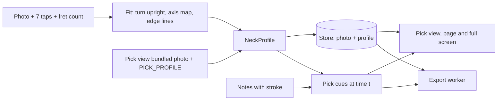
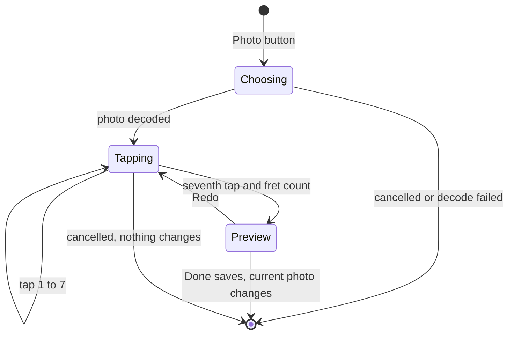

## Goal Capsule

- **Objective:** Someone practicing, or watching an exported video, can choose a new view of a real guitar that shows the picking hand's side: the lit string runs on to the pickup, shakes when plucked, and a pick flashes and moves across the strings as notes are picked, as in the reference TikTok clip. They can see it on their own guitar by calibrating a photo of it. The existing Real guitar view is unchanged.
- **Means:** A new view mode with its own photo and a profile that drives every position it draws against (KTD1, KTD12), calibrated from seven taps (KTD3), with the effects drawn from pure functions of the notes and the time (KTD5).
- **Product authority:** The Product Contract below, confirmed in the brainstorm and scoping dialogue. Where a unit and the Product Contract disagree, the Product Contract wins on behavior and the KTDs win on mechanism.
- **Execution profile:** Code; test-first for the pure pieces (profile, calibration fit, pick state, wobble), smoke and screenshot checks for the drawing.
- **Stop conditions:** Stop and ask if the fit cannot place the frets of the bundled photo within half a fret gap, or if effects cannot be made identical between the live view and exported frames.
- **Tail ownership:** The implementer commits and opens the PR; the user reviews the look against the reference clip.

---

## Product Contract

### Summary

A new view mode sits beside the existing views and leaves the Real guitar view as it is. It draws the same rings, lit strings, bends and vibrato over a photo of a real guitar, and adds four effects on the picking-hand side: the lit string runs on to the pick point on the pickup, the string shakes briefly when a note is picked, a pick flashes on the string as the note is picked, and the pick moves between strings so up and down strokes can be seen. It needs a photo that shows the body, so it ships with its own bundled vertical photo. The calibration that lets a player swap in their own photo for this view is built in the same plan, with seven taps: the nut, the 12th fret and the last fret at each edge of the neck, then the pick point.

### Problem Frame

The Real guitar view draws glowing rings over one bundled photo. The nut, 23 fret positions, the bridge and the string heights are measured by hand for that photo and live in code, and the photo ends at the bridge, so nothing happens on the body. In the reference clip the colored line runs on across the pickups and a white pick-shaped flash lands on it as a note sounds. A player also cannot show their own guitar without a code change. The file format carries up and down pick strokes, but the app does not read them.

### Requirements

**Photo, profile and calibration**

- R1. The new view's bundled photo shows the body below the neck, through a pickup, so there is guitar under the picking hand's side of the view.
- R22. The new view is a view mode the player can choose like the existing ones, including full screen and video export, and the existing Real guitar view keeps its photo, rings and behavior exactly as they are.
- R2. Calibration asks for seven taps, each with its own prompt: the nut, the 12th fret and the last fret, each at the high-E side and the low-E side of the neck, then the pick point. The player says whether the neck has 22 or 24 frets.
- R3. A profile with no pick point draws with none of the pick and string effects; the Real guitar view uses such a profile.
- R13. Each neck photo has a profile that holds where the nut, the frets, the strings and the pick point sit on it. The views and video export draw against it, and each bundled photo ships with a measured profile, so no calibration is needed to use either view.
- R14. The player can choose a photo of their own and calibrate it for the new view.
- R15. The app fits the frets from the taps with the standard fret-spacing rule, including photos taken at an angle where frets bunch up and strings converge. A photo whose neck is not horizontal with the headstock on the left is turned to that orientation.
- R16. After the seventh tap a preview shows the rings and the pick and string effects on sample notes, with Done and Redo. Nothing changes until Done: leaving calibration midway keeps the photo and profile in use.
- R17. The calibrated photo is the new view's current photo, in its full-screen form and in video export, and it is remembered between sessions. The Real guitar view does not use it.
- R18. The player can go back to the new view's bundled photo.
- R19. A note on a fret beyond the last fret visible in the photo is drawn at the last visible fret, as today.
- R20. A photo that cannot be loaded or saved leaves the new view's bundled photo in use, with a message.

**String past the end of the neck**

- R4. The lit string of a sounding note runs from the ring to the pick point, in the note's string color, with the same glow as the part over the neck.

**Pluck wobble**

- R5. When a note is picked, its lit string shakes from the pick point and settles within a short time. A note that is not picked, such as the end of a hammer-on or pull-off, does not shake.
- R6. A bent or vibrato note keeps its bend and vibrato curves, with the pluck wobble added on top at the moment of the pick.

**Pick flash and travel**

- R7. A pick-shaped flash appears on the string at the pick point at the moment of each pick, and fades quickly.
- R8. Between picks the pick rests at the pick point of the string it last played, and moves to the next picked string when that note starts, so strokes across strings are visible as movement.
- R9. A chord shows one pick moving across its strings in order in the direction of the stroke: low to high for a down stroke and high to low for an up stroke.
- R10. Down and up strokes come from the file's pick-stroke marks when it has them. Without them, single notes alternate down and up in time with the beat and chords are down strokes.

**Where it shows**

- R11. The effects show in the new view on the page, in full screen and in exported video, and are drawn the same way in all three.
- R12. Technique cues turned off leave the new view without the effects, as they do the other technique cues.
- R21. The new view's framing always includes the pick point, so the effects are in frame. It zooms in on the fretted stretch less than the Real guitar view does, to make room.

### Key Decisions

- **All four effects, as in the reference** (session-settled: user-directed — chosen when offered pick flash, pluck wobble, string past the bridge and pick travel as separate choices, over a subset). Governs R4, R5, R7, R8.
- **A new view mode, not a change to the Real guitar view** (session-settled: user-directed — chosen over replacing the existing view's photo and behavior: the existing view stays as it is). Governs R1, R3, R12, R13, R17, R18, R22.
- **The photo must include the body** (session-settled: user-directed — chosen over drawing the effects off the photo's edge on a plain background and over adding them only for a bundled photo: the pick lands on guitar and a custom photo gets the same effects). Governs R1, R2, R3.
- **Calibration is built in this plan, not left as a prerequisite** (session-settled: user-directed — chosen over a hand-measured pick point only, and over building calibration first: the effects and the player's own photo ship together). Governs R2, R13, R14, R15, R16, R17, R18, R20.
- **The third tap pair is the last fret, not the bridge** (session-settled: user-directed — chosen over requiring the bridge in the photo and over letting the player choose: the bundled photo ends at a pickup and the last fret is visible in photos like it). Governs R2, R15.
- **One current photo for everything** (session-settled: user-directed — chosen over a library of calibrated photos). Governs R17, R18.
- **The framing always includes the pick point** (session-settled: user-approved — proposed over a small body inset beside the neck: one picture, with a little less zoom). Governs R21.
- **Pick direction comes from the file when present, otherwise alternates** (session-settled: user-approved — proposed over asking the player to mark strokes). Governs R10.

### Acceptance Examples

- AE1. **Covers R4, R7.** Given a picked note on the third string, a flash lands at the pick point on that string as the note starts, and the string is lit in its color from the ring to that point.
- AE2. **Covers R5.** Given a picked note, its lit string shakes after the pick and is still within a short time. Given a pull-off ending on a note, that string does not shake.
- AE3. **Covers R6.** Given a bent note, the bend curve is drawn as today and the string also shakes at the moment of the pick.
- AE4. **Covers R8, R10.** Given a run of single notes with no pick marks in the file, the pick alternates down and up strokes and moves to each string as its note starts.
- AE5. **Covers R9, R10.** Given a chord marked as an up stroke in the file, the pick crosses its strings from the lowest to the highest.
- AE6. **Covers R3, R22.** Given the Real guitar view, it draws exactly as it does today, with its own photo and without the pick and string effects.
- AE7. **Covers R11.** Given the same song and photo, the full-screen view and an exported video show the same pick and string effects at the same moments.
- AE8. **Covers R2, R14, R15, R16.** Given a photo of a six-string neck, when the player taps the seven points as prompted and gives the fret count, the preview shows rings on the right frets and strings and the pick on the pickup, and Done makes it the current photo.
- AE9. **Covers R16.** Given a preview whose rings sit off the frets, Redo restarts the seven taps. Given a calibration abandoned after three taps, the photo and profile in use before it are unchanged.
- AE10. **Covers R17.** Given a calibrated photo, the new view on the page, in full screen and in an exported video uses it, the Real guitar view still uses its own photo, and the calibrated photo is still current after the app is reopened.
- AE11. **Covers R13, R18.** Given no photo chosen, or after going back to the bundled one, the new view draws against its bundled photo and its measured profile.
- AE12. **Covers R15.** Given a photo taken at an angle where the strings converge toward the body, the rings follow the narrowing frets and converging strings. Given a photo with the headstock at the top, the view still shows it turned with the headstock on the left.
- AE13. **Covers R19.** Given a note past the last fret the photo shows, the ring is drawn at the last visible fret.
- AE14. **Covers R20.** Given a photo file that cannot be decoded, the bundled photo stays current and a message says so.
- AE16. **Covers R22.** Given the view chooser, the new view can be picked into either slot, alone or with another view, and in a video export, without any other view changing.
- AE15. **Covers R21.** Given a song played in the low frets, the pick point is in frame along with the fretted stretch.

### Success Criteria

- Played next to the reference clip, the picking-hand side reads as the same kind of effect: a lit string over the body, a flash on the pick, a visible shake.
- The player can follow strum direction by watching the pick.
- A player can calibrate a photo in about a minute without help, and using a different six-string photo needs no code change.
- For the bundled photo and a calibrated one, the rings sit between the right fret wires and on the right string, to the eye, along the visible neck.

### Scope Boundaries

- Not changing the Real guitar view, its photo or its behavior.
- Not drawing a picking hand, a finger-style hand or a strumming arm; the pick is a flash-and-marker only.
- Not covering bass, seven-string or left-handed guitars.
- Not covering steeply angled photos or heavy lens distortion.
- Not detecting the neck in a photo automatically, and not adjusting individual frets after the taps; the preview offers Redo only.
- Not animating the real photo's strings (warping the photo); only the lit overlay shakes.
- Not asking the player to mark pick strokes in the app.

#### Deferred to Follow-Up Work

- A library of several calibrated photos to switch between.
- Marking pick strokes by hand in the app.
- Bass, seven-string and left-handed guitars.
- Fingerstyle and tapping visuals.

### Dependencies / Assumptions

- Assumption: the vertical, body-visible photo in the repo root (`Gemini_Generated_Image_kdhehekdhehekdhe.jpg`) is the new view's bundled photo; the user confirmed it. It is untracked, so U2 adds it to the repo as an asset next to the existing one, which stays.
- Assumption: a player's photo shows the whole neck from the nut to the last fret, and the body through a pickup.
- Assumption: the tab's track has six strings; a track with another string count keeps drawing as it does today.

### Outstanding Questions

#### Deferred to Implementation

- Wobble size, decay and frequency; flash size and shape; pick marker look. Tuned by eye against the reference clip.
- The sample notes the calibration preview plays.
- The bundled photo's measured values, and whether its neck has 22 or 24 frets.
- The size cap for a stored photo.

### Sources / Research

- `src/render/neck-view.ts` holds the nut, the 23 fret positions, the bridge and the string heights as module constants for the 949 by 475 bundled photo, and `BRIDGE_X` is 945, so the photo ends at the bridge.
- `src/render/neck-cue-model.ts` computes bend, vibrato and the set of unpicked notes (hammer-on and pull-off destinations) from the notes and the time.
- `src/model/alphatab-adapter.ts` builds `NoteEvent`s per note; alphaTab beats carry `pickStroke` and `brushType`, which the adapter does not read.
- `src/app/use-neck-photo.ts` and `src/export/neck-photo.ts` load the one bundled photo for the live view and for export; `src/export/exporter.ts` and `src/export/encoder.worker.ts` pass it to the worker.
- `src/audio/profile-store-web.ts` is the repo's pattern for a guarded, versioned browser store.
- `docs/plans/2026-10-06-0630-feat-neck-photo-calibration-plan.md` carried the calibration requirements this plan now includes; `docs/plans/2026-10-06-0739-feat-neck-technique-cues-plan.md` carries the bend, vibrato and unpicked-note cues.
- Reference: the user's screen recording of a portrait guitar video with rings colored by string, a lit string running to the body, and a white pick flash.

**Product Contract preservation:** changed — R1 (the new view's bundled photo shows the body through a pickup, not past the bridge), R2 (seven taps with the last fret in place of the bridge, absorbing the earlier calibration requirements), R3 (a profile with no pick point; the Real guitar view uses one), R4 (the string runs to the pick point), R11 and R12 (the new view, not the existing one). R5–R10 are unchanged. R13–R22 and AE8–AE16 are added from the folded-in calibration work, the framing decision and the new-view-mode decision; AE6 is rewritten to match R3 and R22.

---

## Planning Contract

### Key Technical Decisions

- KTD1. **A `NeckProfile` replaces the module constants in the neck drawing code.** It holds the photo size, the nut, each fret wire, the string knots, where the strings end, the pick point and the view's start, end and neck row. `PhotoPlacement` carries it, every function that reads a constant takes it as a trailing argument that defaults to the Real guitar view's profile, and the profiles are measured data in `src/render/neck-profile.ts`: `NECK_PROFILE` (today's numbers for `src/assets/guitar-photo.jpg`, no pick point) and `PICK_PROFILE` (the new view's bundled photo, with a pick point). This keeps existing call sites and tests working and lets both views share the drawing code. Serves R13, R22.
- KTD2. **The pick point is a photo-X on the neck axis.** The string heights there come from the existing straight-line extension of the string knots past the last knot (`photoStringY` already carries lines on at the end slopes), so no per-string pick data is stored. A calibration tap is projected onto the axis. Serves R2, R4, R7.
- KTD3. **Calibration fits an axis map and edge lines, in a photo it first turns upright.** Three axis points (nut, 12th, last fret, each the middle of its edge pair) and their known share of the scale length (`1 - 2^(-n/12)`) fix a one-dimensional projective map from share to photo-X, which is how frets bunch on an angled photo. Each neck edge is a straight line through its three taps, and the strings between are spread between the edges as `photoStringY` already does. Before fitting, the photo is rotated by the angle of the nut-to-last-fret axis, plus a quarter turn when needed, so the neck runs left to right with the headstock on the left; the turned bitmap is what is stored. Serves R15.
- KTD4. **The new view's current photo and its profile live in one browser-storage record.** IndexedDB holds the turned photo's bytes and the profile JSON together under one key, so they never disagree; reads and writes are guarded like `src/audio/profile-store-web.ts` and a failure means the new view's bundled photo. The desktop app's webview uses the same store. The photo is downscaled to a long side of at most 2048 pixels before it is stored. The Real guitar view never reads this record. Serves R17, R18, R20, R22.
- KTD5. **Effects are pure functions of notes, the profile and the time.** A new `src/render/pick-cues.ts` gives the pick's position, each flash's strength and each picked note's pluck wobble at time `t`. Nothing reads a clock, so exported frames match the screen. Serves R5, R7, R8, R9, R11.
- KTD6. **Each note carries its pick stroke.** `NoteEvent` gets `stroke: 'down' | 'up' | 'none'`, set in `src/model/alphatab-adapter.ts` from the beat's pick stroke; notes of one chord share it. Where the file marks none, `pick-cues.ts` infers it: a single note on a whole beat is down, a single note between beats is up, and a chord is down. Serves R10.
- KTD7. **Pluck wobble is a term of the existing string offset.** `NoteEffect` gets a `pluck` value that decays from 1 at a picked note's start, and `stringOffset` adds a lateral wave scaled by `pluck` and by a sine envelope along the span from the ring to the pick point. A note in `cues.unpicked` has `pluck` 0. Bend and vibrato terms are unchanged, so R6 holds by addition. Serves R5, R6.
- KTD8. **The lit string's far end is the pick point.** The lit-string path of a note runs from its ring through the string knots to the pick point when the profile has one, and to the string end as today when it does not. Serves R3, R4.
- KTD9. **The framing window is the union of today's window and the pick point plus a margin.** `zoomedPlacement` computes today's window and then widens it to take in the pick point, clamped to the photo, so the camera glide stays continuous. Serves R21.
- KTD10. **The body is dimmed less when the profile has a pick point.** `drawDigitalNeck` dims everything outside the board; with a pick point the dimming over the body is lighter so the pickup and the effects read on the guitar. Serves R1, R7.
- KTD11. **Calibration is a modal over the new view's panel, with pure helpers for the geometry.** A new `NeckCalibration` component handles the prompts and taps; mapping a tap to photo pixels, fitting and building sample notes are pure and tested apart from it. Serves R14, R16.
- KTD12. **The new view is a new `PanelId`, `'pick'`, drawn by the same neck renderer.** It goes through `PANEL_IDS`, `PANEL_NAMES`, `drawSurface`, `renderStageFrame` and the export panel list like the existing panels, calling `renderNeckFrame` with `PICK_PROFILE` or the stored profile and the effects on. The Real guitar view's id, name, saved layouts and render path stay as they are, so no stored layout changes meaning. The display name is chosen at implementation. Serves R22.

### High-Level Technical Design

*Data flow, from a photo to what is drawn:*

*Calibration flow:*

*Pick state: the pick rests at the last picked string's pick-point position; when a picked step starts it has travelled from there to the step's strings in stroke order over a short strum time, with a flash at each string as it is reached.*

### Assumptions

- A pick travel of about 0.05 s across a chord reads as a strum without lagging the audio; tuned in U4.
- The neck view's `zoom` is not a setting (it is always on in `src/app/panel-draw.ts`), so R21 changes the new view's framing itself and adds no control.
- The new view shares the Real guitar view's drawing code but not its photo or profile; the effects and the wider framing switch on from the profile having a pick point, so the Real guitar view needs no flag.

---

## Implementation Units

### U1. Neck profile model and the Real guitar profile

- **Goal:** Replace the neck drawing code's module constants with a `NeckProfile` that the placement carries, with the current photo's numbers as `NECK_PROFILE` and no change in how the Real guitar view draws.
- **Requirements:** R13, R19, R22; supports R3.
- **Dependencies:** none.
- **Files:** `src/render/neck-profile.ts` (new), `src/render/neck-view.ts`, `src/render/neck-cues.ts`, `tests/render/neck-profile.test.ts` (new), `tests/render/neck-view.test.ts`, `tests/render/neck-cues.test.ts`.
- **Approach:**
  - Define `NeckProfile` and move `PHOTO_WIDTH`, `PHOTO_HEIGHT`, `NUT_X`, `FRET_X`, `BRIDGE_X`, `STRING_KNOTS_X/Y`, `VIEW_START/END` and `NECK_ROW` into the current numbers as `NECK_PROFILE` (KTD1).
  - Thread the profile through `photoPlacement`, `zoomedPlacement`, `photoStringY`, `photoNoteX`, `photoNoteXAt`, `photoRingRadius`, `drawNeckPhoto`, the board and fret drawing, the camera path and `neckSpace`, each with a trailing profile argument defaulting to `NECK_PROFILE`; `PhotoPlacement` carries its profile.
  - Add a `pick` field (photo-X) to the profile type, absent on `NECK_PROFILE`.
- **Execution note:** Characterization first: pin the current outputs of the placement and position functions in tests before moving the constants.
- **Patterns to follow:** The pure, constant-driven style of `src/render/neck-view.ts`.
- **Test scenarios:**
  - Covers AE13. A fret beyond the profile's fret count maps to the last fret's position.
  - Characterization: for frets 0 to 23 and each string, positions and ring radii equal the values before the change.
  - A profile with a different nut and fret list moves rings and wires accordingly.
  - `photoPlacement` on a portrait and a landscape screen is unchanged for `NECK_PROFILE`.
- **Verification:** The Real guitar view looks exactly as before; all existing render tests pass without changed expectations.

### U2. The new view's photo and its measured profile

- **Goal:** Add the vertical body-visible photo, turned to headstock-left, as the new view's bundled photo, with `PICK_PROFILE` measured, including the pick point. The existing photo and profile stay.
- **Requirements:** R1, R13, R19.
- **Dependencies:** U1.
- **Files:** `src/assets/pick-guitar-photo.jpg` (new), `src/render/neck-profile.ts`, `tests/render/neck-profile.test.ts`, `Gemini_Generated_Image_kdhehekdhehekdhe.jpg` (the source; moved out of the repo root once the asset is made).
- **Approach:**
  - Turn the repo-root photo a quarter turn so the headstock is on the left, downscale it to a size that keeps frets crisp on a phone, and save it as the new view's bundled asset next to `src/assets/guitar-photo.jpg`.
  - Measure the nut, each fret wire, the string heights at several points, the point where the neck meets the body, and a pick point on the pickup, from the turned photo. The photo is strongly foreshortened, so fret gaps do not shrink evenly; measure each wire rather than derive them.
  - Set `PICK_PROFILE`'s view start, end and neck row and its board bounds for this photo.
- **Execution note:** Verify by drawing rings for every fret on every string over the photo and checking by eye before committing the numbers.
- **Patterns to follow:** The measuring approach recorded in the comment at the top of `src/render/neck-view.ts`.
- **Test scenarios:**
  - Fret positions are strictly increasing and the fret count matches the photo's neck.
  - String heights are strictly increasing from the high string to the low at every knot.
  - The pick point is beyond the last fret and inside the photo.
  - Test expectation for the photo itself: none — the check is by eye.
- **Verification:** Screenshots at a portrait and a landscape size show rings between the fret wires and on the strings along the visible neck, and the pickup under the pick point.

### U3. Pick stroke on notes and its inference

- **Goal:** Give each note the stroke the file marks, and the rule that fills in strokes the file leaves out.
- **Requirements:** R10; supports R8, R9.
- **Dependencies:** none.
- **Files:** `src/model/score.ts`, `src/model/alphatab-adapter.ts`, `src/render/pick-cues.ts` (new), `tests/model/pick-stroke.test.ts` (new), `tests/render/pick-cues.test.ts` (new), plus any fixtures that build `NoteEvent`s.
- **Approach:**
  - Add `stroke` to `NoteEvent`, set from the beat's pick stroke in the adapter (KTD6); update fixtures and helpers that construct notes.
  - In `pick-cues.ts`, add the inference: group notes into steps by start time; a step the file marks keeps its stroke; unmarked single notes are down on a whole beat and up between beats (by the bar's time signature and the note's tick); unmarked chords are down.
- **Execution note:** Test-first for the inference rule.
- **Test scenarios:**
  - A file whose beats are marked up and down gives notes with those strokes, and a chord's notes share one.
  - A file with no marks gives `none` on every note.
  - Unmarked eighth notes alternate down on the beat and up off it, in 4/4 and 6/8.
  - An unmarked chord is down. A marked up-stroke chord stays up.
  - A tied-over note keeps the stroke of the note that was picked (Covers AE4).
- **Verification:** A real tab with pick marks in `tests/fixtures` reports strokes through `Timeline.notesForTrack`.

### U4. Pick state, flash, wobble and the lit string to the pick point

- **Goal:** Draw the four effects from pure functions of the notes, the profile and the time.
- **Requirements:** R4, R5, R6, R7, R8, R9, R12, R22; AE1–AE6.
- **Dependencies:** U1, U3.
- **Files:** `src/render/pick-cues.ts`, `src/render/neck-cue-model.ts`, `src/render/neck-view.ts`, `src/render/neck-cues.ts`, `tests/render/pick-cues.test.ts`, `tests/render/neck-cue-model.test.ts`, `tests/render/neck-cues.test.ts`.
- **Approach:**
  - `pick-cues.ts` gives the pick's position at `t`: at rest on the last picked string's pick-point position, moving to the next step's strings in stroke order over a short strum time, ending at the step's start (KTD5).
  - It also gives a flash strength per picked note that peaks at the pick and fades within about 0.12 s, and no flash for a note in the unpicked set.
  - `neck-cue-model.ts` adds `pluck` to `NoteEffect`, decaying from a picked note's start and zero for unpicked notes; `stringOffset` in `neck-view.ts` adds the wobble term with a sine envelope along ring to pick point, on top of bend and vibrato (KTD7).
  - The lit-string path ends at the pick point when the profile has one (KTD8); drawing the pick marker and flash follows the lit-string glow style, leans the marker toward its direction of travel, and happens after the rings so it shows over them.
  - All of it is off when `techniqueCues` is off or the profile has no pick point, which is always so for the Real guitar view.
- **Execution note:** Test-first for the pick position, flash strength and `pluck` values; tune look by eye against the reference clip.
- **Patterns to follow:** `emphasisAt` in `src/render/emphasis.ts` for time-shaped strengths; the string glow in `drawLitStrings`.
- **Test scenarios:**
  - Covers AE1. At a picked note's start the flash is at full strength on that note's string and the lit string reaches the pick point.
  - Covers AE2. `pluck` is 1 at a picked note's start, falls toward 0 within the settle time, and is always 0 for a hammer-on or pull-off destination.
  - Covers AE3. A bent note's offset equals its bend offset plus the wobble term at its start, and equals the bend offset alone once settled.
  - Covers AE4. In a run of unmarked single notes the pick position at each note's start is on that note's string, and the strokes alternate.
  - Covers AE5. For an up-stroke chord the pick passes the strings from the lowest to the highest, a flash on each, in that order.
  - Between notes the pick rests on the last picked string's pick-point position; before the first note it rests on the middle of the strings.
  - Covers AE6. With `NECK_PROFILE`, or with technique cues off, the drawn calls are identical to today's.
  - The effects at a given `t` are the same on repeated calls and independent of draw order.
- **Verification:** A screenshot of a plucked chord and of a fast single-note run shows the flash on the string, the wobble and the pick position; frames at the same `t` from the live path and the export path agree.

### U5. Framing that includes the pick point, and lighter body dimming

- **Goal:** Keep the pick point in frame and let the body read through the overlay.
- **Requirements:** R21; supports R1, R7.
- **Dependencies:** U1, U4.
- **Files:** `src/render/neck-view.ts`, `tests/render/neck-view.test.ts`.
- **Approach:**
  - In `zoomedPlacement`, compute today's window, then widen it to include the profile's pick point plus a margin, clamped to the photo, for both the fitted and the following-camera cases (KTD9).
  - In `drawNeckPhoto`'s dimming, apply a lighter shade over the body when the profile has a pick point (KTD10).
- **Test scenarios:**
  - Covers AE15. For a song in frets 1 to 5, the pick point's screen position is inside the frame in portrait and landscape.
  - For a song needing the following camera, the window still contains the pick point at every time in a camera move, and the window edge moves continuously (no jump between frames).
  - With `NECK_PROFILE` (no pick point), the window equals today's.
  - A portrait screen (rotated) and a landscape screen both keep the pick point in frame.
- **Verification:** Low-fret and high-fret songs both show the pick and string effects in frame on a phone-shaped and a desktop-shaped window.

### U6. Calibration fit

- **Goal:** Turn seven taps, a fret count and a photo into an upright photo and a profile.
- **Requirements:** R2, R15; AE8, AE12.
- **Dependencies:** U1.
- **Files:** `src/render/neck-calibration.ts` (new), `tests/render/neck-calibration.test.ts` (new).
- **Approach:**
  - Taps are the nut, the 12th fret and the last fret at the high-E side then the low-E side, then the pick point. Compute the axis angle from the nut and last-fret midpoints and the rotation that turns the photo upright with the headstock on the left (KTD3).
  - In the upright frame, fit the projective axis map through the three axis points with their scale shares, derive each fret wire's X for the 22 or 24 frets, fit each edge as a line through its three taps, build string knots by sampling at a handful of X values, and project the pick tap onto the axis.
  - Reject a set of taps whose order or spacing is impossible (last fret before the 12th, edges crossing) with a reason the UI can show.
  - Provide a pure helper that maps a tap on a displayed photo to photo pixels for any display fit.
- **Execution note:** Test-first with synthetic photos: generate taps from a known profile and check the fit recovers it.
- **Test scenarios:**
  - Covers AE8. Taps generated from the bundled profile's own positions give a profile whose frets are within a quarter of a fret gap of the originals.
  - Covers AE12. Taps from a perspective-projected neck with converging strings give frets that bunch toward the body at the right rate.
  - Covers AE12. A photo with the headstock at the top is turned upright; the fitted nut is left of the last fret.
  - A 22-fret and a 24-fret answer give different fret counts and spacing.
  - Taps in the wrong order, or with the edges crossing, are rejected with a reason.
  - The pick tap beyond the last fret gives a pick X beyond it; a tap on the neck is rejected.
- **Verification:** The fit recovers a synthetic profile, and the fitted bundled-photo taps match the measured profile closely enough that rings fall between the fret wires.

### U7. Photo and profile store and loaders for the new view

- **Goal:** Keep the new view's current photo and its profile, and give the live view and the export one way to load them, leaving the Real guitar view's loaders as they are.
- **Requirements:** R17, R18, R20, R22; AE10, AE11, AE14.
- **Dependencies:** U1, U2.
- **Files:** `src/app/pick-photo-store.ts` (new), `src/app/use-pick-photo.ts` (new), `src/export/pick-photo.ts` (new), `tests/app/pick-photo-store.test.ts` (new).
- **Approach:**
  - Store one record (photo bytes and profile JSON, versioned) in IndexedDB with guarded reads and writes (KTD4); anything unreadable or missing resolves to the new view's bundled photo and `PICK_PROFILE`; saving downscales to the size cap first.
  - `usePickPhoto` returns the current image and its profile, and refreshes when calibration changes it; `loadPickPhoto` returns the bitmap and the profile for the export. `use-neck-photo.ts` and `src/export/neck-photo.ts` keep serving the Real guitar view.
  - Provide save and "use the bundled photo" operations the calibration UI calls.
- **Patterns to follow:** `src/audio/profile-store-web.ts` for guarding and versioning.
- **Test scenarios:**
  - Covers AE10. A saved photo and profile read back identical after a fresh store instance.
  - Covers AE11. With nothing stored, the store returns the new view's bundled photo and `PICK_PROFILE`; after "use the bundled photo" it does the same.
  - Covers AE10. Saving a photo does not change what the Real guitar view's loader returns.
  - Covers AE14. A failed write or a blocked store leaves the previous record, or the bundled photo, and reports the failure.
  - A stored record with an unknown version or a corrupt profile reads as the bundled photo.
  - A photo over the size cap is stored downscaled with its profile scaled with it.
- **Verification:** After reload, the new view uses the saved photo; with storage blocked, the bundled photo is used without an error; the Real guitar view is unaffected in both.

### U8. Calibration interface

- **Goal:** The player picks a photo, taps seven prompted points, previews and confirms.
- **Requirements:** R2, R14, R16, R18, R20; AE8, AE9, AE14.
- **Dependencies:** U4, U6, U7, U10.
- **Files:** `src/app/NeckCalibration.tsx` (new), `src/app/Stage.tsx`, `src/app/PanelFullscreen.tsx`, `src/app/app.css`, `tests/app/neck-calibration-flow.test.ts` (new).
- **Approach:**
  - Add a Photo control to the new view's panel tools and full-screen header next to Techniques, opening the modal with Choose photo and Use bundled photo (KTD11).
  - The modal shows the chosen photo, one prompt at a time for the seven taps with the taps so far marked, asks for the fret count, then shows the preview, which draws the view with the new profile over sample notes that exercise rings, a chord and single notes so the effects show; Done saves, Redo restarts.
  - Keep the flow's state in a small pure reducer so abandoning at any step changes nothing; surface decode, rejection and save failures as messages.
- **Test scenarios:**
  - Covers AE8. Seven taps and a fret count move the flow to the preview; Done calls the store with the fitted profile.
  - Covers AE9. Redo returns to the first tap with no taps kept; cancelling after three taps does not call the store.
  - Covers AE14. A photo that fails to decode keeps the flow at the choosing step with a message.
  - A rejected tap set returns to tapping with the reason shown.
  - Use bundled photo calls the store's reset and closes the modal.
- **Verification:** In the running app a photo can be calibrated end to end, the preview shows the effects on it, and the new view and an export use it afterwards while the Real guitar view does not.

### U9. Export carries the new view's profile and agrees with the live view

- **Goal:** Exported video of the new view draws against its current photo's profile, with the same effects as the screen.
- **Requirements:** R11, R17, R22; AE7.
- **Dependencies:** U4, U7, U10.
- **Files:** `src/app/ExportDialog.tsx`, `src/export/exporter.ts`, `src/export/encoder.worker.ts`, `src/export/pick-photo.ts`, `tests/export/composite-views.test.ts`, `tests/export/timeline-agreement.test.ts`.
- **Approach:**
  - When the layout includes the new view, `ExportDialog` loads its photo and profile together with `loadPickPhoto`, passes the profile (plain data) to the worker with the photo, and the worker's frame render uses it for that panel. An export of the Real guitar view still takes its existing photo path.
  - Keep the worker's missing-photo guard for each view and add one for a missing profile on the new view.
- **Test scenarios:**
  - Covers AE7. The same song, photo, profile and `t` rendered through the live path and the export path produce identical draw calls for the new view.
  - An export with a calibrated profile draws rings at its positions, not `PICK_PROFILE`'s.
  - A layout with both the Real guitar view and the new view draws each against its own photo and profile.
  - A worker message for the new view without a profile fails with a clear error rather than drawing with the wrong one.
- **Verification:** A short export of the new view shows the pick and string effects at the right moments over the current photo.

### U10. The new view mode in the view chooser, page and full screen

- **Goal:** Add the new view as a choosable panel that draws through the shared neck renderer with `PICK_PROFILE` and the effects on, leaving every existing view as it is.
- **Requirements:** R11, R12, R21, R22; AE16.
- **Dependencies:** U1, U2, U4, U5, U7.
- **Files:** `src/app/stage-layout.ts`, `src/app/panel-draw.ts`, `src/render/stage-frame.ts`, `src/app/Stage.tsx`, `src/app/PanelFullscreen.tsx`, `src/app/ViewControls.tsx`, `tests/app/stage-layout.test.ts`, `tests/export/composite-views.test.ts`.
- **Approach:**
  - Add `'pick'` to `PanelId` and `PANEL_IDS` with a display name, and include it where the code lists the dot-showing panels (`showsDots`) so the label and look-ahead controls apply (KTD12).
  - In `drawSurface` and `renderStageFrame`, add a `'pick'` case that calls `renderNeckFrame` with the new view's photo and profile, `zoom: true`, and `techniqueCues` taken from the same setting the Real guitar view uses.
  - Give the new view the Techniques button in its panel tools and full-screen header, and have `Stage` and `PanelFullscreen` load its photo and profile through `usePickPhoto`.
  - Leave the preset layouts and the default layout unchanged, so saved layouts keep their meaning.
- **Patterns to follow:** How `'neck'` is wired through `Stage.tsx`, `panel-draw.ts` and `stage-frame.ts`.
- **Test scenarios:**
  - Covers AE16. `setPanel`, `swapPanels` and `normaliseLayout` accept `'pick'` in either slot and still never show a panel twice.
  - A saved layout from before this change loads unchanged.
  - `showsDots` and `needsBarStrip` treat the new view like the Real guitar view.
  - Covers AE6. A frame with the Real guitar view alone draws the same calls as before this unit.
  - A frame with the new view and technique cues off draws no pick or string effects.
- **Verification:** The new view can be chosen in the view chooser, appears on the page and in full screen, and the Real guitar view looks and behaves exactly as before.

---

## Verification Contract

| Check | Command or step | Applies to |
|---|---|---|
| Unit tests | `npm test` | all units |
| Types | `npm run typecheck` | all units |
| Build | `npm run build` | U2, U7, U8, U9, U10 |
| Visual check, live | Run the app, choose the new view, open it full screen on a portrait and a landscape window, play a tab with chords, single notes, bends and hammer-ons, and compare with the reference clip | U2, U4, U5, U8, U10 |
| Visual check, export | Export a short video with the new view and view the pick and string effects | U9 |
| Calibration end to end | Calibrate a photo in the running app, check the preview, reload, and confirm the view and an export use it | U7, U8 |

## Definition of Done

- Every requirement R1–R22 is met and every acceptance example AE1–AE16 holds, shown by the unit tests where they are testable and by the visual checks where they are not.
- `npm test`, `npm run typecheck` and `npm run build` pass.
- The Real guitar view draws exactly as it did before, and the new view with technique cues off has none of the pick and string effects.
- The live view and exported frames agree at the same time for the same song and photo.
- The bundled photo is tracked in the repo as an asset, the repo-root copy is gone, and no dead experiment code is left in the diff.

## Risks & Dependencies

- **Strong foreshortening in the bundled photo:** the frets bunch toward the body unevenly, so a derived fret rule can drift. U2 measures each wire; U6's fit is checked against it (Verification in U6).
- **Photos with parallel strings:** the fit leans on three axis points, not on convergence, so it does not degenerate for a top-down shot; very steep angles stay out of scope.
- **Storage limits and blocked storage:** photos are downscaled and every access falls back to the bundled photo (KTD4).
- **Wider framing makes rings smaller (R21):** by design; the minimum ring size and label rule in `drawRing` still apply, and the visual check covers a low-fret song on a phone-shaped window.
- **Dimming the body less (KTD10) may reduce ring contrast:** checked in the visual check.
