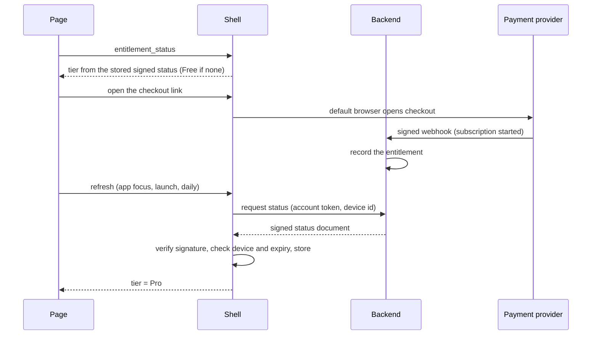

# Paid Pro Subscription Launch - Plan

## Goal Capsule

- **Objective:** A hobbyist guitarist who learns covers from Songsterr tabs can install Tab Highway on Windows, review a tab for free at full speed on the fret view, and subscribe monthly to unlock slow-down and customised practice, the neck and pick views, stems and exports, with the app safe to sell: installable by a stranger, legally cleared, and reliable enough to charge for.
- **Product authority:** The owner of Tab Highway decides tiers, pricing and the free/paid line. Settled decisions in Key Decisions bind planning.
- **Means:** Pro status is a signed document issued by a small billing backend and verified in the Windows shell, shipped in a signed installer with signed updates (KTD1, KTD3, KTD7).
- **Stop conditions:** Stop and ask the owner if no payment provider accepts the YouTube feature in writing (KTD3), if no signing certificate is available, or if the licence check finds a new non-commercial package.
- **Execution profile:** Phased. The shell and backend are test-first; packaging is smoke-first.
- **Tail ownership:** Implementers deliver code, tests and docs. The owner opens the provider account, buys the certificate, publishes the legal pages and uploads releases.
- **Open blockers:** None.

## Product Contract

### Summary

Tab Highway for Windows becomes a free app with one paid tier, Pro, billed monthly. Free covers full-speed review on the highway, tab strip and fret views. Pro adds slowing down and customised practice, the neck and pick views, stems and exports. The plan covers everything needed to sell it: the tier and licensing model, an installable signed build, legal clearance, and paid-grade reliability.

### Problem Frame

The app is a working free tool with distinctive views, and its pick view is drawing a growing TikTok audience. Nothing yet lets the owner charge for it. There is no way to prove a user has paid, no installer a stranger can safely run, and no sign-off that every bundled component may be sold. The audit already removed one non-commercial component and one unused SoundFont of unclear origin, and added a build check against both.

The buyer is a hobbyist learning covers from Songsterr tabs. They want to slow a hard passage, see the song on a real neck, split the original recording into stems, and share clips. Other practice apps exist, but none offer these views.

### Key Decisions

- **One Pro tier, gated at the practice controls.** The upgrade moment is the first time a learner wants to slow down or customise practice. (session-settled: user-approved — chosen over a views-only membership and a separate Creator tier: matches the buyer and keeps pricing simple.) Governs R1, R2.
- **Monthly subscription, not lifetime-only.** Monthly is justified only if new views keep shipping. (session-settled: user-directed — chosen over lifetime-only after the tradeoff was shown: new views keep arriving.) Governs R6, R7.
- **YouTube search and import stays in the paid build.** The owner accepts the terms-of-service, copyright and payment-processor risk. (session-settled: user-directed — chosen over removing it or shipping without it: it is how a hobbyist gets the original recording.) Governs R17, R18.
- **Free exports carry a small watermark that Pro removes.** Every free clip posted to TikTok then advertises the app. (an idea raised in dialogue and carried into the plan; not yet confirmed as final wording or placement.) Governs R4.
- **The web build is the free tier only.** It links to the desktop app for Pro, which closes the bypass without adding web accounts. (session-settled: user-approved — chosen over keeping everything free on the web and over gating Pro on the web: keeps the funnel and needs no web accounts.) Governs R27.
- **The moat is the audience and the pace of new views, not any single view.** Plan the roadmap around shipping views regularly.

### Actors

- A1. Visitor: arrives from TikTok or the website with no account and wants to try the tool.
- A2. Free user: has the app installed and uses the free tier.
- A3. Pro subscriber: pays monthly for Pro.
- A4. Owner: sells, supports and ships updates.

### Requirements

**Tiers and gating**

- R1. The free tier plays any supported tab at 100% tempo on the highway, tab strip and fret views, with a basic loop.
- R2. Pro unlocks any tempo other than 100%, sections, backing track, alignment, the neck and pick views, stem separation and export.
- R3. A free user who reaches a Pro feature sees what it is, what it costs, and a way to subscribe, without losing their place in the song.
- R4. Free exports are allowed but carry a visible watermark; Pro exports do not.
- R5. Stems and YouTube import are enforced by the desktop shell; the other Pro features are enforced in the app's own logic, not only by hiding controls, and a determined user bypassing those is accepted.

**Licensing and billing**

- R6. A user can start a monthly Pro subscription, with a free trial, from inside the app.
- R7. A paying user can cancel, change payment details, and get a receipt without contacting the owner. Cancellation keeps Pro until the paid period ends.
- R8. The app confirms Pro status on sign-in and re-checks it periodically, and keeps working offline for a grace period of at least seven days.
- R9. Refunds and chargebacks end Pro access.
- R10. A subscriber can sign in on a new machine and recover access, with a stated limit on devices per account.
- R11. A failed payment gives a grace period before access ends, with clear in-app notice.
- R12. The payment provider handles sales tax and VAT for the owner.

**Install and update**

- R13. The app installs with a standard Windows installer, signed so SmartScreen does not warn, and uninstalls cleanly. The user chooses whether their saved data is kept.
- R14. The app updates itself, with signed updates and the ability to roll one back.
- R15. First-run setup (the one-time download of the audio tools and models) shows progress, can be resumed after an interruption, and fails with a clear message and a retry. It does not depend on third-party URLs staying available.
- R16. The owner receives crash and error reports from consenting users.

**Legal and content clearance**

- R17. Every bundled component's licence permits commercial use, checked by an automated build gate and a reviewed notices file. Remaining unchecked items are resolved before launch: model-weight licences, image provenance, and the licence text bundle.
- R18. YouTube import is controllable by a single build setting and a remote switch, so it can be switched off quickly if a provider or YouTube objects.
- R19. The product name and app icon are checked for trademark conflicts; "Guitar Hero" and "Clone Hero" are not used.
- R20. Terms of service, privacy policy, EULA and refund policy are published and linked from the installer and the app.

**Paid-grade reliability**

- R21. The installer and first run are tested on clean Windows 10 and 11 machines, including a standard user account, antivirus enabled, a username with non-ASCII characters, and a OneDrive-synced profile.
- R22. Stem separation completes on a typical mid-range laptop without a GPU for a typical song, with progress shown and a clear failure message otherwise. The minimum hardware is published.
- R23. Saved profiles, alignments and stems carry a version and survive app updates, and the user can back them up and restore them.
- R24. Exports of long songs complete or fail cleanly, and can be cancelled.
- R25. A new user can reach "tab playing" in under two minutes from install, with the sample riff as the fallback.
- R26. A support contact, a help page and a changelog exist before launch.

**Web build**

- R27. The web build offers only the free tier (R1) and shows where to get the desktop app for Pro; slow-down below 100%, the neck and pick views, stems and export are not available on the web.

### Key Flows

- F1. First-time visitor to Pro subscriber
  - **Trigger:** A1 installs the app after seeing a TikTok clip.
  - **Actors:** A1, A2, A3
  - **Steps:** Installs; loads a tab or the sample; plays at full speed free; moves the tempo slider below 100%; sees the Pro prompt; starts the free trial; the slider unlocks without reloading the tab.
  - **Outcome:** The visitor is a Pro subscriber in the same session.
  - **Covered by:** R1, R2, R3, R6

- F2. Pro subscriber offline
  - **Trigger:** A3 opens the app with no internet.
  - **Actors:** A3
  - **Steps:** The app finds a recent valid confirmation; Pro features work; after the grace period the app asks for one online check.
  - **Outcome:** Offline practice is uninterrupted within the grace period.
  - **Covered by:** R8

- F3. Cancellation
  - **Trigger:** A3 cancels from the customer portal.
  - **Actors:** A3
  - **Steps:** Cancels; keeps Pro until the paid period ends; reverts to the free tier with their saved data intact.
  - **Outcome:** No data is lost and Pro features lock on the end date.
  - **Covered by:** R7, R23

### Acceptance Examples

- AE1. **Covers R2, R3.** Given a free user playing a song at 100%, when they drag the tempo slider below 100%, then the tempo does not change, they see the Pro prompt, and playback position is unchanged.
- AE2. **Covers R5.** Given a free user who forces the stem controls to appear, when they start a separation, then the engine refuses because the shell gives the page no way to reach it.
- AE3. **Covers R4.** Given a free user exporting a clip, when the export finishes, then the clip carries the watermark; given a Pro user, the same export has none.
- AE4. **Covers R8.** Given a Pro user whose last confirmation is 5 days old and who has no internet, when they open the app, then Pro features work; given the confirmation is 31 days old and still offline, the app asks for an online check before unlocking Pro.
- AE5. **Covers R9.** Given a refunded subscription, when the app next confirms status, then Pro features lock and the user's saved data remains.
- AE6. **Covers R15.** Given the first-run download is interrupted at 60%, when the user reopens the app, then the download resumes rather than restarting, and a failure shows the cause and a retry.
- AE7. **Covers R17.** Given a build whose runtime contains a package with a non-commercial licence, when packaging runs, then the build fails and names the package.
- AE8. **Covers R27.** Given a visitor on the website, when they try to slow a song below 100% or open the pick view, then they see an invitation to get the desktop app instead of the feature.

### Success Criteria

- A stranger can install, subscribe, and cancel without help from the owner.
- No bundled component with a non-commercial or unreviewed licence ships.
- At least 20 beta users complete install and first stem split on their own machines, and the remaining failures are logged and triaged before public launch.
- The free-to-paid funnel is measurable: installs, first tab played, Pro prompt shown, trial started, converted, churned.
- `ce-plan` can decide how to build each requirement without inventing tier boundaries, pricing mechanics or legal gates.

### Scope Boundaries

**Deferred for later**

- Creator tier with watermark-free export presets and batch export: add once creators show up in the audience data.
- macOS build and its notarisation.
- Pricing for the web version, and any paid web features.
- Highway/game mode with scoring. It needs its own product decisions and trademark-safe naming.
- Annual or lifetime plans: decide after launch pricing data.

**Outside this plan**

- Selling or bundling copyrighted tab files or chart content.
- A cloud sync service for profiles and stems.

### Dependencies / Assumptions

- Assumption: the free tier includes the highway, tab strip and fret views, and the neck and pick views are Pro. The owner described the free view as "the fret view" and the paid ones as "additional views"; this has not been confirmed view by view.
- Assumption: the web build keeps showing the free tier as a funnel, so the pick view's TikTok pull leads to a download, not a web workaround.
- Dependency: a code-signing certificate and a payment provider (merchant of record) that tolerates a downloader feature in the product. The provider is chosen in planning.
- Dependency: the owner or a legal advisor reviews the YouTube risk, the terms, the privacy policy and the trademark check. This plan does not constitute legal advice.
- Verified against the code on 2026-10-18: the app already has a tempo percent slider, loop, sections, backing track and alignment tools, five view surfaces (highway, tab, fretboard, neck, pick), an export dialog, a build flag for YouTube search, and desktop-only stems. The Windows package is a loose folder and the shell's bundling is switched off in `src-tauri/tauri.conf.json`.

### Outstanding Questions

**Resolve Before Planning**

None.

**Deferred to Implementation (owner decisions)**

- Q1. The payment provider, monthly price and trial length, decided after the written policy check in KTD3 and before U4 completes.
- Q2. The crash-reporting service, chosen against the privacy limits in KTD8 before U10.
- Q3. Whether the Python runtime ships inside the installer and updates or as a separately versioned download, decided from the size measured in U2.
- Q4. The Authenticode signing method (a cloud signing service or a hardware token), decided with the certificate purchase in U11.

### Sources / Research

- Licence audit and packaging gate: `scripts/check-licences.py`, `scripts/package-windows.ps1`, `packaging/windows/THIRD_PARTY_NOTICES.md`, `THIRD_PARTY_NOTICES.md`.
- Desktop packaging and first-run downloads: `docs/desktop-packaging.md`.
- Shell commands and bridge: `src-tauri/src/main.rs`, `src/app/desktop.ts`.
- Existing practice controls and views: `src/app/Transport.tsx`, `src/app/practice-tools.ts`, `src/app/panel-draw.ts`, `src/app/ExportDialog.tsx`, `src/app/feature-flags.ts`.
- Prior related plan: `docs/plans/2026-10-04-0945-feat-desktop-stem-separation-plan.md`.
- External, checked 2026-10-18: Polar's acceptable-use policy (https://polar.sh/docs/merchant-of-record/acceptable-use) prohibits third-party content downloaders including YouTube and services that circumvent other services' terms. Paddle's and Lemon Squeezy's policies could not be read and are unverified. Tauri's updater (https://v2.tauri.app/plugin/updater/) requires signed artifacts and a public key in config, reuses the NSIS and MSI installers on Windows, and takes a static JSON manifest.

---

## Planning Contract

### Product Contract preservation

Changed: R2 — a tempo above 100% is also Pro, confirmed at the planning checkpoint. R5 and AE2 — narrowed to say which gates the shell enforces and which the page enforces, matching the bypass the owner already accepted; all other requirements, flows and examples unchanged. Open questions were reclassified: the old remote-switch question is answered by KTD6, and the rest are owner or implementation decisions.

### Key Technical Decisions

- KTD1. **Pro status is a short-lived signed document that the Windows shell verifies.** The backend signs it with a private key held only there; the shell carries the matching public key, stores the last good document, and reports the tier to the page. Each document is valid for 30 days from issue, which gives the offline grace of R8. Refresh happens at launch and then daily while online. Governs R5, R8, R9, R11.
- KTD2. **Email sign-in, not licence keys.** One account holds the subscription and up to three registered devices; a new machine signs in and registers. Keys cannot express cancel, refund, failed-payment grace or device limits as cleanly. Governs R6, R7, R10.
- KTD3. **The payment provider is chosen by a written policy check, and the backend is a small hosted service the owner already has tooling for.** The provider must be a merchant of record, support monthly plans with a trial, and accept a product that includes YouTube import in its written acceptable-use terms. Polar is excluded: its policy prohibits "third-party content downloaders, including … YouTube". Paddle and Lemon Squeezy policies were not readable during planning and must be checked. If no provider accepts it, the owner decides between switching the feature off (KTD6) and handling tax directly. The backend is Supabase (database plus edge functions), fed by the provider's signed webhooks. Governs R6, R9, R11, R12, R18. (session-settled: user-directed — YouTube import stays in the paid build over removing it or shipping without it: it is how a hobbyist gets the original recording. Conflict call-out: the risk the owner accepted is now concrete, because at least one provider forbids it outright.)
- KTD4. **The shell withholds the stem engine's address and secret from the page unless the tier is Pro, and refuses engine setup for Free.** This is the one gate the page cannot bypass: stems and YouTube import both go through the engine. Governs R2, R5.
- KTD5. **The page reads the tier from one module and gates tempo, the neck and pick views, and the practice tools there.** A determined user could bypass page-level gates; that is accepted, because the shell enforces the expensive parts (KTD4) and release builds ship without developer tools. The web build compiles that module to a constant Free-only tier. Governs R1, R2, R5, R27.
- KTD6. **The YouTube remote switch rides on the signed status as a feature switch.** The build setting stays the master: both must be on. Offline, the last known switch applies. This answers how the remote switch works without a second channel. Governs R18.
- KTD7. **Installer and updates use the Tauri bundler and updater.** A per-user NSIS installer (no admin rights), Authenticode signing through a configured sign command, and updater artifacts signed with a separate update key, served from a static manifest published with each release. The updater only moves forward, so a rollback is the previous build re-released under a higher version number. Governs R13, R14.
- KTD8. **Crash reports and funnel events are opt-in and scrubbed.** They never include file names, tab titles or paths. The reporting service is chosen later (Q2). Governs R16 and the funnel measure in Success Criteria.
- KTD9. **The free-export watermark is drawn into the video frames by the exporter when the tier is not Pro.** Wording and corner are the owner's call at implementation. Governs R4.

### High-Level Technical Design

How a visitor becomes a subscriber and how Pro status reaches the page:

Where each capability is enforced:

| Capability | Free | Pro | Enforced by |
|---|---|---|---|
| Tempo other than 100% (slider and shortcuts) | No | Yes | Page, reading the shell's tier |
| Neck and pick views | No | Yes | Page, reading the shell's tier |
| Sections, backing track, alignment | No | Yes | Page, reading the shell's tier |
| Stem separation and engine setup | No | Yes | Shell: engine address and secret withheld, setup refused |
| YouTube search and import | No | Yes | Shell (same gate) plus the feature switch in the signed status |
| Export | Watermarked | Clean | Page, exporter draws the watermark |
| Web build | Free tier only | Not offered | Build setting: constant Free tier |

### Assumptions

- The owner's Supabase tooling stays available and the backend lives in this repository under a new `supabase/` folder.
- The Tauri CLI already installed (2.x) supports the bundler and updater features used here.
- Windows is the only target; the web build keeps deploying to the existing Pages site.
- The runtime and first-run downloads stay outside the signed update path unless Q3 decides otherwise.

### Risks & Dependencies

| Risk or dependency | Mitigation |
|---|---|
| A provider drops the account over the YouTube feature (KTD3) | Written policy check before opening the account; the feature switch (KTD6) turns it off without a release |
| The Python runtime makes installers and updates very large | Q3: measure first; if too large, ship the runtime as a separately versioned download |
| Lost update-signing key blocks all updates | Back up the key offline before the first public release; recorded in U11 |
| No code-signing certificate means SmartScreen warnings | Certificate is a launch blocker owned by the owner (U11); signing is wired but unused until then |
| Page-level gates can be bypassed | Accepted (KTD5); expensive features are shell-enforced (KTD4) |
| Clock changes defeat the 30-day window | The shell rejects a status issued in the future and tracks the latest time it has seen (U3) |

### System-Wide Impact

- New shell commands and a changed `engine_status` result affect every page that reads the stem engine's state.
- The release pipeline changes: `scripts/package-windows.ps1` stays as the staging step and a new release script adds signing and update artifacts.
- The web deploy workflow (`.github/workflows/deploy.yml`) must build the Free-only variant.
- Privacy: the backend stores email, subscription state and device ids; the privacy policy (R20) must say so.

### Alternatives Considered

- **Licence keys with offline activation:** simpler offline story, but cancellation, refunds and device limits need extra machinery. Rejected for KTD2.
- **Moving the Pro views into the shell:** would make every gate unbypassable but rewrites the renderer in Rust. Rejected as disproportionate (KTD5).

### Phased Delivery

- Phase A — Foundation: U1, U2, U8, U9 (no dependency on billing).
- Phase B — Entitlement: U3, U4.
- Phase C — Product behavior: U5, U6, U7.
- Phase D — Operations: U10, U11.

---

## Implementation Units

| Unit | Title | Key files | Depends on |
|---|---|---|---|
| U1 | Close the licence audit | `scripts/check-licences.py`, `scripts/package-windows.ps1` | none |
| U2 | Signed installer and updater build | `src-tauri/tauri.conf.json`, `scripts/release-windows.ps1` | none |
| U3 | Entitlement verification in the shell | `src-tauri/src/entitlement.rs`, `src-tauri/src/main.rs` | none |
| U4 | Account and billing backend | `supabase/functions/`, `supabase/migrations/` | U3 (public key), Q1 |
| U5 | Tier module and gating in the page | `src/app/tier.ts`, `src/app/App.tsx` | U3 |
| U6 | Upgrade prompt, sign-in and account UI | `src/app/UpgradePrompt.tsx`, `src/app/AccountPanel.tsx` | U3, U4, U5 |
| U7 | Free export watermark | `src/export/exporter.ts` | U5 |
| U8 | First-run setup resilience | `src-tauri/src/setup.rs` | none |
| U9 | Data versioning and backup | `src-tauri/src/profiles.rs`, `src-tauri/src/backup.rs` | none |
| U10 | Crash reporting and funnel events | `src/app/telemetry.ts`, `src-tauri/src/main.rs` | U5 |
| U11 | Launch checklist and clean-machine pass | `docs/launch-checklist.md` | U1–U10 |

### U1. Close the licence audit

**Goal:** Every bundled component is cleared for commercial use, with the remaining audit items resolved and the proof shipped with the package.

**Requirements:** R17, R19, AE7

**Dependencies:** none

**Files:**
- Modify: `scripts/check-licences.py`, `scripts/package-windows.ps1`, `packaging/windows/THIRD_PARTY_NOTICES.md`, `THIRD_PARTY_NOTICES.md`
- Test: `engine/tests/test_check_licences.py` (create)

**Approach:**
- Add the checker's own tests, covering the blocked, reviewed and unknown cases.
- Copy StemDeck's per-package `licenses/` folder into the staged package, and make the script fail if the release archive has none.
- Record the beat-this and All-In-One weight licences, the origin of the neck and pick photos, and the Gemini-generated image terms in the notices, or in U11's checklist when they need the owner.

**Execution note:** Write the checker tests first; the script already exists.

**Patterns to follow:** `engine/tests` pytest layout; the `REVIEWED` list in `scripts/check-licences.py`.

**Test scenarios:**
- Covers AE7. A package declaring CC BY-NC is reported and the script exits non-zero.
- A package in `REVIEWED` with blocked-looking text passes.
- A package with no licence field that is not reviewed fails, naming the package.
- A permissive package (MIT, BSD, Apache) passes.

**Verification:** The checker tests pass and a packaging run still exits 0 with the licences folder present in the staged package.

### U2. Signed installer and updater build

**Goal:** A release run produces a signed per-user installer and signed update artifacts that an installed app can fetch.

**Requirements:** R13, R14

**Dependencies:** none

**Files:**
- Modify: `src-tauri/tauri.conf.json`, `src-tauri/Cargo.toml`, `src-tauri/capabilities/default.json`, `src-tauri/src/main.rs`, `scripts/package-windows.ps1`, `docs/desktop-packaging.md`
- Create: `scripts/release-windows.ps1`

**Approach:**
- Turn the bundler on for a per-user NSIS installer; the staged runtime, backend, engine and `data/` layout from the packaging script becomes the installer's payload.
- Add the updater with its public key in config; the private update key and the Authenticode sign command come from the environment, never the repository (KTD7).
- The uninstaller asks whether to keep saved data.
- The release script builds, signs, writes the update manifest and lists the files to upload.
- Measure the installer and update size, and record the result against Q3.

**Execution note:** Mostly packaging; prefer an install, update and uninstall smoke run on a clean machine over unit tests.

**Patterns to follow:** `docs/desktop-packaging.md`; the staging in `scripts/package-windows.ps1`.

**Test expectation:** none -- packaging and configuration; proven by the smoke run below.

**Verification:** On a clean Windows machine the installer installs without admin rights, launches, updates to a newer test build, and uninstalls with the data prompt working; SmartScreen shows no warning once a certificate is configured.

### U3. Entitlement verification in the shell

**Goal:** The shell decides the tier from a signed status document and enforces the engine gate.

**Requirements:** R5, R8, R9, R10; AE2, AE4, AE5

**Dependencies:** none (the production key arrives with U4)

**Files:**
- Create: `src-tauri/src/entitlement.rs`
- Modify: `src-tauri/src/main.rs`, `src-tauri/Cargo.toml`

**Approach:**
- Add commands to read the tier, to store or clear a status document, and to ask the backend for a fresh one (KTD1).
- Verify the signature and the device id; keep the latest time seen to reject a rolled-back clock.
- `engine_status` returns no address or secret when the tier is not Pro, and `engine_setup` refuses (KTD4).
- Expose the feature switches from the document for KTD6.

**Execution note:** Implement test-first; this is the security-sensitive core.

**Patterns to follow:** command and test layout in `src-tauri/src/exports.rs` and `src-tauri/src/links.rs`.

**Test scenarios:**
- A correctly signed status for this device reads as Pro.
- A status with a tampered tier or a wrong signature reads as Free.
- A status for another device id reads as Free.
- Covers AE4. A status 5 days old reads as Pro offline; one 31 days old reads as needing a refresh.
- A status issued in the future, or after the clock moved back past the last seen time, is rejected.
- With no stored status the tier is Free and `engine_status` has no address or secret; with a valid Pro status it does.
- Covers AE2. `engine_setup` does nothing when the tier is Free.

**Verification:** `cargo test` in `src-tauri` passes, including the cases above.

### U4. Account and billing backend

**Goal:** A hosted backend turns provider webhooks into entitlements and issues signed status documents.

**Requirements:** R6, R7, R9, R10, R11, R12, R18; AE5

**Dependencies:** U3 (verification contract), Q1 (provider decision)

**Files:**
- Create: `supabase/migrations/` (accounts, subscriptions, devices), `supabase/functions/billing-webhook/`, `supabase/functions/issue-status/`, `supabase/functions/register-device/`, and their tests; the signing public key is recorded for U3

**Approach:**
- Verify each webhook's provider signature and handle repeats idempotently.
- Record start, renewal, cancel (access to period end), failed payment (grace, then end), refund and chargeback (end now).
- Register devices up to three and refuse the next with a clear message (R10).
- Issue a signed status carrying tier, expiry, device id and feature switches (KTD1, KTD6).
- Tax, receipts and the customer portal are the provider's job (R7, R12).

**Execution note:** Implement test-first against recorded provider webhook samples.

**Patterns to follow:** none in this repository; follow the backend platform's function-test conventions.

**Test scenarios:**
- A forged or unsigned webhook is rejected and changes nothing.
- A duplicate webhook is applied once.
- Covers AE5. A refund ends access at the next status request.
- A cancelled subscription stays Pro until its period end, then Free.
- A failed payment keeps Pro through the grace window, then ends it.
- A fourth device registration is refused with the limit message.
- A status request from an unregistered device fails.

**Verification:** The backend's tests pass, and a sandbox purchase, cancel and refund in the provider's test mode move a real account through each state.

### U5. Tier module and gating in the page

**Goal:** The page shows the free tier correctly and unlocks Pro features from the shell's tier.

**Requirements:** R1, R2, R3, R5, R27; AE1, AE8

**Dependencies:** U3

**Files:**
- Create: `src/app/tier.ts`
- Modify: `src/app/desktop.ts`, `src/app/App.tsx`, `src/app/Transport.tsx`, `src/app/practice-tools.ts`, `src/app/stage-layout.ts`, `src/app/ViewControls.tsx`, `src/app/stem-controls.ts`, `src/app/feature-flags.ts`, `vite.config.ts`, `.github/workflows/deploy.yml`
- Test: `tests/app/tier.test.ts` (create), `tests/app/practice-tools.test.ts`, `tests/app/feature-flags.test.ts`

**Approach:**
- One module exposes the tier and a "needs Pro" check; tempo changes (slider and shortcuts), panel choices for neck and pick, and the Pro practice tools all go through it (KTD5).
- A blocked action keeps playback position and raises the upgrade prompt (U6).
- A build setting sets the Free-only constant for the web build, and the deploy workflow passes it (R27).

**Execution note:** Implement the tier logic test-first; wire the UI after.

**Patterns to follow:** the build constant in `src/app/feature-flags.ts`; the pure helpers in `src/app/practice-tools.ts`.

**Test scenarios:**
- Covers AE1. A Free tier setting tempo to anything but 100 leaves it at 100 and requests the prompt; position is unchanged.
- The tempo shortcuts do the same.
- Choosing the neck or pick view as a panel is refused for Free and accepted for Pro.
- `availableTools` returns only the basic loop for Free and every tool for Pro.
- Covers AE8. The Free-only web build offers no Pro action and shows the desktop invitation.
- A Pro tier changes nothing about full-speed behavior.
- A Free user sees the stems panel locked with the upgrade prompt, not an engine error.
- Covers R18. When the signed status turns the YouTube switch off, the search and import controls disappear even in a build whose setting is on; when the build setting is off they stay hidden whatever the status says.

**Verification:** `npm test` and `npm run typecheck` pass; in the built desktop app a Free user cannot move tempo and a Pro user can.

### U6. Upgrade prompt, sign-in and account UI

**Goal:** A user can see what Pro offers, sign in, subscribe, manage the subscription and understand their status, all from inside the app.

**Requirements:** R3, R6, R7, R10, R11; F1, F3

**Dependencies:** U3, U4, U5

**Files:**
- Create: `src/app/UpgradePrompt.tsx`, `src/app/AccountPanel.tsx`
- Modify: `src/app/App.tsx`, `src/app/app.css`, `src/app/desktop.ts`, `src-tauri/src/links.rs`
- Test: `tests/app/account-flow.test.ts` (create); tests in `src-tauri/src/links.rs`

**Approach:**
- The prompt names the Pro features, the price and the trial, and opens checkout through the existing safe link command.
- Extend the allowed-address list in `links.rs` to the chosen provider's checkout and portal addresses only.
- The app refreshes its status when it regains focus and shows the renewal date, the grace period and failed-payment notices.
- Sign-in uses the email flow of KTD2 and shows the device-limit message.

**Patterns to follow:** the allowlist and tests in `src-tauri/src/links.rs`; `src/app/Notices.tsx`.

**Test scenarios:**
- Covers F1. Starting a trial opens checkout, and after the status refresh the slider unlocks without reloading the tab.
- The prompt and account panel never open an address outside the allowlist.
- Covers F3. After cancelling, the panel shows the end date and Pro features keep working until it.
- A failed payment shows a notice with the grace end date.
- The device-limit refusal shows the message and how to free a slot.
- `links.rs` rejects a look-alike of the provider host and accepts the exact checkout host.

**Verification:** `npm test` and `cargo test` pass; a sandbox purchase from the built app unlocks Pro and a cancel shows the end date.

### U7. Free export watermark

**Goal:** Free exports carry a small watermark that Pro exports lack.

**Requirements:** R4; AE3

**Dependencies:** U5

**Files:**
- Modify: `src/export/exporter.ts`, `src/app/ExportDialog.tsx`
- Test: `tests/export/watermark.test.ts` (create)

**Approach:**
- The exporter draws the mark into each video frame when the tier is not Pro (KTD9); the dialog says so and links to the prompt.
- Wording and corner are decided with the owner during this unit.

**Patterns to follow:** the existing frame drawing in `src/export/exporter.ts`.

**Test scenarios:**
- Covers AE3. A Free export's frames include the watermark region; a Pro export's frames do not.
- Audio-only export is unaffected.
- The watermark does not change export length or audio sync.

**Verification:** A Free and a Pro export of the same sample riff differ only by the mark when compared frame by frame.

### U8. First-run setup resilience

**Goal:** The one-time download resumes, verifies and fails clearly, and does not depend on third-party URLs staying up.

**Requirements:** R15, R22; AE6

**Dependencies:** none

**Files:**
- Modify: `src-tauri/src/setup.rs`, `src-tauri/src/model_progress.rs`, `docs/desktop-packaging.md`
- Test: tests inside `src-tauri/src/setup.rs`

**Approach:**
- Resume partial downloads, check each file against a known checksum, retry with a clear message, and prefer an owner-hosted mirror over the original hosts, with the original as fallback.
- Show a clear message when the machine is below the published minimum for stem separation.
- Publishing the mirror files is an owner task recorded in U11.

**Patterns to follow:** the existing checksum handling in `src-tauri/src/setup.rs`.

**Test scenarios:**
- Covers AE6. A download interrupted at 60% resumes from 60%, not 0%.
- A checksum mismatch discards the file and retries once, then reports the cause.
- With the mirror unreachable, the original host is tried.
- With no network, the failure message names the cause and offers retry.

**Verification:** `cargo test` passes, and a manual run interrupted mid-download resumes on the next launch.

### U9. Data versioning and backup

**Goal:** Saved profiles, alignments and stems survive updates, and the user can back them up and restore them.

**Requirements:** R23; F3

**Dependencies:** none

**Files:**
- Modify: `src-tauri/src/profiles.rs`, `src-tauri/src/alignments.rs`, `src-tauri/src/main.rs`
- Create: `src-tauri/src/backup.rs`
- Test: inline tests in those files

**Approach:**
- Keep the existing rule that a newer-version file reads as empty, and add a migration step for older versions.
- Add backup and restore commands that write and read a single archive of the data folder's user content.

**Patterns to follow:** the envelope guarding in `src-tauri/src/profiles.rs` and `src-tauri/src/alignments.rs`.

**Test scenarios:**
- An older-version profile file migrates and keeps its content.
- A newer-version file reads as empty and is not overwritten.
- A backup then restore on an empty data folder reproduces profiles, alignments and the stem index.
- Restore refuses an archive that is not a Tab Highway backup.

**Verification:** `cargo test` passes and a backup made on one machine restores on another.

### U10. Crash reporting and funnel events

**Goal:** The owner can see crashes and the install-to-paid funnel from consenting users.

**Requirements:** R16; Success Criteria (funnel)

**Dependencies:** U5

**Files:**
- Create: `src/app/telemetry.ts`
- Modify: `src-tauri/src/main.rs`, `src/app/App.tsx`, `src/app/Notices.tsx`
- Test: `tests/app/telemetry.test.ts` (create)

**Approach:**
- Ask for consent once; the default is off (KTD8).
- Send only counts and event names for installs, first tab played, prompt shown, trial started, converted and churned, plus scrubbed crash reports.
- The reporting service is chosen first (Q2).

**Test scenarios:**
- With consent off, no event or report leaves the machine.
- A crash report contains no file names, tab titles or user paths.
- Withdrawing consent stops sending immediately.

**Verification:** `npm test` passes and a forced crash in a consenting build appears in the service without personal content.

### U11. Launch checklist and clean-machine pass

**Goal:** Everything that needs the owner, or a manual pass, is listed, owned and checked before launch.

**Requirements:** R19, R20, R21, R24, R25, R26; Success Criteria

**Dependencies:** U1–U10

**Files:**
- Create: `docs/launch-checklist.md`

**Approach:**
- List the owner tasks: payment account and written policy check, trademark search, terms, privacy policy, EULA and refund policy, signing certificate, update-key backup, mirror hosting, support contact, help page and changelog.
- Define the clean-machine matrix (Windows 10 and 11, standard user, antivirus on, non-ASCII username, OneDrive-synced profile) and the beta with at least 20 users.
- Record results and the failures triaged before launch.

**Test expectation:** none -- documentation and a manual pass; its manual scenarios are the matrix above plus: a long-song export completes or cancels cleanly (R24), a new user reaches a playing tab within two minutes of install (R25), and a typical song splits on a mid-range laptop without a GPU within a time the owner sets and publishes (R22).

**Verification:** Every checklist item has an owner and a done date, and the beta results meet the Success Criteria.

---

## Verification Contract

| Check | Command or pass | Applies to |
|---|---|---|
| Page types | `npm run typecheck` | U5, U6, U7, U10 |
| Page tests | `npm test` | U5, U6, U7, U10 |
| Page build | `npm run build` | U5, U7 (Free-only and Pro variants) |
| Shell tests | `cargo test` in `src-tauri` | U3, U6, U8, U9 |
| Engine and licence tests | `python -m pytest engine/tests` | U1 |
| Package build | `scripts/package-windows.ps1` exits 0 and the licence check passes | U1, U2 |
| Backend tests | the backend's own test runner | U4 |
| Installer smoke | install, update, uninstall on a clean machine | U2, U11 |
| Sandbox billing | purchase, cancel, failed payment and refund in the provider's test mode | U4, U6 |
| Clean-machine matrix and beta | `docs/launch-checklist.md` | U11 |

## Definition of Done

**Global**
- All Verification Contract checks pass for the units delivered.
- No package in the shipped runtime carries a non-commercial or unreviewed licence.
- Each requirement R1 to R27 traces to a unit and a passing check or a recorded manual result.
- Abandoned-attempt code and experiments are removed from the diff.

**Per unit**
- U1: checker tests pass and the licences folder ships.
- U2: signed installer and update proven on a clean machine.
- U3: shell tests pass, including clock and device cases.
- U4: a sandbox purchase, cancel and refund move an account through each state.
- U5: Free cannot change tempo, open Pro views or use stems; Pro can.
- U6: a sandbox purchase from the app unlocks Pro.
- U7: Free and Pro exports differ only by the mark.
- U8: an interrupted download resumes.
- U9: a backup restores on a second machine.
- U10: nothing is sent without consent.
- U11: every checklist item has an owner and a date.
