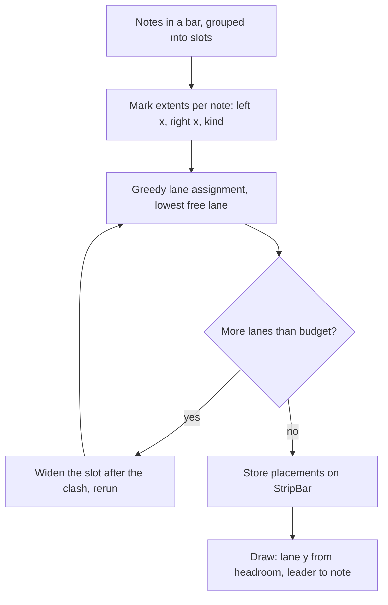

# Dense Tab Strip Legibility - Plan

## Goal Capsule

- **Objective:** In busy passages, every fret number and technique mark on the tab strip is clear at normal play-along size, as in Songsterr's version of the same passage.
- **Means:** Marks are placed by a lane planner, and bars widen to fit them (KTD1, KTD3).
- **Product authority:** The user. Only note room and technique-mark placement on the tab strip are active scope. Rhythm notation (rests, dots, triplets, ties), Songsterr's wrapped page layout and new technique types are not.
- **Execution profile:** Test-first on the pure lane planner; the strip drawing is verified with recorded canvas calls plus one visual check against photo 2.
- **Open blockers:** None.

**Product Contract preservation:** Clarified, no requirement change. The Problem Frame and Outstanding Questions now record that photo 1 predates the working-copy changes. R1 to R6 and AE1 to AE3 are unchanged.

---

## Product Contract

### Summary

Fast bars get generous room per note, technique marks sit in lanes above the staff and drop a lane rather than overprint, and technique words become printed symbols. The check is bars 113 to 118 of the example passage, where no fret number or mark may touch or sit on another.

### Problem Frame

Photo 1 (the strip) and photo 2 (Songsterr) show the same passage. In the strip, fret numbers in fast bars and chords run together and labels such as `bfull`, `b½`, `PM` and `h` print over each other. Songsterr keeps every number and mark separate.

Photo 1 was taken from the committed build. Its labels come from `techniqueMark` in `src/render/techniques.ts`, which the uncommitted working copy deletes. That working copy already widens notes to their label size and draws bends, slurs and `P.M.` brackets as symbols, but it still draws every mark at one fixed height with no collision check (`src/render/strip-techniques.ts`). Marks on neighbouring notes can therefore still overprint, and marks are not counted when a bar is widened.

### Key Decisions

- **Combine note room, mark lanes and symbols.** Fast bars get wider, marks move to lanes, and words become symbols, all three together. (session-settled: user-directed — chosen over any single direction: picked from the three sketched, then asked to take all three.) Governs R1, R3, R4, R5.
- **Clarity over bars per screen.** Busy bars may get wider, so fewer bars fit on screen and the strip moves faster through them. (session-settled: user-directed — chosen over keeping today's bar widths: the user's done-signal is every number and mark clear, not bar count.) Governs R1, R2.

### Requirements

**Note room**

- R1. In every bar, no two fret numbers touch, including chord stacks and the fastest runs, at normal play-along size.
- R2. A bar widens as much as its content needs to meet R1 and R3; no minimum bar count per screen is kept.

**Technique marks**

- R3. No technique mark overprints a fret number or another mark.
- R4. A mark that would overlap another moves to the next lane above the staff instead of being dropped, with a thin leader to its note when it is not directly above it.
- R5. Technique marks use printed symbols over words where Songsterr does: arcs for hammer-ons and pull-offs, bend arrows with their size, one dashed `P.M.` bracket per run of palm-muted notes.

**Unchanged**

- R6. Click-to-select, loop highlight, repeats, tempo changes and the playback cursor keep working on the wider layout.

### Acceptance Examples

- AE1. **Covers R1, R3.** Given bars 113 to 118 of the example passage, when they are on screen at normal size, then no fret number touches another and no label sits on a number or another label.
- AE2. **Covers R4.** Given a `bfull` bend next to a `P.M.` run on adjacent notes, when both would share a height, then one moves to a higher lane and both stay readable.
- AE3. **Covers R2, R6.** Given a bar widened to fit a fast run, when playback crosses it, then the cursor still lands on each note as it sounds and the bar can still be clicked to select it.

### Scope Boundaries

**Deferred for later**

- Rests, dotted notes, triplet brackets and ties in the rhythm row below the staff. The working copy already draws dots and triplet brackets; this plan leaves that code as it is and does not extend it.
- Songsterr's page layout: a boxed staff in wrapped rows, bar numbers, tempo and text marks such as Rake.
- New technique types beyond what the strip already draws.

### Sources

- `src/render/tab-strip.ts` — slot and bar widths (`MIN_SLOT_WIDTH`, `SLOT_GAP`, `slotWidth`, `buildSlots`) and the cached `getStripLayout`.
- `src/render/strip-techniques.ts` — technique glyphs, all drawn at one `laneY`.
- `tests/render/tab-strip.test.ts` — recorded-canvas tests, including `makeTimeline` and the `strip techniques` and `note-value spacing` groups.
- `docs/plans/2026-10-18-1804-feat-tab-strip-clean-layout-plan.md` — earlier spacing and notation work that left technique marks unchanged (its R9).

---

## Planning Contract

### Key Technical Decisions

- KTD1. **The lane plan is computed in the layout and stored on each `StripBar`; drawing only paints it.** Bar width depends on mark extents, so the plan must exist before widths are final, and the layout cache then serves both layout and draw. Governs R2, R3, R4.
- KTD2. **Layout stays independent of panel height, so the lane budget is a constant (3 lanes).** The existing test `lays bars out the same whatever the canvas size` requires this. Drawing squeezes the lane pitch to fit the headroom above the staff, down to a floor, and never drops a mark. Governs R3, R4.
- KTD3. **Lanes are assigned greedily left to right: each mark takes the lowest lane whose last mark ends clear of it.** When more than the budget would be needed, the bar widens at the slot after the clash and the plan reruns, bounded by the number of marks in the bar. Governs R2, R4.
- KTD4. **A mark's extent is its drawn width plus a fixed clearance, not just its anchor note's label.** Bend labels, `Harm.`, `P.M.` with its dashed run, slur spans and vibrato waves each report a left and right x. The same extents feed the widening in KTD3 and the paint in U4. Governs R1, R3.
- KTD5. **Build on the uncommitted working copy as it stands, including its dot and triplet drawing, and add the planner beside it.** (session-settled: user-approved — chosen over reverting the rhythm parts of the working copy: the user confirmed the scope after the call-out.) Governs R5.

### High-Level Technical Design

Each stage consumes the previous one's output; only the last touches the canvas.

### Assumptions

- Technique marks other than the bend, harmonic, palm-mute, slur, slide and vibrato glyphs already in `strip-techniques.ts` do not exist on the strip today, so the planner needs no other mark kinds.
- Slides and short slide stubs sit beside the fret number on its own string line and do not need a lane.
- The bars 113 to 118 file is not in the repo; the fixture in U1 recreates the pattern the photos show (sixteenth runs with bends, `P.M.` runs, a harmonic and chord stacks) instead of loading it.

### Risks and Dependencies

- A lane budget of 3 may leave too little room above the staff on short panels. The pitch floor in KTD2 keeps marks apart at the cost of a tighter stack; the visual check in U5 covers a short panel.
- Widening for marks makes some bars wider than the note spacing alone needs, which shifts the cursor's seconds anchors. U3 keeps the anchors derived from the final slots so AE3 holds.

---

## Implementation Units

### U1. Passage fixture and overlap checker

- **Goal:** A test fixture that reproduces a bars 113 to 118 style passage, plus a helper that reports overlapping boxes, so every later unit has a failing test to turn green.
- **Requirements:** R1, R3; AE1.
- **Dependencies:** None.
- **Files:** `tests/render/tab-strip.test.ts`, `tests/render/strip-fixtures.ts` (new).
- **Approach:**
  - Build the fixture with `makeTimeline` from the existing test file, moving it into the new fixtures module if it is not already importable.
  - Include sixteenth runs on two-digit frets, a `bfull` next to a `P.M.` run on adjacent notes, a harmonic beside a bend, and a chord stack, as in photo 1.
  - The checker takes `fillText` calls from the recording context and returns any pair of boxes that intersect. The recording context has no text measurement, so it sizes fret numbers with `labelBoxWidth` and marks with the extent functions U2 introduces, and takes box height from the font size.
- **Execution note:** Write the passage test first and watch it fail against the current fixed-lane drawing.
- **Patterns to follow:** The recorded-context style in the `strip techniques` group of `tests/render/tab-strip.test.ts`.
- **Test scenarios:**
  - Covers AE1. The passage fixture on a normal panel reports no overlapping fret-number or mark boxes. Fails before U4.
  - Edge: a chord stack on adjacent strings reports no fret-number overlap.
- **Verification:** The passage test exists and fails on the current code for a mark overlap, not for a fixture error.

### U2. Mark extents and lane planner

- **Goal:** A pure function that turns a bar's marks into lane placements and reports when the budget is exceeded.
- **Requirements:** R3, R4; AE2.
- **Dependencies:** U1.
- **Files:** `src/render/strip-marks.ts` (new), `tests/render/strip-marks.test.ts` (new), `src/render/strip-techniques.ts`.
- **Approach:**
  - Define a mark as kind, anchor slot, left x, right x, and an optional own lane of 0 for marks drawn on the staff (slur, slide, vibrato).
  - Move text-width and extent knowledge for bend labels, `Harm.` and `P.M.` out of `strip-techniques.ts` so the planner and the painter read one source (KTD4).
  - Assign lanes per KTD3; return placements plus an `overflow` position naming the first slot that needs widening.
- **Patterns to follow:** `labelBoxWidth` in `src/render/strip-techniques.ts` for how widths are shared between layout and drawing.
- **Test scenarios:**
  - Covers AE2. A `bfull` mark and a `P.M.` mark whose extents overlap get lanes 0 and 1.
  - Two marks that do not overlap share lane 0.
  - A third overlapping mark gets lane 2; a fourth overlapping mark reports overflow at its slot.
  - Clearance: marks whose extents are closer than the clearance count as overlapping.
  - A bar with no marks returns an empty plan.
- **Verification:** Planner tests pass and no drawing code is touched yet.

### U3. Layout widens for marks and stores the plan

- **Goal:** `buildSlots` counts mark extents when sizing slots and stores the lane plan on each `StripBar`.
- **Requirements:** R1, R2, R3, R6; AE3.
- **Dependencies:** U2.
- **Files:** `src/render/tab-strip.ts`, `tests/render/tab-strip.test.ts`.
- **Approach:**
  - After the existing label-based slot widths, run the planner on the provisional offsets.
  - On overflow, add the shortfall to the slot width at the reported position and rerun, at most once per mark in the bar (KTD3).
  - Add `marks` to `StripBar` and derive `secondsAnchors` and `beatXs` from the final slots, as they are today.
  - Keep the layout independent of panel height (KTD2).
- **Execution note:** Characterize the current cursor and bar-pick behavior with the existing `cursor on uneven bars` tests before changing widths.
- **Patterns to follow:** The existing `needed` width rule in `buildSlots` and the anchor construction in `barAnchors`.
- **Test scenarios:**
  - Covers AE1. The passage fixture's bars have at most 3 lanes and no overflow after layout.
  - A bar whose marks need a fourth lane is wider than the same notes without marks.
  - A bar with no marks has the same width as before this unit.
  - The layout is identical at a short and a tall panel (extends `lays bars out the same whatever the canvas size`).
  - Covers AE3. On a widened bar the cursor sits on each note at its start second, and `scoreBarAtX` returns the bar for a position inside it.
  - Repeats and tempo changes: the existing repeat-bar cursor test still passes.
- **Verification:** All `tab-strip.test.ts` layout and cursor groups pass, including the new ones.

### U4. Draw marks from the plan

- **Goal:** `drawStripTechniques` paints marks at their lane height with leaders, and the fixed `laneY` is gone.
- **Requirements:** R3, R4, R5; AE1, AE2.
- **Dependencies:** U3.
- **Files:** `src/render/strip-techniques.ts`, `tests/render/tab-strip.test.ts`.
- **Approach:**
  - Compute lane pitch from the headroom above the staff, between a floor and the current gap (KTD2).
  - Draw each mark at its planned lane; add a thin leader to its note when the mark is above lane 0 or offset sideways.
  - Keep symbols as they are (arcs, bend arrow, dashed bracket) and keep the per-run `P.M.` bracket logic; only the y and leader change.
  - A bend arrow rises to its lane, so its size label sits in the lane the planner chose; today the arrow's height comes from the bend size and string.
  - A bend arrow starts to the right of every fret number stacked above its note in the same slot, so the arrow line does not cross a chord neighbour's number (R3).
  - Remove `LANE_GAP`/`MIN_LANE_Y` constants that the planner replaces.
- **Patterns to follow:** The existing glyph helpers `drawBendArrow`, `drawSlur`, `drawPalmMutes` in the same file.
- **Test scenarios:**
  - Covers AE1. The U1 passage test passes.
  - Covers AE2. A `bfull` and a `P.M.` run on adjacent notes draw at different y positions, and a leader line is drawn for the raised one.
  - On a short panel the lane pitch shrinks but the two marks still draw at different y positions.
  - A bend on a lower string in a chord with a number on the string above draws its arrow clear of that number's box.
  - A bar with a single mark draws it at the same height as today.
  - The existing `strip techniques` tests still pass (one `P.M.` label per run, bend arrow with size, slur, harmonic diamond).
- **Verification:** `tests/render/tab-strip.test.ts` passes in full and no `fixed` lane height remains in `strip-techniques.ts`.

### U5. Visual check against the photos

- **Goal:** Confirm the real passage reads like photo 2 on a normal and a short panel.
- **Requirements:** R1, R3, R4; AE1.
- **Dependencies:** U4.
- **Files:** none changed; findings that need code go back to U3 or U4.
- **Approach:**
  - Load the Guitar Pro file from photo 1 (the user's file, not in the repo), scroll to bars 109 to 118, and capture the strip at normal and short panel heights. If the file is not available, render the U1 fixture in the running app instead and say so in the result.
  - Compare against photo 1 and photo 2 for touching numbers and overprinted labels.
- **Test expectation:** none -- visual comparison against the user's photos; the automated proof is in U1 to U4.
- **Verification:** No touching numbers or overprinted marks in bars 113 to 118 at either height.

---

## Verification Contract

| Check | Command | Applies to |
|---|---|---|
| Unit and recorded-canvas tests | `npm test` | U1 to U4 |
| Types | `npm run typecheck` | U2 to U4 |
| Build | `npm run build` | before handoff |
| Visual check | run the app, the photo 1 song (or the U1 fixture), bars 109 to 118 | U5 |

## Definition of Done

- R1 to R6 hold: AE1, AE2 and AE3 each have a passing test.
- `npm test`, `npm run typecheck` and `npm run build` pass.
- The visual check shows no touching numbers or overprinted marks in bars 113 to 118 at a normal and a short panel height.
- No fixed mark height remains in `src/render/strip-techniques.ts`, and no unused constants or dead-end experiment code from this work remains in the diff.
- The working copy's dot and triplet drawing is unchanged by this work.
