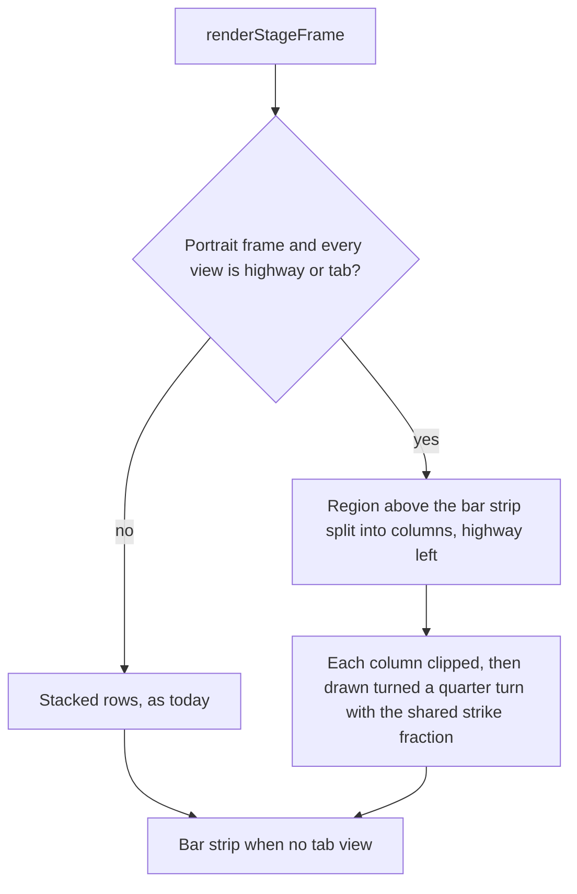

# Vertical Waterfall Columns - Plan

## Goal Capsule

- **Objective:** A vertical (1080 x 1920) export of the highway and tab strip reads naturally on a tall screen: notes fall down into a play area instead of crawling sideways across thin lanes.
- **Means:** Draw the existing highway and tab strip turned upright inside each column, instead of writing new upright renderers (KTD1).
- **Product authority:** The user. Upright Real guitar, pick and fretboard views, waterfalls on the live page or in fullscreen, and an export-dialog layout choice are not active scope.
- **Open blockers:** None.
- **Execution profile:** Code, test-first on the pinned frames (U1), then the new views. Done means the Definition of Done holds and a real vertical export has been looked at (U5).
- **Tail ownership:** The implementer runs the work through local verification. Committing and opening a PR happen only when the user asks.

---

## Product Contract

### Summary

In the vertical export, the highway and the tab strip draw as upright waterfalls: strings are columns, notes fall from the top into a strikeline about three-quarters of the way down, and fret numbers show on the notes. Choosing both views puts them side by side as two columns (highway left, tab right); a single view takes the full width of the frame, above the slim bar strip when no tab strip is chosen. Landscape export and the live page are unchanged.

### Problem Frame

The vertical preset only changes the frame size. `frameLayout` in `src/render/stage-frame.ts` stacks the chosen panels in equal-height rows, and `renderHighway` in `src/render/highway.ts` draws horizontal string lanes with notes travelling right to left. In a 1080 x 1920 frame, a highway or tab strip therefore sits in a wide, short row with its notes crossing sideways. It looks like a landscape video squeezed into a portrait one, and the tall frame's space goes unused.

### Key Decisions

- **Waterfalls appear in the vertical export only.** The live page and fullscreen keep today's horizontal highway and tab strip. (session-settled: user-approved — chosen over also switching on-screen portrait views and over a manual on-screen toggle: the user accepted the export-only option.) Governs R1.
- **Vertical export lays the highway and tab strip out as side-by-side columns, not stacked rows; any other mix stays stacked (R6).** Chosen after the user compared sketches of a full-height waterfall, a waterfall over the horizontal tab strip, and side-by-side waterfalls. (session-settled: user-directed — chosen over stacking a waterfall above a horizontal view and over a single waterfall with no tab: the user picked the side-by-side layouts.) Governs R2, R3.
- **This plan owns the waterfall columns; upright Real guitar, pick and fretboard are a follow-up.** The two pieces are independently useful. (session-settled: user-approved — chosen over doing the upright guitar views first and over doing both in one plan: the user accepted the recommended option.) Governs R5, R6.
- **A layout that includes any view that cannot yet run upright stacks entirely as today.** (session-settled: user-approved — chosen over stacking a waterfall above a horizontal guitar view and over blocking the pairing: the user accepted the recommended option.) Governs R5.

<!-- ce-section: work-relationships -->
### How This Work Fits Together

This plan covers the waterfall columns for the highway and tab strip. The wider breakdown below is the current understanding, not a committed roadmap.

- Upright guitar views: draw the Real guitar, pick and fretboard views to run top to bottom in the vertical export.
  - Depends on the column layout from this plan.
  - Enables those views to join the columns layout and lifts the stack-as-today fallback in R6.
  - Still to decide: how the guitar photo is shown upright.

### Requirements

**Waterfall views**

- R1. In the vertical export, the highway draws as an upright waterfall: one column per string, time running from the top (future) to a strikeline (now), with notes falling into it. Landscape export, the live page and fullscreen draw as they do today.
- R2. In the vertical export, the tab strip draws as an upright waterfall of the same shape: columns per string, fret numbers on the staff lines, bar lines crossing the columns, falling into the same strikeline.
- R3. The strikeline sits about three-quarters of the way down the frame or column, with the string names under it as the play area. The look-ahead window is the one the highway uses today.
- R4. Waterfall notes show the fret number, and sustained notes stretch up from the strikeline as the note sounds.

**Layout**

- R5. When every chosen view can draw as a waterfall (highway, tab strip), the vertical export places them as side-by-side columns: highway on the left, tab strip on the right. A single view takes the full width of the frame and the full height above the bar strip.
- R6. When the chosen layout includes the Real guitar, pick or fretboard view, the vertical export is laid out exactly as it is today, panels stacked in rows, with no waterfalls.
- R7. The slim bar strip rule is unchanged: it shows when no tab strip is on screen, and a tab waterfall counts as the tab strip.

### Acceptance Examples

- AE1. **Covers R1, R5.** Given highway alone chosen for a vertical export, then every frame shows one full-frame waterfall with the notes falling toward a strikeline about three-quarters down.
- AE2. **Covers R2, R5.** Given highway plus tab strip chosen for a vertical export, then each frame shows two columns, highway left and tab right, whose notes reach their strikelines at the same moment.
- AE3. **Covers R6.** Given highway plus Real guitar chosen for a vertical export, then the frames match the stacked horizontal frames produced before this change.
- AE4. **Covers R1, R2.** Given the same layouts exported at 1080p landscape, then their frames match those produced before this change.
- AE5. **Covers R4.** Given a sustained note, then its bar stretches up from the strikeline while it sounds, and the fret number stays readable.

### Scope Boundaries

**Deferred for later**

- Upright Real guitar, pick and fretboard views in the vertical export, which would let them join the columns layout.
- Waterfall views on the live page or in fullscreen, including a portrait-aware or manually toggled version.
- An export-dialog choice between stacked and column layouts.

### Success Criteria

- A vertical export of highway plus tab strip uses the whole tall frame, and a viewer can read which notes are coming without scanning sideways.
- No existing landscape export, and no vertical export of a layout with a Real guitar, pick or fretboard view, changes.

### Dependencies / Assumptions

- `docs/plans/2026-10-18-2020-feat-one-stage-renderer-plan.md` plans a shared drawing path for the page, fullscreen and export and is not yet built. This plan should build on it if it lands first, and otherwise on the export's current frame layout.
- The tab waterfall keeps the tab strip's playhead and bar markings, turned to run along the strikeline. This is assumed and not confirmed with the user.
- The strikeline height (about three-quarters down) and the look-ahead are defaults the user has not adjusted.

### Sources / Research

- `src/export/presets.ts`: the `vertical` preset, 1080 x 1920 at 30 fps.
- `src/render/stage-frame.ts` (`frameLayout`, `renderStageFrame`): equal-height row stacking and the bar-strip rule.
- `src/render/highway.ts` (`renderHighway`) and `src/render/tab-strip.ts` (`renderTabStrip`, `playheadStripX`): the horizontal drawings.
- `src/render/layout.ts` (`computeLayout`): the highway's strikeline sits 18% in from the past edge. `src/render/tab-strip.ts` (`buildStripLayout`): the tab cursor sits 30% in.
- `src/export/encoder.worker.ts`: calls `renderStageFrame` with the preset's width and height, so the renderer sees only frame size.
- `tests/export/composite-views.test.ts` and `tests/helpers/recording-context.ts`: how frames are tested today, with a recording context that stores every drawing call.

---

## Planning Contract

Product Contract unchanged. Its two questions deferred to planning are resolved here: how column size drives the drawing (KTD1) and where the shared moment, sustain and technique marks fit (KTD1, since the existing drawings are reused whole).

### Key Technical Decisions

- KTD1. **Draw the existing highway and tab strip through a turned drawing surface, not through new upright renderers.** The surface lays a landscape-shaped canvas, as wide as the column is tall and as tall as the column is wide, onto the column turned a quarter turn counter-clockwise. Time then runs up the screen and strings run left to right with string 1 on the left. Text is drawn upright by turning it back about its anchor, except technique-mark labels, which stay turned with the strip. The mark planner stacks labels in lanes only 9 to 13 px apart and measures each label along the time axis, so upright labels, whose long side would run across the lanes, would overprint one another. Fret numbers, string names, the clef and bar numbers read upright. Reuse keeps sustains, technique marks, beams, the clef gutter and the shared moment identical to the live views for free. Rewriting each renderer's geometry for a vertical axis would touch every helper in both files and drift. Implements R1, R2, R4.
- KTD2. **A frame uses columns when it is portrait and every chosen view is the highway or the tab strip; the highway is always the left column.** The renderer sees only frame size, and the vertical preset is the only portrait one, so no preset flag has to be threaded through the export worker. Any other mix takes today's stacked path untouched. Implements R5, R6. (session-settled: user-approved — whole layout falls back to stacked rows, chosen over stacking a waterfall above a horizontal guitar view and over blocking the pairing.)
- KTD3. **Both renderers take an optional strike position, as a fraction measured from the past edge, and a shared waterfall value of 0.25 is passed for column drawing.** Defaults stay at 0.18 and 0.3, so no landscape frame changes. The tab layout cache key includes the fraction. The two strikelines then line up in side-by-side columns. Implements R3, AE2, AE4.
- KTD4. **The bar strip keeps its rule and its place.** It stays a full-width horizontal strip under the columns, shown when no tab strip is chosen. A tab column counts as the tab strip. Implements R7.
- KTD5. **Pin today's frames before changing anything.** A recorded-call hash table for the layouts that must not change is captured on the unchanged code and kept green by every later unit. This overlaps the golden test planned in `docs/plans/2026-10-18-2020-feat-one-stage-renderer-plan.md`; whichever lands second extends the other's table instead of duplicating it. Implements AE3, AE4.

### High-Level Technical Design

The branch lives at the top of the frame renderer and chooses between the two layouts. Columns reuse the stacked path's background, bar strip and moment.

How a point in the landscape drawing lands in a column:

| Landscape drawing | In the column |
|---|---|
| x, time axis (past at 0, future at the right) | Up from the column's bottom edge (past at the bottom) |
| y, top lane is string 1 | Left to right, string 1 at the left |
| Strikeline at 25% in from the past edge | A line 25% up from the bottom, so about three-quarters down |
| Clef and string-name gutter at the past edge | Under the strikeline, as the play area |
| Technique marks above the staff | To the left of the strings |
| Stems and beams below the staff | To the right of the strings |
| Text | Upright, anchored where it was drawn |

---

## Implementation Units

### U1. Pin the frames that must not change

- **Goal:** Record today's output for every layout this work must leave alone, before any source file changes.
- **Requirements:** R6; AE3, AE4.
- **Dependencies:** none.
- **Files:** `tests/export/stage-frame-unchanged.test.ts` (new).
- **Approach:**
  1. Render frames through `renderStageFrame` with the recording context for the landscape layouts the app offers (highway and tab strip, highway and Real guitar, tab strip and Real guitar, highway alone, tab strip alone, highway and fretboard) and for the portrait layouts that must keep stacking (highway and fretboard, Real guitar alone, highway and Real guitar, tab strip and Real guitar).
  2. Take each at several times: before the first note, at a note start, mid-sustain and with a loop set.
  3. Hash each frame's recorded calls and compare with a committed table generated by running the test once on the unchanged code.
  4. Portrait highway alone, tab strip alone and highway plus tab strip are not pinned, because U4 changes them.
- **Execution note:** Capture the hashes first, before U2 to U4 edit any source file.
- **Patterns to follow:** the frame helpers and recording context in `tests/export/composite-views.test.ts` and `tests/helpers/recording-context.ts`.
- **Test scenarios:**
  - Covers AE3, AE4. Each pinned layout at each time hashes to its committed value.
  - The same layout at the same time hashes the same on two renders.
  - Changing the look-ahead changes the hash of a layout that shows dots, so the test can tell frames apart.
- **Verification:** The test passes on the unchanged tree and fails if a pinned layout's drawing is altered.

### U2. A turned drawing surface

- **Goal:** Let existing renderers draw into a column as if it were a landscape canvas, with upright text.
- **Requirements:** R1, R2, R4; AE5. Implements KTD1.
- **Dependencies:** U1.
- **Files:** `src/render/upright.ts` (new), `src/render/strip-techniques.ts`, `tests/render/upright.test.ts` (new).
- **Approach:**
  1. Provide one function that takes a host context, a column rectangle and a drawing callback. It places the origin at the column's bottom-left, turns the context a quarter turn counter-clockwise, and gives the callback a drawing context whose width is the column's height and whose height is the column's width.
  2. That context forwards style properties and path calls to the host unchanged. Its text call turns back a quarter turn about the anchor, draws at the origin, and restores, so text stays upright.
  3. Give the turned context a text-orientation setting, upright by default, that the technique-mark drawing in `src/render/strip-techniques.ts` sets to turned for its labels and restores afterwards.
  4. Export the shared strike fraction of 0.25 here for U3 and U4.
  5. Describe the host as a drawing context plus translate and rotate, which the frame and page contexts already provide.
- **Technical design:** *Directional.* The turned surface is a thin proxy over the host. Saves and restores stay balanced, so a column cannot leak its transform into the next region.
- **Patterns to follow:** the `region` helper in `src/render/stage-frame.ts` for save, translate, clip, restore, and the proxy in `tests/helpers/recording-context.ts`.
- **Test scenarios:**
  - Covers AE5. A callback that draws a line along the landscape x axis produces a recorded translate to the column's bottom-left and a quarter-turn counter-clockwise rotate before the line.
  - A text call becomes save, translate to the anchor, quarter-turn clockwise rotate, text at the origin with the same string, restore.
  - With the text-orientation setting on turned, a text call passes straight through to the host with no counter-turn; setting it back restores the counter-turn.
  - Setting fill colour, font, text alignment and line width on the turned context sets them on the host.
  - The callback receives width equal to the column's height and height equal to the column's width.
  - Saves and restores balance after a callback that draws and after one that draws nothing.
- **Verification:** The upright tests pass and U1 stays green.

### U3. A shared strike position

- **Goal:** Let the highway and the tab strip put their strikeline at the same place in a column.
- **Requirements:** R3; AE2, AE4. Implements KTD3.
- **Dependencies:** U1.
- **Files:** `src/render/layout.ts`, `src/render/highway.ts`, `src/render/tab-strip.ts`, `tests/render/highway.test.ts`, `tests/render/tab-strip.test.ts`.
- **Approach:**
  1. Add an optional strike fraction to the highway layout builder and pass it through the highway's options. The look-behind and pixels per second follow from it.
  2. Add the same option to the tab layout builder and options, so the cursor sits at that fraction, still clamped to clear the gutter.
  3. Include the fraction in the tab layout cache key so two sizes or fractions never share a layout.
  4. Defaults stay at today's values.
- **Patterns to follow:** the existing `lookaheadSeconds` option on the highway layout and the layout cache in `src/render/tab-strip.ts`.
- **Test scenarios:**
  - With no fraction given, the highway layout is identical to today's (strike at 18% of the width).
  - Given 0.25, the highway strike sits at a quarter of the width and the look-behind equals that distance divided by pixels per second.
  - With no fraction given, the tab cursor is at 30% of the width or the gutter minimum, as before.
  - Given 0.25 on a 1920-wide strip, the cursor is at 480; on a very narrow strip the gutter minimum still wins.
  - Two calls with the same size and different fractions return different cursors, not a cached layout.
- **Verification:** The highway and tab strip tests pass and U1 stays green.

### U4. Columns in the video frame

- **Goal:** Lay highway and tab strip out as upright waterfall columns in a portrait export, and leave every other frame alone.
- **Requirements:** R1, R2, R3, R4, R5, R6, R7; AE1, AE2, AE3, AE4, AE5. Implements KTD2, KTD4.
- **Dependencies:** U2, U3.
- **Files:** `src/render/stage-frame.ts`, `tests/export/waterfall-columns.test.ts` (new), `tests/export/composite-views.test.ts`.
- **Approach:**
  1. Add a small pure rule that returns true for a portrait frame whose panels are all the highway or the tab strip.
  2. Add a column layout built on the existing frame layout: take the region above the bar strip, split its width into one or two columns with a gap scaled to the frame, highway first.
  3. In `renderStageFrame`, when the rule holds, draw each column clipped to its rectangle through U2's surface with the shared strike fraction, passing the same shared moment, loop and look-ahead as the stacked path. Otherwise run the existing path.
  4. Keep the bar strip drawn under the columns by the existing rule.
  5. If the shared drawing path from the one-stage-renderer plan has landed, call it inside each column instead of the panel switch.
- **Patterns to follow:** the clipped `region` helper and the bar strip handling in `src/render/stage-frame.ts`; `frameLayout` tests in `tests/export/composite-views.test.ts`.
- **Test scenarios:**
  - Covers AE1. A 1080 x 1920 frame with highway alone has one column as wide as the frame, its drawing preceded by the quarter-turn transform, and a bar strip region under it.
  - Covers AE2. Highway plus tab strip gives two columns, the first starting at 0 and the second starting past the frame's midpoint, with no bar strip.
  - The tab strip chosen before the highway still puts the highway on the left.
  - Covers AE3. Highway plus Real guitar, highway plus fretboard and Real guitar alone at 1080 x 1920 still match U1's pinned hashes.
  - Covers AE4. Highway plus tab strip at 1920 x 1080 still matches its pinned hash.
  - Covers AE5. A note with a long sustain and one with a short sustain, both sounding, draw tails of different lengths along the time axis, and the longer tail is the one that reaches farther from the strikeline.
  - Fret numbers in both columns appear as text calls with the note's fret label, each wrapped in the counter-turn from U2.
  - A tab column with a bend, a harmonic and a palm-mute mark on the same note draws all three labels with the turned orientation set and restored, so labels in different lanes stay separated as the planner placed them.
  - A bass track with four strings gives four lanes in the column, not six.
  - A timeline with no notes renders both columns without throwing.
- **Verification:** The new and existing export tests pass, including U1's table.

### U5. Look at a real export and tune

- **Goal:** Judge the result in an actual vertical video, since no test can say whether it reads well.
- **Requirements:** R1 to R4; AE5.
- **Dependencies:** U4.
- **Files:** none unless tuning is needed; a tuning change touches `src/render/tab-strip.ts` or `src/render/upright.ts` and extends the matching tests.
- **Approach:**
  1. Export a short vertical clip of a song with sustains, technique marks and a repeat for highway alone, tab strip alone and both together.
  2. Check that the strikelines match across columns, notes land on the strikeline as they sound, fret numbers and string names read upright, turned technique labels are readable and do not overlap, and fret numbers fit their backing boxes and are legible at full-frame width.
  3. If fret numbers read small at full width, scale the tab's type with column width in a way that leaves the landscape strip's type alone.
  4. If left-aligned labels such as bar numbers sit oddly after the counter-turn, adjust their anchor for the column.
- **Test scenarios:** Test expectation: none -- this unit is a visual judgement in a real export. Any tuning change carries its own scenarios in the unit it touches.
- **Verification:** The Definition of Done's hand check is complete and any tuning is covered by tests.

---

## Verification Contract

| Check | Command or action | Proves |
|---|---|---|
| Types | `npm run typecheck` | The turned context, the new options and the frame branch compile across `src/render` and `src/export` |
| Unit and export tests | `npm test` | The turned surface, the strike options, the column layout, and that pinned frames did not change |
| Production build | `npm run build` | The export worker still bundles with the new imports |
| Real export by hand | Export a short vertical clip for highway alone, tab strip alone, both together, and highway plus Real guitar | AE1, AE2, AE3 and AE5 in a real file, and legibility |

## Definition of Done

- Every unit's test scenarios pass under `npm test`, and `npm run typecheck` and `npm run build` are clean.
- R1 to R7 hold. U1's pinned frames are unchanged, so landscape exports and every portrait layout with a guitar or fretboard view match what they produced before.
- The hand check in the Verification Contract is done and any tuning from U5 is covered by tests.
- No abandoned experiments or unused helpers remain in the diff.

---

## Risks

- **Small type at full-frame width.** The tab's fret numbers cap at 16 px, so a tab alone in a 1080-wide column may read small. U5 checks this and allows a scoped fix.
- **Left-aligned text after the counter-turn.** Labels anchored at their left edge, such as bar numbers, extend a different way once the text is turned back. They are few and are checked in U5.
- **The tab strip lays out for a different height.** Its line spacing follows the column width, so a full-frame tab column spaces its strings far apart. This is intended for a tall frame and also checked in U5.
- **A second change to the same file.** `src/render/stage-frame.ts` is also the target of the planned shared drawing path, so whichever lands second rebases onto the other.

### Deferred to Follow-Up Work

- Upright Real guitar, pick and fretboard views, which lift the stack-as-today fallback in R6.
- A note in the export dialog that a vertical layout with a guitar view stays stacked.
