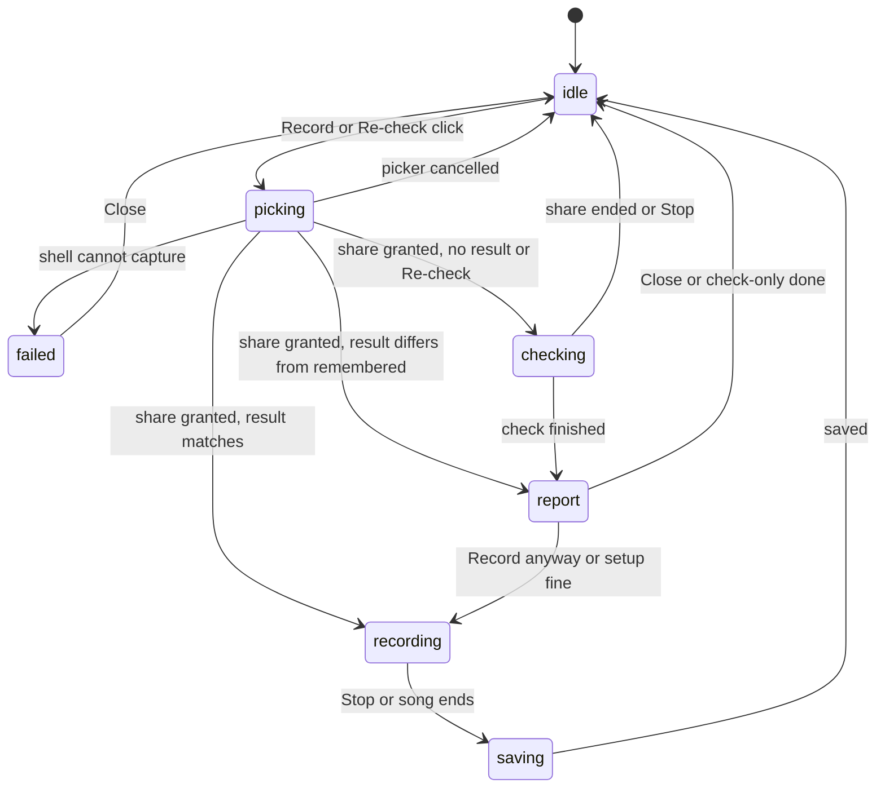

# Capture Doctor and Clean Audio - Plan

## Goal Capsule

- **Objective:** A video made with Record with video sounds the same as the YouTube video does when watched in a normal tab.
- **Means:** A setup check built into the app, run on a player's first recording and remembered, plus a recording request that stops the browser from processing the sound (KTD1, KTD2).
- **Product authority:** The owner. The guarded start (readiness checks, countdown, leave-page guard, dock lock) and any change to the picture are not active scope here.
- **Open blockers:** None. Whether the desktop shell can turn the processing off is an execution-time unknown, reported by the check itself.
- **Execution profile:** Code. Logic is built test-first as pure functions and injectable controllers; the picker, the real captured sound and the desktop shell are verified by hand, because the test setup has no browser.
- **Tail ownership:** The implementer finishes through typecheck, tests and the manual checks in the Verification Contract.

---

## Product Contract

**Product Contract preservation:** changed — R9 reworded (steers by warning, adds the lock on source switching and file loads), R12 and AE6 added, both confirmed in the scoping synthesis. R1–R8 and R10–R11 keep their meaning. R4 keeps its outcome (no test sound in the saved file); KTD1 owns how.

### Summary

The first time a player presses Record with video on a machine, the app plays a short built-in test sound through the real capture path and compares what came back with what it played. It tells the player in plain words what the browser did to the sound and whether it captured only this tab or the whole system. The recording itself asks for the video's sound with the browser's processing turned off, and keeps the app's own sounds out of the file. The result is remembered for that machine and can be re-run from the export dialog.

### Problem Frame

Players who record with video report the sound as thin, muffled and compressed. The recorder asks the browser for the video's sound with no options (`src/export/record-capture.ts:67-69`), so the browser is free to apply its own voice-call processing to music. The recording is also encoded a second time on top of YouTube's own encoding.

The owner has never seen what the desktop shell actually captures, because the one spike that would show it (`dev/capture-spike.ts`) prints to a page and saves nothing. The export plan lists that as an open question (`docs/plans/2026-10-25-0830-feat-export-with-youtube-video-plan.md`, U1). Without that answer, neither the audio fix nor any later picture work can be judged.

### Key Decisions

- KD1. **Doctor and clean audio first; the guarded start waits.** (session-settled: user-approved — chosen over all three together, clean audio only, and guarded start only: the owner wants the sound fixed and the shell's behavior known before more flow work.) Governs R1, R7.
- KD2. **The check is part of the app and runs for every player.** (session-settled: user-directed — chosen over a dev-only tool and a silent pre-record probe: players' machines differ, so a developer's run proves little.) Governs R1, R5.
- KD3. **It runs on the first Record click and is remembered per machine, with a Re-check button.** (session-settled: user-approved — chosen over on-demand only and every-click: players see it once and later recordings are not slowed.) Governs R1, R5, R12.
- KD4. **A setup that cannot meet the bar gets a warning and can still record.** (session-settled: user-approved — chosen over blocking it and over falling back to the no-YouTube export: the player decides.) Governs R10, R12.
- KD5. **The bar is "same as watching YouTube normally".** (session-settled: user-directed — chosen over "clearly better than today" and "close to the offline export's sound": that is what the player expects to hear.) Governs R7, R8, R11.
- KD6. **The check uses a built-in test sound and decides pass or fail itself.** (session-settled: user-approved — chosen over a listen-and-compare check and over fixing first with no check: it needs no ears and records no YouTube content.) Governs R2, R3, R6.
- KD7. **The app's own sounds stay out of the file.** (session-settled: user-approved — proposed during the scope check and accepted: other sounds in the file are part of the quality complaint.) Governs R9.

### Requirements

**The check**

- R1. The first time Record with video is pressed on a machine, a short setup check runs before the song starts, and its result is remembered for that machine.
- R2. The check plays a built-in test sound, not the video, through the same capture the recording uses, and compares what was captured with what was played.
- R3. The check reports in plain words whether the captured sound was altered (level changes, lost highs), which browser processing was active, the sample rate, and whether only this tab's sound or the whole system's was captured.
- R4. The check and the first recording share one share-picker visit, and the test sound is not in the saved file.
- R5. The export dialog offers Re-check, which runs the check again and replaces the remembered result.
- R6. The result screen offers a "hear it yourself" button that plays back the captured test sound.
- R12. A later recording skips the test sound but still reads the new share's settings, and shows the warning again when they differ from the remembered result, for example the whole screen instead of the tab.

**Clean audio**

- R7. The recording asks the browser for the video's sound with echo cancellation, noise suppression and automatic gain turned off.
- R8. Where the check shows the encoder, not the browser's processing, is limiting the quality, the recording uses the container and audio quality setting that removes that loss.
- R9. During a recording with video, the only sound in the file is the video's. The app plays no sound of its own, switching the audio source and loading files are unavailable until the recording ends, and a share that carries the whole system's sound is warned about (R10).

**Weak setups**

- R10. When the check finds a setup that cannot meet the bar (processing cannot be turned off, only whole-system sound is available, or no audio track comes back), it tells the player what is wrong and what to change, and Record with video still works.
- R11. When the recording cannot match YouTube exactly, the result screen says how far it falls short instead of claiming a pass.

### Key Flows

- F1. First recording on a machine
  - **Trigger:** The player presses Record with video and no result is remembered.
  - **Steps:** The picker appears once. The test sound plays and is compared. The result is saved. If the setup is fine the song starts and records; if not, the warning appears first (R10) and the player continues or fixes the setup.
  - **Outcome:** A saved file with only the video's sound, and a remembered result.
  - **Covered by:** R1, R2, R3, R4, R10

### Acceptance Examples

- AE1. **Covers R1, R4.** Given a machine with no remembered result, when the player presses Record with video, then the picker appears once, the check runs in the first seconds, and the saved file does not contain the test sound.
- AE2. **Covers R3, R7, R10.** Given a browser that ignores the request to turn the processing off, when the check runs, then the result names the processing still active and warns the player, and the recording is still allowed.
- AE3. **Covers R3, R10.** Given a share that carries the whole system's sound, when the check finishes, then the player is told to share the tab with its sound, and can still record.
- AE4. **Covers R9.** Given Original audio and a video attached, when the player records, then the saved file contains no sound from the app other than the video's, and the audio source cannot be switched until the recording ends.
- AE5. **Covers R5.** Given a remembered result, when the player presses Re-check, then the check runs again and the new result replaces the old one.
- AE6. **Covers R12.** Given a remembered result for a tab share, when the player picks the whole screen for a later recording, then the warning appears again and no test sound plays.

### Success Criteria

- A recording of a known song, played next to the same video in a normal tab at normal listening volume, is not distinguishable by ear. Where it is, the result screen has already said so (R11).
- The owner can read, for the desktop build, whether screen capture with sound works and which processing the shell applies. That answers the open question in the export plan.

### Scope Boundaries

**Deferred for later**

- The guarded start: readiness checks, countdown, leave-page guard, and locking the dock while recording.
- Picture changes: rendering the stage offline with only the dock captured live, cropping out the window and banner, and native Windows capture.
- A recording that ends leaves the song paused at its end rather than at the position and tempo it started from; the existing recorder behaves this way and it stays as is.

**Outside this work**

- The offline export's audio, and any export that leaves out the YouTube video.
- Changing the share-picker itself; the browser controls it.

### Dependencies / Assumptions

- The audio can be no better than what the browser hands over. Whether the desktop shell lets the page turn processing off is unknown until the check runs there.
- The legal review of Record with video is still open (`docs/launch-checklist.md:44`). This work does not change that risk.
- Assumption: the processing is the main cause of the thin, muffled sound. The check confirms or rules it out; if it is ruled out, the remaining loss is the second encode, which only an export without YouTube's sound avoids.

### How This Work Fits Together

<!-- ce-section: work-relationships -->
This plan covers the setup check and the audio fix. The breakdown below is the current understanding, not a committed roadmap.

- Guarded start (readiness checks, countdown, leave-page guard, dock lock)
  - Shares the capture setup this plan introduces.
  - Can proceed independently of this plan.
- Picture quality (offline stage with a live dock, cropped frame, native capture)
  - Depends on the check's recorded answer about what the desktop shell can capture.
  - Still to decide: which of these routes is worth building.

### Outstanding Questions

**Deferred to Planning**

- Pass thresholds for "altered" (level change in dB, high-frequency rolloff in dB) are calibrated during U2 against synthetic and real recordings; the plan fixes the measures, not the numbers.
- What the desktop shell does with a share request (picker, audio track, processing flags) is learned by running U7; if the shell cannot capture at all, the check reports that and native capture stays in Deferred scope.

### Sources / Research

- Recorder and audio request: `src/export/record-capture.ts:62-91`
- Start sequence: `src/app/useRecordWithVideo.ts:61-89`
- Spike that records nothing: `dev/capture-spike.ts`
- Export dialog entry point: `src/app/ExportDialog.tsx:298-309`
- Existing per-machine settings pattern: `src/app/neck-cues-setting.ts`
- Related plans: `docs/plans/2026-10-25-0830-feat-export-with-youtube-video-plan.md`, `docs/plans/2026-10-24-2230-feat-embedded-youtube-backing-plan.md` (R8, R11)
- Origin: `docs/ideation/2026-10-25-export-fullscreen-with-youtube-ideation.html`, idea "Capture doctor, clean audio and guarded start"

---

## Planning Contract

### Key Technical Decisions

- KTD1. **The check runs on the one granted stream before the long recorder exists.** The recorder is created only after the check passes or the player continues, so the test sound can never be in the file and nothing has to be trimmed. A separate short recorder on the same stream records the test once for each candidate container (mp4 and webm, as KTD4 describes) so encoder loss is measured too. (session-settled: user-approved — chosen over recording and trimming the test sound afterwards: a finished recording cannot be cut cleanly.) Governs R4, R8.
- KTD2. **Request the audio with processing off, keep the current-tab preference and keep system audio offered, then read back what happened.** The request sets echo cancellation, noise suppression and automatic gain to off. After every grant the track's settings and the share's surface type are read and reported. System audio stays on `include`; changing it to `exclude` could return no sound at all in the desktop shell. (session-settled: user-approved — chosen over forcing tab-only sound: forcing risks no audio in the shell, so the share is steered by preferring the tab and warned about instead.) Governs R3, R7, R9, R10.
- KTD3. **The test signal varies over time and the comparison is pure.** Tone bursts at stepped levels, pink noise and a log sweep are generated by a page audio context and played into the tab's output. Steady tones are avoided because noise suppression removes them, and the real video is not used because that would record YouTube content just to test. Played and captured samples are compared by pure functions over `Float32Array`: per-burst level, band energy near 100 Hz, 1 kHz, 8 kHz and 16 kHz, and latency from a leading chirp. Governs R2, R3, R11.
- KTD4. **R8 changes the container or quality setting the check shows to be better, not a number the browser may clamp.** The short-recorder measurement compares the mp4 and webm candidates the recorder already supports and picks the one with less loss; the audio bitrate rises only if both still show loss. Simply raising the number was rejected: the browser may clamp it and the real value cannot be read back. Governs R8.
- KTD5. **The remembered result is one versioned JSON value in the existing per-machine settings store.** It follows `src/app/neck-cues-setting.ts`: injectable storage, defensive parse, silent write failure. A bad or old value reads as "no result". It carries a check version, bumped only when the request or the comparison changes; the share's surface, the processing flags, the sample rate and whether capture worked; and the container and audio bitrate the check chose (KTD4), which later recordings reuse. The surface and flags are compared separately from the version (R12). It is stale when the version or sample rate differs; Re-check is the only other reset. The app's package version was rejected as the staleness key because every release would re-prompt every player, and a Tauri store was rejected because the repo has none and the web build needs the same code path. Governs R1, R5, R12.
- KTD6. **The record flow is one injectable controller with explicit states and one abort path.** `checking` and `report` states are added to the record state. A flag set synchronously on click blocks a second picker. Stop, a share that ends, and page leave all run the same abort, which stops the tracks and closes the audio context and the short recorder. The clock is not touched until the check passes and the player continues. Keeping the logic inside the React hook was rejected because the test setup has no browser, so it could not be tested. Governs R1, R10, R12.
- KTD7. **R9 is met by pausing the other clocks at start and locking source switching and file loads while recording.** At start the synth, stems and loaded-recording clocks are paused; while the state is `recording` or `checking` the source toggle and the file and stem loaders are disabled with a reason. The lock is a pure function of the record state. (session-settled: user-approved — proposed in the scoping synthesis and accepted: a stray switch would put the synth in the file.) Governs R9.
- KTD8. **The result UI lives in the banner and the dialog only starts things.** The export dialog closes on click so the picker stays user-initiated, so results appear in `RecordBanner`; keeping the dialog open to show them was rejected because the picker must open inside the click. Re-check is an optional dialog prop that triggers a check-only run with its own fresh click. Hear-it-yourself plays the captured buffer from memory and is never written to disk. Governs R5, R6.

### High-Level Technical Design

The record flow after this plan. Each arrow is a user action or a controller outcome, and the abort path is any state back to `idle`.

### System-Wide Impact

- **Record state:** `RecordState` gains `picking`, `checking` and `report`; every consumer (`RecordBanner`, `App.tsx` wiring, the lock function) handles them.
- **Main screen:** the source toggle and the stem and recording loaders in `src/app/App.tsx` read the lock, so a disabled control needs a visible reason.
- **Export dialog:** one new optional prop; the offline export path and its audio are untouched.
- **Storage:** one new per-machine key; a blocked or corrupt value falls back to running the check.
- **Dev tooling:** `dev/capture-spike.ts` stops being a separate recorder and points at the in-app check so the request and bitrate settings cannot diverge again.
- **Failure propagation:** every abort path ends in `idle` with the tracks stopped, so a failed check never leaves a live screen share.

### Assumptions

- The page's own audio context output is part of tab capture, so the test tone is captured when the player shares the tab. A window share will not carry it, which the check reports as "no sound captured".
- A second recorder on the same stream is allowed in the target browsers; if the desktop shell refuses it, the check skips encoder loss and says so.

### Risks

- The desktop shell may not support display capture, tab audio or the processing flags. Mitigation: that outcome is a normal report, not an error, and it is the answer the owner is waiting for.
- Echo cancellation can treat the played test sound as echo, so a pass with processing off but a fail with defaults is possible and informative; the check reports both settings it requested and what is active.
- A threshold set too tight would warn on good setups. Mitigation: calibrate on real recordings in U2 and keep the warning non-blocking (KD4).
- Local storage can be blocked. Mitigation: KTD5 reads that as "no result", so the check runs each time without breaking.

---

## Implementation Units

### U1. Capture request, stream inspection and a separate recorder

- **Goal:** Make the capture acquisition injectable and testable, request clean audio, and report what the share actually gave.
- **Requirements:** R3, R7, R9, R10; KTD2.
- **Dependencies:** None.
- **Files:** `src/export/record-capture.ts`, `tests/export/record-capture.test.ts`, `tests/export/capture-acquire.test.ts` (new).
- **Approach:**
  - Split `startCapture` into acquiring the stream, inspecting it, and creating the long recorder, with `getDisplayMedia` and `MediaRecorder` passed in.
  - Put the audio processing flags in every request attempt; keep the current-tab preference and system audio on `include`.
  - Return an inspection of the audio track: present or not, live or not, the processing flags and sample rate it reports, and the share's surface type.
  - Move the long recorder's creation out of the acquire step so U4 can run the check first (KTD1).
  - Keep the single-grant rule: only one `getDisplayMedia` call per user action.
- **Patterns to follow:** injected fakes in `tests/export/save-export.test.ts`; typed object slices in `tests/audio/count-in.test.ts`.
- **Test scenarios:**
  - Covers AE2. A fake track reporting `echoCancellation: true` after a request for false is reported as processing still active.
  - A fake share with no audio tracks reports "no audio" and does not throw.
  - Covers AE3. A fake share whose surface is the monitor reports whole-system sound.
  - The first request attempt contains the three processing flags set to off; the fallback attempts keep them.
  - A `NotAllowedError` from the picker is rethrown unchanged; `NotSupportedError` and `NotFoundError` are surfaced as a capture failure.
  - Only one `getDisplayMedia` call happens per acquire, including when the first attempt throws a non-permission error and a plainer one is tried.
- **Verification:** Acquire and inspect are covered by tests with fakes; the existing `record-capture` tests still pass.

### U2. Test signal and the comparison

- **Goal:** Generate the built-in test sound and decide, from played and captured samples, what the browser did to it.
- **Requirements:** R2, R3, R10, R11; KTD3.
- **Dependencies:** None.
- **Files:** `src/audio/capture-test-tone.ts` (new), `src/export/capture-check.ts` (new), `tests/export/capture-check.test.ts` (new), `tests/helpers/synthetic-audio.ts` (extend if a gate or lowpass helper is missing).
- **Execution note:** Build test-first with synthetic signals; calibrate the thresholds against a few real recordings before fixing the numbers.
- **Approach:**
  - The tone module describes the signal (stepped-level bursts, pink noise, log sweep, a leading chirp) and plays it through a page audio context created from the click, mirroring `src/audio/count-in.ts`. The sound lasts a few seconds and is capped at a moderate level so it cannot startle the player.
  - The comparison is pure: per-burst level change, band energy at 100 Hz, 1 kHz, 8 kHz and 16 kHz, latency alignment from the chirp, and a verdict that names each effect found (level pumping, gating, lost highs, silence).
  - It returns the measured numbers so the result screen can show how far short a setup falls (R11).
- **Patterns to follow:** `tests/helpers/synthetic-audio.ts` for generated PCM; the `ClickAudio` slice style in `src/audio/count-in.ts`.
- **Test scenarios:**
  - A captured copy identical to the played signal reports no effects.
  - A copy lowpassed at 8 kHz reports lost highs with the rolloff in dB.
  - A copy whose burst levels converge reports automatic gain.
  - A copy whose late bursts are attenuated reports gating.
  - A captured copy delayed by a known latency is aligned before comparing and reports no false loss.
  - An all-zero capture reports "captured nothing" and not a pass.
  - Covers AE2. A copy with a 6 dB overall drop reports a level change with the number.
- **Verification:** Every effect above is detected by a test, and a clean copy is not flagged.

### U3. The remembered result

- **Goal:** Store and read the check result per machine, safely.
- **Requirements:** R1, R5, R12; KTD5.
- **Dependencies:** None.
- **Files:** `src/app/capture-check-setting.ts` (new), `tests/app/capture-check-setting.test.ts` (new).
- **Approach:**
  - One storage key with the same `tab-highway.` prefix, one JSON value with a version field, written and read through the injectable storage used by `src/app/neck-cues-setting.ts`.
  - A pure `isStale` compares the stored check version and sample rate with the current ones.
  - A pure `differsFromShare` compares a new share's surface and processing flags with the stored result (R12).
  - Record `captureWorks` so a failed shell is readable later.
  - Store the chosen container and audio bitrate; a missing field reads as the default order.
- **Patterns to follow:** `tests/app/neck-cues-setting.test.ts` (memory storage factory, hostile storage, null storage); versioned JSON in `src/audio/profile-store-web.ts`.
- **Test scenarios:**
  - Round trip: a written result, including the chosen container and audio bitrate, reads back equal.
  - A stored result with no container field reads as "use the default order".
  - Junk, an old version and missing fields all read as no result without throwing.
  - Covers AE6. A stored tab-share result and a new monitor-share inspection report a difference.
  - A changed sample rate reads as stale; an unchanged one does not.
  - Blocked storage and null storage never throw on read or write.
- **Verification:** All the cases pass and no function throws on hostile storage.

### U4. The check flow controller

- **Goal:** Run the first-record flow, Re-check and the abort paths as one injectable controller.
- **Requirements:** R1, R2, R4, R5, R10, R12; KTD1, KTD4, KTD6.
- **Dependencies:** U1, U2, U3.
- **Files:** `src/export/capture-check-flow.ts` (new), `tests/export/capture-check-flow.test.ts` (new).
- **Execution note:** Define the states and the single abort path first, then write the tests for abort at every state before the happy path.
- **Approach:**
  - The controller takes the acquire function, the tone player, the short recorder factory, the settings reader and writer, and the long-recorder starter as dependencies.
  - Order: acquire, inspect, then run the check or skip it by the remembered result (R12), then report or start; the clock is never touched here.
  - The short recorder records the test using each candidate container so encoder loss is compared (KTD4); if a second recorder is refused, skip that measurement and say so.
  - The long recorder uses the remembered container and audio bitrate when a non-stale result exists, and the default order otherwise (R8).
  - A flag set synchronously on entry blocks a second start; Stop, share ended and dispose all call one abort that stops the tracks, closes the context and the short recorder.
  - A check that cannot run because the shell cannot capture stores `captureWorks: false` and reports it; a picker cancel stores nothing.
- **Patterns to follow:** injected fakes in `tests/app/desktop.test.ts` and `tests/export/save-export.test.ts`.
- **Test scenarios:**
  - Covers AE1. With no stored result, one acquire happens, the check runs, the result is stored, and the long recorder starts only after the check, so the test sound is never recorded.
  - Covers AE6. With a stored tab result and a monitor share, no test sound plays and a report is produced.
  - Covers AE5. Re-check runs the check, never starts the long recorder, and replaces the stored result.
  - A second start while one is in flight is ignored and opens no second picker.
  - The share ending during the check aborts, stores nothing and reports that the share ended.
  - Stop during the check aborts and releases the tracks and the context.
  - A picker `NotAllowedError` returns to idle and stores nothing.
  - A `NotSupportedError` stores `captureWorks: false` once and reports the shell cannot capture.
  - A later recording with a stored webm choice starts the long recorder with webm, and one with no stored choice uses the default order.
  - A refused second recorder skips the encoder measurement and the report says so.
  - A warning report allows "Record anyway", which starts the long recorder on the same stream with no new picker.
- **Verification:** All states reach idle on abort with tracks stopped, and the long recorder never starts before the check ends.

### U5. Hook, banner, dialog and styling

- **Goal:** Wire the controller into the app and show the result.
- **Requirements:** R3, R5, R6, R10, R11; KTD6, KTD8.
- **Dependencies:** U4.
- **Files:** `src/app/useRecordWithVideo.ts`, `src/app/RecordBanner.tsx`, `src/app/ExportDialog.tsx`, `src/app/App.tsx`, `src/app/app.css`.
- **Execution note:** UI and the hook cannot be unit-tested here (no browser test environment); keep them thin over U4 and verify by hand per the Verification Contract.
- **Approach:**
  - Add `picking`, `checking` and `report` to the record state; the hook delegates to the controller and keeps the existing save path.
  - The clock is not touched during the check, so aborting a check needs no restore; what the existing recorder does when a recording ends is unchanged (Scope Boundaries).
  - `RecordBanner` gains a picking line ("choose this tab and tick share tab audio"), a checking branch, and a report branch; use a modifier class on `.record-banner` that wraps.
  - The checking branch says a short test sound is about to play, asks the player to leave the volume and tab alone, and shows a Stop button.
  - The report has two variants. Before a recording it shows the plain-word findings and the shortfall in numbers, with Record anyway and Close; to fix a share the player closes it and presses Record with video again. After a Re-check it shows the findings, says so plainly when the setup is clean, and offers only Close and Hear it yourself, because a Re-check never records.
  - `ExportDialog` gets an optional Re-check prop beside Record with video, called in the click before the dialog closes; Re-check and Record are disabled with a reason while a check or recording is running.
  - Hear it yourself plays the in-memory captured buffer, is disabled while a recording runs, and frees the buffer on close.
- **Patterns to follow:** the `.record-banner` and `.notice` styles in `src/app/app.css`; `src/app/RecordBanner.tsx` branch-per-state structure.
- **Test scenarios:**
  - Test expectation: no automated tests — UI wiring over U4's tested controller. Manual checks on the web and desktop builds:
    - Covers AE1. First Record click shows one picker, then a "checking" banner, then the song starts and the saved file has no test sound.
    - Covers AE2. With processing reported active, the report names it and Record anyway still records.
    - Covers AE5. Re-check never starts a recording and the dialog's Re-check button is disabled with a reason while a recording runs.
    - Hear it yourself plays the captured test sound and is disabled during a recording.
    - Leaving the page mid-check ends the screen share and leaves no recording behind.
- **Verification:** The manual steps in the Verification Contract pass on both builds.

### U6. Silence guard

- **Goal:** Keep the app's own sounds out of the file.
- **Requirements:** R9; KTD7.
- **Dependencies:** U4.
- **Files:** `src/app/record-locks.ts` (new), `tests/app/record-locks.test.ts` (new), `src/app/App.tsx`, `src/app/useRecordWithVideo.ts`.
- **Approach:**
  - A pure function maps the record state to what is locked: source switching, stem loads and recording loads; each lock carries a reason shown to the player.
  - At start the hook pauses the synth, stems and loaded-recording clocks; at every exit the locks release.
  - `App.tsx` passes the locks to the source toggle and the loaders and ignores a switch request while locked.
- **Patterns to follow:** `dockRules` in `src/app/youtube-dock.ts` and its tests in `tests/app/youtube-wiring.test.ts`.
- **Test scenarios:**
  - Covers AE4. In `recording` and `checking` states the lock function locks source switching and loads, with a reason.
  - In `idle`, `done` and `failed` nothing is locked.
  - A `report` state opened from a check-only run locks nothing.
  - Locking is independent of the source, so it also holds with Synth selected.
- **Verification:** Tests pass; by hand, the source toggle and the loaders are disabled during a recording and release afterwards.

### U7. Run the check on both builds and record the answer

- **Goal:** Learn what the desktop shell does and put the answer where the export plan can read it.
- **Requirements:** Success Criteria (the desktop answer); R3.
- **Dependencies:** U5, U6.
- **Files:** `docs/plans/2026-10-25-0830-feat-export-with-youtube-video-plan.md`, `dev/capture-spike.ts` (retire or point at the in-app check).
- **Execution note:** Needs a person at the picker; this is a manual unit.
- **Approach:**
  - Run Record with video and Re-check in the web build and in the desktop build; note whether a picker appears, whether an audio track exists, which processing is active, and the tab or system surface.
  - Write the finding into the export plan's open question about the desktop shell, and say plainly what it means for the picture ideas.
  - Leave the dev spike pointing at the in-app check so the two do not diverge again.
- **Test scenarios:**
  - Test expectation: none — manual verification and a documentation edit.
- **Verification:** The export plan's open question holds a dated answer for each build.

---

## Verification Contract

| Gate | Command or step | Applies to |
|---|---|---|
| Types | `npm run typecheck` | All units |
| Tests | `npm test` (the glob covers `tests/**/*.test.ts` only) | U1–U4, U6 |
| Build | `npm run build` | All units |
| Web check | `npm run dev`, then Record with video and Re-check in Chromium: one picker visit, no test sound in the saved file, warning appears on a screen share | U5, U6 |
| Desktop check | Run the shell per `docs/desktop-packaging.md`, then Record with video and Re-check | U5–U7 |
| By ear | A saved recording of a known song played next to the same video in a normal tab | Success Criteria |

The repo has no lint script, so typecheck is the static gate.

## Definition of Done

- The first Record click on a machine runs the check on one picker visit, stores the result, and starts the song only after it; the saved file has no test sound (AE1).
- The recording requests the audio with processing off, and the result names any processing still active (AE2, AE3).
- A later recording with a different share warns again without playing a test sound (AE6); Re-check replaces the result (AE5).
- Source switching and file loads are locked during a recording, and the saved file holds only the video's sound (AE4).
- Every path out of the check, including picker cancel, share ended, Stop and page leave, releases the tracks, closes the audio context and returns to idle.
- The export plan's open question about the desktop shell holds a dated answer.
- Dead code and experimental attempts are removed from the diff, and `npm run typecheck` and `npm test` pass.
