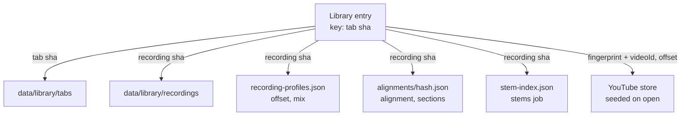
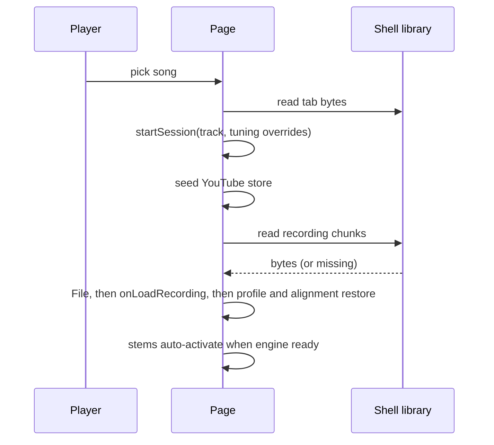

# Song Library Save and Reopen - Plan

## Goal Capsule

- **Objective:** A desktop player reopens any song they practised before from a list on the start screen, and it comes back ready to play: tab, backing track already loaded, and the setup they left.
- **Means:** A library index plus copied tab and recording files in the shell's `data/library/` folder, linked to the per-recording stores that already exist (KTD1, KTD2, KTD4).
- **Product authority:** RACE-001 (`docs/races/RACE-001-song-library.md`) and the user's choices recorded under Key Decisions. Sprint tracking: `docs/sprints/RACE-001-SPRINT-01-save-and-reopen.md`.
- **Stop conditions:** Stop and ask if a requirement would need a new Tauri plugin, Cargo feature or CSP change, or if keeping recordings in backups proves infeasible within the existing zip format.
- **Execution profile:** TypeScript page logic and React start screen, plus a Rust shell module and backup change. Proof is Vitest, `cargo test`, and a manual pass on a packaged desktop build.
- **Tail ownership:** The implementer stops at local verification. Commits, push and PR need the owner's approval (CLAUDE.md, Authority).

---

## Product Contract

### Summary

Every tab opened in the desktop app is saved as a song. Loading a recording for it copies the recording into the app's library folder, and a YouTube video attached to it is remembered with the song. The start screen lists saved songs, newest first. Opening one restores the tab, loads its backing track without a drop, and brings back offset, alignment, sections, mix, stems, chosen track and file tuning.

### Problem Frame

The app forgets every tab between visits. `onFile` in `src/app/App.tsx` parses the dropped bytes and keeps nothing. Per-recording state (offset, mix, alignment, stems) is saved by the recording's content hash, but it only comes back after the player finds and drops the same recording again. The webview receives dropped files without their path, so the app cannot reopen a recording from where it sits on disk. Players who practise several songs re-drop two files every session.

### Requirements

**Saving**

- R1. On desktop, opening a tab file saves a song with the tab's bytes, its title (score title, or the file name when the title is empty) and file name. The bundled sample is never saved.
- R2. A song is identified by its exact tab file contents: reopening the same file updates the existing song, while a different file (even with the same bar timings) is a separate song.
- R3. Loading a recording while a song is open copies it into the library and makes it the song's recording; the player's original file is never moved or changed. A recording already in the library is not copied again.
- R4. Attaching a YouTube video, or changing its offset, saves the video and offset with the song.
- R5. A song keeps its recording and its video side by side, plus which one was last selected as the backing source. Loading a new recording replaces only the recording; removing the recording clears it from the song, leaving the stored copy for SPRINT-03.
- R6. The song saves its chosen track and file tuning whenever they change, and its last-opened time whenever it opens.

**Reopening**

- R7. The start screen shows the saved songs, last opened first; songs with the same title also show their file name.
- R8. Opening a song restores the tab with its saved track and file tuning, then loads its backing track with no drop. Offset, alignment, sections and mix come back through the existing per-recording restore.
- R9. A song whose recording was separated reopens with its saved stems playing once the engine is ready, without separating again.
- R10. A song with a video reopens with that video attached at its saved offset, including after a backup restore on another machine.
- R11. Reopening a song and then loading nothing keeps its stored backing track.

**Failure handling**

- R12. Nothing about the library can block opening a file the normal way: an unreadable library reads as empty, and the unreadable file is set aside rather than overwritten by the next save.
- R13. A song whose stored recording is missing or unreadable opens its tab with one short note that the recording is missing.
- R14. A recording copy that fails (disk full, app closed) never leaves a song pointing at a partial file; the recording still plays this session and one short note says it was not saved to the library.
- R15. If the player opens another file or song while a reopen is still loading, the earlier reopen is abandoned.

**Backups and scope**

- R16. Backups include the library index, the stored tabs and the stored recordings; restoring a backup brings every song back playable. Stems remain outside backups, so a restored stems song opens on its recording.
- R17. The web build shows no library and behaves exactly as today.

### Key Decisions

- **Desktop only.** (session-settled: user-directed — chosen over web and desktop together, or desktop first then web: the desktop app already owns a durable data folder.) Governs R17.
- **Recordings are copied into the library, not referenced by path.** (session-settled: user-directed — chosen over a native file picker that stores the file's path: the player wanted tracks moved into a reusable area; copying keeps their original in place and survives the file moving.) Governs R3, R14.
- **A reopened song brings back tab, backing track and all setup.** (session-settled: user-directed — chosen over tab plus recording only, or tab only.) Governs R8, R9, R10.
- **Backups include recordings.** (session-settled: user-directed — chosen over leaving recordings out or asking per backup: a restore should bring every song back playable.) Governs R16.
- **Songs save automatically, one song per tab file, sample excluded.** (session-settled: user-approved — proposed with the tradeoff that glanced-at tabs fill the list until SPRINT-03 adds remove; the alternative of several backing tracks per song was shown.) Governs R1, R2, R5.

### Acceptance Examples

- AE1. **Covers R2.** Given two different 64-bar 4/4 tabs at 120 bpm (same bar timings), when both are opened, then the library shows two songs.
- AE2. **Covers R5, R8.** Given a song with a recording and a video, last played on the video, when it is reopened, then both are attached and the video is the selected source.
- AE3. **Covers R14.** Given the app is closed halfway through copying a recording, when it starts again, then the song has its previous backing track (or none) and no partial file remains.
- AE4. **Covers R16.** Given a backup made on machine A, when it is restored into an empty data folder on machine B, then each song opens with its recording or video loaded, and a stems song plays its recording until separated again.

### Scope Boundaries

- Switching songs from inside a song, and saving state on leaving: SPRINT-02.
- Rename, remove and freeing disk space: SPRINT-03.
- Restoring loop or tempo (deliberately not remembered, R19 of `docs/plans/2026-10-06-0431-feat-durable-alignment-memory-plan.md`).
- Backing up stem audio.
- Hardening the bar-timing fingerprint used by the YouTube and alignment stores.

#### Deferred to Follow-Up Work

- Pro gating of the library and automatic stems restore, once `isPro` stops being forced true in `src/app/tier.ts`.

### Sources

- Race and sprint: `docs/races/RACE-001-song-library.md`, `docs/sprints/RACE-001-SPRINT-01-save-and-reopen.md`.
- Durable data folder and alignment files: `docs/plans/2026-10-06-0431-feat-durable-alignment-memory-plan.md`.

---

## Planning Contract

### Key Technical Decisions

- KTD1. **Songs are keyed by a SHA-256 of the tab bytes.** `tabFingerprint` (`src/audio/tab-fingerprint.ts`) hashes only bar count and bar timings, so different songs collide (AE1). The entry also stores the fingerprint, which links it to the YouTube store. Hashing reuses the `crypto.subtle` approach in `src/stems/file-hash.ts`.
- KTD2. **One shell module, `src-tauri/src/library.rs`, owns `data/library/`.** It holds the index `library.json`, tabs at `tabs/<sha>.bin`, and recordings at `recordings/<sha>.<ext>`, each named by a validated 64-hex content hash, following `alignments.rs::is_valid_hash`. The index follows the profiles envelope pattern (`profiles.rs`, `main.rs` read/write commands): versioned envelope, page owns the inner shape, writes via `write_atomic`. Governs R3, R12.
- KTD3. **Binary goes page→shell in 4 MB raw slices and shell→page through a chunked read returning `tauri::ipc::Response`.** Writes mirror `exports.rs` (begin/append/finish/cancel with a handle, `InvokeBody::Raw`). Files are written under a temp name and renamed on finish, and the index is updated only after the rename. Reads need no Tauri feature, plugin or CSP change, unlike the asset protocol. A new `desktop.ts` helper returns the raw invoke result. Governs R14.
- KTD4. **The entry is the authority for a song's video, and reopen makes the YouTube store match it in both directions.** The YouTube store lives in webview `localStorage`, outside `data/` and backups, and is keyed by the timing-only fingerprint that different songs can share (AE1). Before the session starts, reopen attaches the entry's video and offset, or detaches the fingerprint's video when the entry has none. Only a video attach or offset change the player makes writes to the entry. The hook's automatic attach from the store does not. Governs R2, R10.
- KTD5. **A reopened recording is rebuilt as a `File` with its stored name and type, and fed to the existing `onLoadRecording`.** Everything downstream (hash, exact copy, profile and alignment restore, stem lookup) already takes a `File`. Priming the hash cache with the stored hash avoids a second full hash. Reopen runs as one async flow begun from the start-screen render, where `session` and `clock` are still null, so `onLoadRecording` must read the session, its duration, the clock and the tempo from `live.current`, not the render closure. Otherwise the clock gets duration 0. Governs R8.
- KTD6. **Library recordings are exempt from the profile cap.** `PROFILE_CAP = 200` (`src/audio/recording-profile.ts`) trims the oldest offsets and mixes, which would silently strip a saved song's setup. The trim step takes a set of hashes to keep. Governs R8.
- KTD7. **Restore applies track and file tuning before the timeline and synth are built.** `startSession` takes optional overrides. File tuning is applied with `applyFileTuning` from the score's written tunings, so the synth is built once. The fingerprint must not change under tuning (it is timing-only). Governs R8.
- KTD8. **Stems restore auto-activates when the engine reports ready.** `StemPanel.tsx` already finds saved stems but plays them only on click. A reopen marks the session for auto-activation, which starts when engine status becomes ready and is cancelled by any manual mix action. Governs R9.
- KTD9. **Backups add a streamed binary path off the main thread.** `backup.rs` today reads entries as UTF-8 text with a 50 MB cap held in memory, and `backup_create`/`backup_restore` are sync commands, which Tauri 2 runs on the main thread. Both become async commands that do their file work on a blocking thread. Library audio and tab entries are streamed into the zip with `io::copy` and stored uncompressed (`CompressionMethod::Stored`). They are restored by streaming to a temp file and renaming, and checked against the hash in their name. The library index restores by merging entries by tab hash: the backup's entry wins, and songs only on this machine are kept. `BACKUP_VERSION` is bumped. Older backups still restore, and an older app refuses a newer backup, as it does today. Governs R16.
- KTD10. **A corrupt index is quarantined.** An index that fails to parse is renamed `library.json.bad` (replacing an earlier `.bad`), and the page receives an empty list plus a flag. A read that fails for any other I/O reason returns an error, so the page skips the save rather than overwriting. Governs R12.
- KTD11. **Reopen is guarded by the existing session token.** Each async step of a reopen checks that the session it started is still current, following the `sessionToken`/`loadRuns` pattern in `App.tsx`. Governs R15.

### High-Level Technical Design

Data stays split between the new library and the existing stores, joined by two keys.

Reopen sequence:

Each arrow after "pick song" checks the session token (KTD11).

### Implementation Constraints

- Keep `src/render` free of alphaTab and leave library logic out of `src/model` (CODING_STANDARDS.md).
- Every library call from the page is guarded. Failures reduce to "not saved" or "not found" and never throw into the UI (R12).

---

## Implementation Units

### U1. Shell library store

- **Goal:** The shell can store, list and read back the library index, tab files and recordings under `data/library/`.
- **Requirements:** R3, R12, R14 (KTD2, KTD3, KTD10)
- **Dependencies:** none
- **Files:** `src-tauri/src/library.rs` (new), `src-tauri/src/main.rs`
- **Approach:**
  1. Pure functions for the envelope (parse, serialize, quarantine decision) and path building from a validated hash and an allowlisted extension.
  2. Commands: index read/write, write begin/append/finish/cancel (kind: tab or recording), chunk read, exists check.
  3. Finish renames the temp file into place, or discards it when the target already exists (dedupe).
  4. At startup, delete leftover temp files in `data/library/`.
  5. Register the commands in the existing `generate_handler!`.
- **Patterns to follow:** `profiles.rs`, `alignments.rs`, `exports.rs`, `write_atomic` and the read commands in `main.rs`.
- **Test scenarios:**
  - Index round-trips a version-1 envelope. A missing file reads as an empty list.
  - An unparseable index is renamed to `library.json.bad` and reads as empty with the flag set. A second corrupt read replaces the earlier `.bad`.
  - A hash that isn't 64 lowercase hex, or an extension outside the allowlist, is refused (path traversal).
  - Begin, three appends and finish produce a file whose bytes equal the input. Cancel leaves no file.
  - Finish onto an existing hash leaves the original file untouched and removes the temp file.
  - The startup sweep deletes `*.tmp` files and leaves completed files alone.
  - A chunk read past the end returns the remaining bytes, and then an empty chunk.
- **Verification:** `cargo test` passes for the new module, and the commands are registered.

### U2. Page library model and shell client

- **Goal:** The page has a pure library model (entries, upsert, ordering) and a guarded client for the U1 commands, including copying a `File` in and reading one back.
- **Requirements:** R1, R2, R3, R5, R6, R7, R12 (KTD1, KTD3, KTD5)
- **Dependencies:** U1
- **Files:** `src/app/library.ts` (new), `src/app/library-shell.ts` (new), `src/app/desktop.ts`, `tests/app/library.test.ts` (new), `tests/app/library-shell.test.ts` (new)
- **Approach:**
  - The entry holds: the tab hash, title, file name, fingerprint, opened time, an optional recording reference (hash, name, type, extension), an optional video (ID and offset), the backing source, the track index and the file tuning ID.
  - The model takes a backend interface, mirroring `StemIndexStore`/`ProfileFileBackend`.
  - Listing sorts by last opened. It marks duplicate titles for the R7 file-name display.
  - Copying slices the `File` into 4 MB pieces via the new raw-result helper in `desktop.ts`, following `src/export/save-export.ts`.
  - Reading assembles chunks into a `Blob`, then into a `File` with the stored name and type.
- **Patterns to follow:** `src/stems/saved-stems.ts`, `src/audio/profile-store-web.ts`, `src/export/save-export.ts`, fakes in `tests/stems/saved-stems.test.ts` and `tests/app/desktop.test.ts`.
- **Test scenarios:**
  - Covers AE1. Two different byte arrays with the same fingerprint produce two entries.
  - Upserting the same tab bytes again updates the opened time and keeps the stored recording and video (R11).
  - Setting a new recording replaces only the recording. Clearing it removes the reference and keeps the video and source (R5).
  - Listing orders by last opened, newest first. Two entries titled "Riff" are both marked to show their file names. An empty title falls back to the file name.
  - A backend whose read throws makes every operation report "not saved" and the list read as empty, without throwing.
  - A 9 MB fake file is sent as three raw slices in order, then finish. A failing append triggers cancel and reports failure.
  - Reading back joins chunks into a `File` with the stored name and type, and its hash equals the stored hash.
- **Verification:** The new tests pass, and nothing under `tests/` changes behaviour.

### U3. Save hooks in the app

- **Goal:** Opening a tab, loading or removing a recording, attaching a video, and changing track, tuning or source keep the open song's entry current on desktop.
- **Requirements:** R1, R3, R4, R5, R6, R14, R17 (KTD4, KTD6)
- **Dependencies:** U2
- **Files:** `src/app/App.tsx`, `src/app/use-youtube-backing.ts`, `src/audio/recording-profile.ts`, `src/app/library-session.ts` (new; pure helpers deciding what to save), `tests/app/library-session.test.ts` (new), `tests/audio/recording-profile.test.ts`
- **Approach:**
  - `onFile` hashes the bytes it already reads and upserts the entry; `onSample` does nothing. Both are gated on `isDesktop()`.
  - `onLoadRecording` starts the copy in the background without delaying playback. The copy captures the tab hash of the song open when the recording was loaded. On confirmation it updates that entry by tab hash, even if another song has opened since. A failure shows one note (R14).
  - Video attaches and offset changes made by the player also write to the entry (KTD4). Track, tuning and source changes update it.
  - The R13 and R14 notes use one dismissible `role="status"` notice in the player view, cleared when a recording loads.
  - The profile trim keeps hashes referenced by the library (KTD6).
- **Patterns to follow:** fire-and-forget guarded saves in `restore-profile.ts`. The `onBackup={isDesktop() ? … : undefined}` gating in `App.tsx`.
- **Test scenarios:**
  - On desktop, opening a tab yields an upsert carrying the title and file name. The sample yields none. On web, nothing is called (R17).
  - A recording load yields a copy followed by an entry update. A failed copy yields no entry change and one "not saved" note.
  - Load a recording on song A, open song B before the copy confirms: A's entry gets the recording and B's is unchanged.
  - The hook's automatic attach of a stored video for a tab writes nothing to the entry.
  - Covers AE2. Attaching a video then switching the source to it records both, with the video as source.
  - Removing the recording clears the reference only.
  - With 201 profiles where the oldest belongs to a library song, trimming keeps that one and drops the next oldest.
- **Verification:** The tests pass. Manually, on a desktop dev build, opening a tab and loading a recording creates `data/library/` files and an index entry.

### U4. Start-screen library and reopen

- **Goal:** The start screen lists saved songs, and choosing one restores the tab, backing track and setup.
- **Requirements:** R7, R8, R9, R10, R11, R13, R15 (KTD5, KTD7, KTD8, KTD11)
- **Dependencies:** U2, U3
- **Files:** `src/app/LibraryList.tsx` (new), `src/app/DropZone.tsx`, `src/app/App.tsx`, `src/app/StemPanel.tsx`, `src/app/use-youtube-backing.ts`, `src/app/library-restore.ts` (new; pure plan of restore steps), `src/app/app.css`, `tests/app/library-restore.test.ts` (new)
- **Approach:**
  1. `DropZone` takes an optional library prop, passed only on desktop.
  2. Reopen reads the tab bytes, runs `openTabBytes`, then `startSession` with track and tuning overrides (KTD7).
  3. It then seeds the YouTube store both ways (KTD4), reads the recording and calls `onLoadRecording` reading from `live.current` (KTD5), and finally restores the source.
  4. The YouTube hook gets a restore entry point. It sets the saved source and keeps the next recording-clock change from taking over, because today a recording that appears while the video is selected parks the video and shows the "muted" message.
  5. A missing or unreadable tab shows an error and keeps the start screen. A missing recording opens the tab with the R13 note (U3's notice).
  6. The stems auto-activate flag goes to `StemPanel` (KTD8).
- **Start-screen layout:**
  - The list sits under the existing action buttons as a "Your songs" section, hidden when empty, so the first run looks as it does today.
  - Each row is a native button showing:
    - the title, plus the file name when titles collide (R7);
    - the relative last-opened time;
    - a small indicator for recording, video or stems.
  - The list scrolls inside a capped-height container.
  - Rows don't take part in the drop zone's drag-over styling.
- **Reopen feedback:**
  - While a reopen runs, the clicked row shows "Opening…" with `aria-busy`.
  - Rows and file buttons are disabled through the existing `loading` flag.
  - The status line names the song.
  - On failure, focus returns to the row.
- **Patterns to follow:** the `DropZone` layout and `.actions` styles, `startSession` and `onLoadRecording` in `App.tsx`, the stem lookup effect in `StemPanel.tsx`.
- **Test scenarios:**
  - The restore plan for an entry with a recording, a video and source "video" orders the steps as: tab, overrides, seed video, load recording, select video.
  - A stored track index beyond the tab's track count falls back to `firstPlayableTrack`. An unknown tuning ID falls back to the file tuning.
  - Applying a stored tuning leaves the tab fingerprint unchanged.
  - A missing recording yields a plan with the R13 note and no load step.
  - A token change between steps stops the remaining steps (R15).
  - A recording loaded right after `startSession` in the same async flow gets the new tab's duration, not 0.
  - Covers AE2. With the video player ready before the recording loads, a reopened song whose source is the video keeps the video selected and shows no "muted" message.
  - Two entries share a fingerprint and only one has a video: reopening the other attaches no video.
  - Auto-activate starts stems on the first "ready" status and does not start after a manual mix change.
- **Verification:** The tests pass, and the manual reopen checks in the Verification Contract pass.

### U5. Library in backups

- **Goal:** Backups carry the library index, tabs and recordings, and restore them intact.
- **Requirements:** R16 (KTD9)
- **Dependencies:** U1
- **Files:** `src-tauri/src/backup.rs`, `src/app/BackupDialog.tsx` (size and duration wording only if needed)
- **Approach:**
  - `is_user_content` admits `library.json` and the hash-named library files.
  - Binary entries skip the text path. Writing streams them in uncompressed (Stored). Restoring streams them to a temp file and then renames it. A file whose content hash doesn't match its name is refused.
  - Both commands become async and run their file work on a blocking thread (KTD9).
  - The library index is merged by tab hash, not replaced (KTD9).
  - `BACKUP_VERSION` is bumped, and version-1 backups still restore.
- **Patterns to follow:** existing `create_backup`/`restore_backup` tests on scratch dirs in `backup.rs`.
- **Test scenarios:**
  - Covers AE4. Back up a data dir holding the index, one tab and one 60 MB recording. Restore into an empty dir. All three are byte-identical.
  - A recording entry whose bytes don't match the hash in its name is refused and leaves no file.
  - Restoring over an existing library merges the index by tab hash, keeping `.bak`. A song present only locally survives, a song in both takes the backup's entry, and existing recordings are not deleted.
  - A version-1 backup restores as before. Stem audio is still excluded.
- **Verification:** `cargo test` passes, and a manual backup and restore on a packaged build brings a song back playable.

---

## Verification Contract

| Gate | Command or procedure | Applies to |
|---|---|---|
| Unit tests | `npm test` (focused: `npx vitest run tests/app/library*.test.ts tests/audio/recording-profile.test.ts`) | U2, U3, U4 |
| Typecheck | `npm run typecheck` | all page units |
| Rust tests | `cargo test` in `src-tauri/` | U1, U5 |
| Manual: reopen | Packaged desktop build, restart, then reopen songs with a recording, stems, a video, and both recording and video (R8–R11, AE2) | U4 |
| Manual: failure | Kill the app during a recording copy, restart (AE3). Corrupt `library.json`, start (R12). Delete a stored recording, reopen (R13) | U1, U3, U4 |
| Manual: backup | Back up, restore into an empty data folder, reopen each song (AE4). The window stays responsive during a backup holding a large recording. Record backup time and peak memory | U5 |
| Measurement | Save and reopen a 10-minute WAV: record time and peak memory (race risk) | U2, U3 |
| Web regression | `npm run dev` in a browser: no library, file drop unchanged (R17) | U3, U4 |

Record results in the sprint's evidence table.

---

## Definition of Done

- R1–R17 are each met and checked by a test or a recorded manual procedure in the sprint doc.
- All gates in the Verification Contract have actual results recorded. A check that could not run is marked blocked, not passed.
- No new Tauri plugin, Cargo feature, npm dependency or CSP change was added.
- Abandoned approaches and debugging code are removed from the diff.
- The race sprint table and sprint status are updated.
