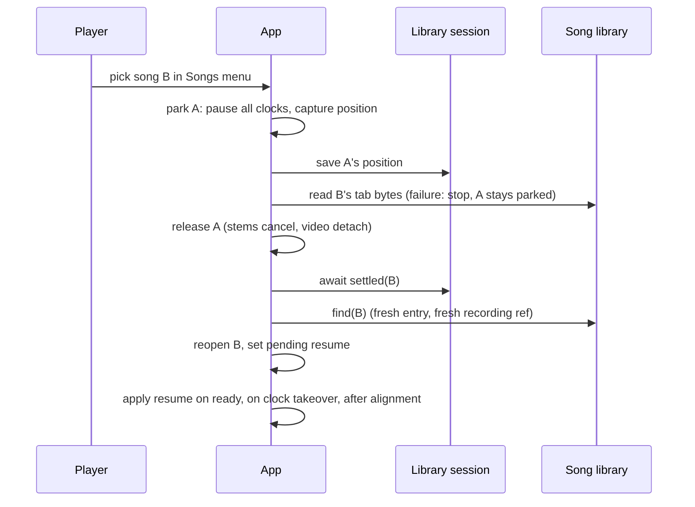

# Song Library Switch Songs - Plan

## Goal Capsule

- **Objective:** While playing a song in the desktop app, a player can switch to any other saved song and back. Each song comes back at the bar the player was on, with its backing track and setup restored and lined up there.
- **Means:** A Songs menu in the player that reuses the saved-songs list, one shared "leave the song" sequence, and a saved bar index on each library entry (KTD1, KTD2, KTD4).
- **Product authority:** RACE-001 (`docs/races/RACE-001-song-library.md`), the SPRINT-01 plan (`docs/plans/2026-11-09-0603-feat-song-library-save-and-reopen-plan.md`) whose behaviour this keeps, and the Key Decisions below. Sprint tracking: `docs/sprints/RACE-001-SPRINT-02-switch-songs.md`.
- **Stop conditions:** Stop and ask before adding a Tauri plugin, a Cargo feature, an npm dependency, or a capability or CSP change.
- **Execution profile:** TypeScript page logic and React UI, plus a small Rust change to the window-close path. Proof is Vitest, `cargo test`, and a manual pass on a packaged desktop build.
- **Tail ownership:** The implementer commits each unit on `feat/song-library` and stops there. Push and PR need the owner's approval.

---

## Product Contract

### Summary

The player gets a Songs menu (desktop only) listing saved songs, with the open song marked. Picking one leaves the current song and opens the picked one through the SPRINT-01 reopen path. Leaving pauses playback, saves the bar the player was on, lets pending saves finish, and releases the recording, stems and video. Reopening a song puts playback at its saved bar, paused.

### Problem Frame

SPRINT-01 lets a player reopen saved songs, but only from the start screen, and every reopen starts at bar 1. Switching between two songs during practice means three clicks per switch, then finding the bar again. The reopen path also assumes it starts from the start screen. Run from inside a live session, it would give the new recording the old song's position and leave the old video playing.

### Requirements

**Switching**

- R1. On desktop, the player has a Songs menu listing the saved songs, newest first, with the open song marked. The web build has no Songs menu.
- R2. Picking another song leaves the current song (R5) and opens the picked one with its tab, backing track and setup restored, as in SPRINT-01.
- R3. Picking the song that is already open does nothing.
- R4. While a recording with video is being captured, the Songs menu's songs are disabled and show why, using the existing recording lock. While stems are being separated, the menu shows "Switching will cancel stem separation", and picking a song cancels the separation and switches.

**Leaving a song**

- R5. Leaving a song pauses playback, saves its position (R7), lets that song's pending saves finish (video offset, source, track and tuning, an in-flight recording copy), and releases its recording, stems and video. Nothing from the left song plays or stays attached afterwards.
- R6. Leaving happens when the player picks another song, uses "Open another file", opens the sample, or drops a file.

**Position**

- R7. A song's position is the played-bar index it was on (repeats expanded). It is saved when the song is left, when playback pauses, and when the window closes. Positions are zero-based bar indexes; reaching the end of the song saves index 0 (bar 1 as the player sees it).
- R8. Reopening a song positions playback at the start of its saved bar, paused. The recording, stems or video are lined up there through the existing alignment.
- R9. A missing or out-of-range position opens at bar 1.

**Failure handling**

- R10. If the picked song's tab can't be read, the player stays on the current song, paused where it was (its position already saved), with a message. A missing recording opens the tab with the SPRINT-01 note.
- R11. If the player picks B and then C before B finishes opening, C opens. Nothing from B is left playing or attached, and B's saved position is unchanged.

### Key Decisions

- **Resume where the player left off.** (session-settled: user-directed — chosen over starting every reopen from bar 1.) Governs R7, R8, R9.
- **Songs menu in the player is the only switcher.** (session-settled: user-directed — chosen over also adding "back to last song" and next/previous shortcuts.) Governs R1, R2.
- **Stem separation: warn, then switch.** (session-settled: user-directed — chosen over blocking the switch or keeping separation running in the background.) Governs R4.
- **Position saved on leave, pause and window close, not continuously.** (session-settled: user-approved — proposed with the tradeoff that a crash mid-play loses the position since the last pause.) Governs R7.
- **"Open another file", the sample and a dropped file count as leaving.** (session-settled: user-approved.) Governs R6.

### Acceptance Examples

- AE1. **Covers R5, R8.** Given song A is playing at bar 37 with a recording, when the player switches to B and back to A, then A opens paused at bar 37's start with the recording lined up there.
- AE2. **Covers R5.** Given the player moved A's video offset a moment before switching, when they come back to A, then the new offset is there.
- AE3. **Covers R8.** Given A's alignment has a hold, when A reopens at a bar after the hold, then tab and recording are both at that bar's start.
- AE4. **Covers R10.** Given B's stored tab was deleted, when the player picks B, then A is still open and paused at the same bar, and a message says B couldn't be opened.
- AE5. **Covers R7.** Given A is paused at bar 12, when the window is closed and the app reopened, then A reopens at bar 12.

### Scope Boundaries

- "Back to last song" and next/previous shortcuts.
- Remembering loop or tempo (deliberately not remembered, SPRINT-01 Scope Boundaries).
- Rename, remove and freeing disk space: SPRINT-03.
- The web build.
- Keeping stem separation running for a song that was left.

### Sources

- Sprint: `docs/sprints/RACE-001-SPRINT-02-switch-songs.md`. SPRINT-01 plan and code on `feat/song-library` (commits `20ad73d`..`e2e879e`).

---

## Planning Contract

### Key Technical Decisions

- KTD1. **One leave function, in two halves.**
  - *Park* runs first:
    1. Invalidate any reopen still running. The exception is a call from `onReopen`, whose own `reopenRuns.begin()` already superseded earlier runs.
    2. Pause every clock, including the YouTube player.
    3. Capture the position (KTD8).
    4. Save it.
  - *Release* tears down: stem auto-start, an in-progress separation, the recording, and the video.
  - The left song's pending writes keep running and are not awaited. They already target that song by hash (KTD3).
  - Every caller parks before anything can fail and releases only once the new song can open:
    - `onReopen` parks A, then reads B's tab. On failure A stays open, paused and saved (R10). On success it releases A.
    - `onFile` and drop parse the new file first. A file that fails to parse leaves A parked and untouched.
    - "Open another file" and `onSample` park and release straight away.

  Governs R5, R6, R10, R11.
- KTD2. **The position is stored as `position`, an optional zero-based bar index on `LibraryEntry`.** The same `tabHash` means the same bytes and the same bars, so an index is stable. File tuning and tempo don't move bars.
  - `isLibraryEntry` accepts it when absent or a non-negative integer, so older entries read as index 0.
  - A position write must not change `openedAt`.
  - The Rust side treats entries as opaque JSON, so backups carry the field with no shell change. A restore overwrites a newer local position (the backup wins), as for every other field.

  Governs R7, R9.
- KTD3. **The library session gains `settled(tabHash)`, which resolves once that song's pending writes finish.** It tracks in-flight promises per song: `latestOnly` video writes, `withSong` writes, the recording copy and position writes.
  - Reopen awaits the target's `settled` and then `library.find(tabHash)`. It reads the recording from that fresh entry, never from the menu's list snapshot. Only the tab bytes, which the hash fixes, are read before that.
  - A→B→A therefore never reads A before A's late writes land.
  - `SongLibrary.serial` stays per call.

  Governs R5, R11.
- KTD4. **Reopen applies a pending resume to whichever clock leads, until it lands.**
  1. The tab step sets a pending resume, tab seconds = `bars[position].startSeconds` (out of range → 0).
  2. The pending resume is applied:
     - to the followed clock when audio becomes ready (a `SynthClock.seek` before ready can be lost);
     - again to a video or stem clock that takes over while it is pending (the YouTube clock copies `own().time()` once, when its player becomes ready);
     - again to the recording clock after `restoreProfile` applies the saved alignment. `UserAudioClock.setAlignment` keeps the recording position unless it is at 0, so an earlier seek would drift.
  3. The pending resume clears when the player seeks or plays, or when the last expected clock has taken it.
  4. `onLoadRecording` takes an explicit start position from the reopen instead of `followedClock`, which can still point at the left song's disposed clock.

  Governs R8.
- KTD5. **Pause saves the position through one effect on the `playing` true→false transition.**
  - It saves only when the tracked open song is the same at the true and false points, and no resume is pending, so a transition that crosses a song change never writes.
  - At the end of the song it saves index 0.
  - The no-op write skip in `SongLibrary.change` keeps repeated pauses at the same bar free.

  Governs R7.
- KTD6. **Window close goes through the shell.**
  1. In `main.rs`, the run loop handles `WindowEvent::CloseRequested` for the main window: it prevents the close, emits `close-requested` to the page, and exits after 2 seconds no matter what.
  2. The page listens through the global `__TAURI__.event` (core:default already includes it; `withGlobalTauri` is true).
  3. The page runs *park*, flushes the profile saver (exiting through the shell may skip `pagehide`), awaits the open song's `settled` with a 1.5-second cap, and calls a new shell command, `app_close_ready`, which exits.

  This needs no plugin or permission. Governs R7, AE5.
- KTD7. **The Songs menu reuses `LibraryList` inside the existing `Menu`.**
  - `Menu` gains an optional `onOpen` callback. The panel shows the last-read list at once, then swaps in a fresh `library.list()`. An empty library shows "No saved songs yet".
  - `LibraryList` gains:
    - a heading/id prop, to avoid the duplicate `library-heading` id;
    - a `currentTabHash` marker; the current row is focusable, has `aria-current`, and does nothing when picked;
    - a notice slot. It shows the recording-lock reason as visible text above disabled rows, or the stem-separation warning.
  - Rows stay enabled while a song opens; only the recording lock disables them (R11).
  - A row click closes the menu, so "Opening <song>…" shows in the player status line until the reopen finishes or fails. Focus returns to the Songs button. A failure uses the player's error line, announced as status.
  - The app tracks the open song's `tabHash` itself, from `openTab`'s result.

  Governs R1, R3, R4, R10.
- KTD8. **Capturing the position.**
  - If the open song has a pending resume, the captured position is that pending index, so leaving a half-opened song keeps its saved bar.
  - Otherwise it is the played-bar index at the followed clock's tab time, or index 0 at the end.
  - The sample or an unsaved tab captures nothing.

  Governs R7, R11.

### High-Level Technical Design

Each step after "pick" checks the reopen token (R11). The window-close path runs park, flushes, waits briefly for `settled`, then calls `app_close_ready`.

---

## Implementation Units

### U1. Position on the song

- **Goal:** Library entries carry a validated position, and the restore plan turns it into a seek.
- **Requirements:** R7, R8, R9 (KTD2, KTD4)
- **Dependencies:** none
- **Files:** `src/app/library.ts`, `src/app/library-session.ts`, `src/app/library-restore.ts`, `tests/app/library.test.ts`, `tests/app/library-session.test.ts`, `tests/app/library-restore.test.ts`
- **Approach:**
  - `isLibraryEntry` accepts an absent `position` or a non-negative integer one.
  - Add `SongLibrary.setPosition(tabHash, index)` through `change`, so `openedAt` is untouched, and a session method `positionChanged(index)`.
  - Add a pure `resumeSeconds(entry, timeline)`. Out of range or missing gives 0.
  - `planRestore` adds a `seek` step after the tab step.
- **Patterns to follow:** existing `setTrackAndTuning` and `restoreTrack` in the same files.
- **Test scenarios:**
  - An entry with `position: 3` validates. `-1`, `1.5` or `"3"` make it invalid. A missing position is valid.
  - `setPosition` writes once, leaves `openedAt` unchanged, and the same index again writes nothing.
  - `open()` keeps an existing position.
  - `resumeSeconds` returns `bars[3].startSeconds` for position 3, and 0 for position 99 or no position (R9).
  - With repeats expanded, position 5 on a tab whose bars 4–7 repeat maps to the fifth played bar.
- **Verification:** The new tests pass.

### U2. Pending-save tracking

- **Goal:** Callers can wait for one song's pending library writes.
- **Requirements:** R5, R11 (KTD3)
- **Dependencies:** U1
- **Files:** `src/app/library-session.ts`, `tests/app/library-session.test.ts`
- **Approach:**
  - Keep a per-song set of in-flight promises, covering `withSong` writes, video `latestOnly` writes, the recording copy and position writes.
  - `settled(tabHash)` resolves when that set drains, including writes added while waiting.
  - Rejections are swallowed, as today.
- **Test scenarios:**
  - `settled` waits for a deferred video write, then resolves.
  - It waits for a deferred recording copy and its `setRecording`.
  - It doesn't wait for another song's writes.
  - A→B→A: A's late `setVideo` lands before a `find(A)` issued after `settled(A)`.
  - With nothing pending it resolves at once. A failed write still settles.
- **Verification:** The new tests pass.

### U3. Leave and reopen from a live session

- **Goal:** One leave sequence used everywhere, and reopen working correctly when a song is already open.
- **Requirements:** R2, R3, R5, R6, R7, R8, R10, R11 (KTD1, KTD3, KTD4, KTD5)
- **Dependencies:** U1, U2
- **Files:**
  - `src/app/App.tsx`
  - `src/app/library-restore.ts` (pure leave and seek decisions)
  - `src/app/use-youtube-backing.ts` (pause or detach the player on leave)
  - `src/app/StemPanel.tsx` (cancel a running separation on leave)
  - `tests/app/library-restore.test.ts`
- **Approach:**
  1. Split leaving into `parkSong()` and `releaseSong()` (KTD1). Callers:
     - the Songs-menu pick (through `onReopen`);
     - "Open another file" and `onSample` (park, then release);
     - `onFile` and drop (parse first, then park and release).

     None of them does anything on the start screen.
  2. Track the open song's `tabHash` and its pending resume (KTD4, KTD8) in refs, set from `openTab`'s result and the tab step.
  3. Picking the open song returns early (R3).
  4. `onReopen` from a live session:
     1. Park A.
     2. Read B's tab bytes. On failure, report the error and stop (R10, AE4).
     3. Otherwise release A, await `settled(B)`, re-read B with `library.find`, read B's recording from that entry, and run the restore.
  5. `onLoadRecording` takes an optional explicit start position, used by reopen.
  6. Apply the pending resume at the three points in KTD4, each guarded by the reopen token. Clear it on a user seek or play.
  7. The pause effect follows KTD5.
- **Patterns to follow:** `reopenRuns`, `sessionToken` and `loadRuns` guards. `runRestore` step ordering.
- **Test scenarios** (pure helpers, since there is no App renderer):
  - `positionToSave(timeline, seconds, atEnd)` gives the played-bar index, and 0 at the end.
  - The park plan's order is invalidate (skipped from `onReopen`), pause, capture, save. Release comes only after B's tab is read.
  - A tab-read failure produces park without release.
  - A file that fails to parse produces park without release.
  - A leave issued while a resume is pending saves the pending index, not 0 (R11).
  - The pause-save decision is false when the open song changed between the true and false points.
  - The resume is re-applied after an alignment with a 2-second offset is set, so the recording clock's `time()` equals `bars[36].startSeconds`.
  - A video clock that takes over before audio is ready still gets the pending resume.
  - The same song produces no-op.
  - Covers AE1. The restore plan for an entry at position 36 seeks to `bars[36].startSeconds` and passes that as the recording's start.
  - Covers AE3. With a hold before bar 36, the seek is tab seconds, so the alignment maps recording time.
  - A superseded reopen (token changed) skips the seek and doesn't write a position for B (R11).
- **Verification:** Tests pass. Manual switch checks in the Verification Contract.

### U4. Songs menu

- **Goal:** The player header gets the Songs menu.
- **Requirements:** R1, R3, R4, R10 (KTD7)
- **Dependencies:** U3
- **Files:** `src/app/LibraryList.tsx`, `src/app/Menu.tsx`, `src/app/App.tsx`, `src/app/app.css`, `tests/app/library-list.test.ts`
- **Approach:**
  - Implement KTD7.
  - Add a `Menu` labelled "Songs" next to "More", desktop only.
- **Patterns to follow:** the "More" menu and `ShortcutLegend`/`TuningChip` menus, and the existing `LibraryList` styles.
- **Test scenarios:**
  - The list marks the current song and its row does nothing.
  - The heading id is unique per instance.
  - Under a record lock the reason shows as visible text and the rows are disabled.
  - The warning text shows while separating, with rows enabled.
  - Rows stay enabled while a song is opening.
  - An empty library shows "No saved songs yet".
  - `Menu`'s `onOpen` fires when the panel opens.
  - No Songs menu on the web (R1).
- **Verification:** Tests pass. A code-level layout check of the menu panel at the app's minimum width.

### U5. Save on window close

- **Goal:** Closing the window saves the open song's position.
- **Requirements:** R7, AE5 (KTD6)
- **Dependencies:** U3
- **Files:** `src-tauri/src/main.rs`, `src/app/desktop.ts`, `src/app/App.tsx`, `tests/app/desktop.test.ts`
- **Approach:**
  - In the Rust run loop, handle `RunEvent::WindowEvent { event: WindowEvent::CloseRequested { api, .. }, .. }` for the main window: call `api.prevent_close()`, emit `close-requested`, and start a 2-second fallback that exits.
  - Add the `app_close_ready` command, which exits.
  - The page registers a listener through a `desktop.ts` helper. It runs park, flushes the profile saver, awaits `settled` with a 1.5-second cap, then invokes `app_close_ready`.
  - Keep `RunEvent::Exit` cleanup unchanged.
- **Execution note:** Mostly platform wiring. Prove it with a packaged-build smoke test (close while paused at a bar, reopen) more than with unit tests.
- **Test scenarios:**
  - The `desktop.ts` listen helper registers through the injected host and returns an unlisten.
  - On the web it does nothing.
  - The close handler calls `app_close_ready` after the save resolves, and also when the save exceeds the cap.
- **Verification:** `cargo test` and Vitest pass. Manual AE5 on a packaged build.

---

## Verification Contract

| Gate | Command or procedure | Applies to |
|---|---|---|
| Unit tests | `npm test` (focused: `npx vitest run tests/app/library*.test.ts tests/app/desktop.test.ts`) | U1–U5 |
| Typecheck and build | `npm run typecheck`, `npm run build` | all page units |
| Rust tests | `cargo test` in `src-tauri/` | U5 |
| Manual: switch | Packaged desktop build. Switch A→B→A while playing, paused, with a recording, with stems, with video only. Check AE1–AE3 | U3, U4 |
| Manual: guards | Switch during a recording with video (blocked), during stem separation (warning, then cancel), B then C quickly (R11), B's tab deleted (AE4) | U3, U4 |
| Manual: close | Close while paused at bar 12, reopen (AE5) | U5 |
| Web regression | Browser dev run: no Songs menu, file drop unchanged | U4 |

Record results in the sprint's evidence table.

---

## Definition of Done

- R1–R11 are each met and checked by a test or a recorded manual procedure.
- Every Verification Contract gate has a recorded result. A check that couldn't run is marked blocked, not passed.
- No new plugin, Cargo feature, npm dependency, capability or CSP change.
- The SPRINT-01 tests still pass. Opening a song from the start screen behaves as before, apart from resuming its saved bar.
- Abandoned approaches and debugging code are removed.
