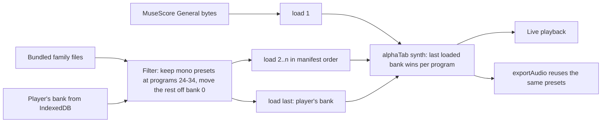
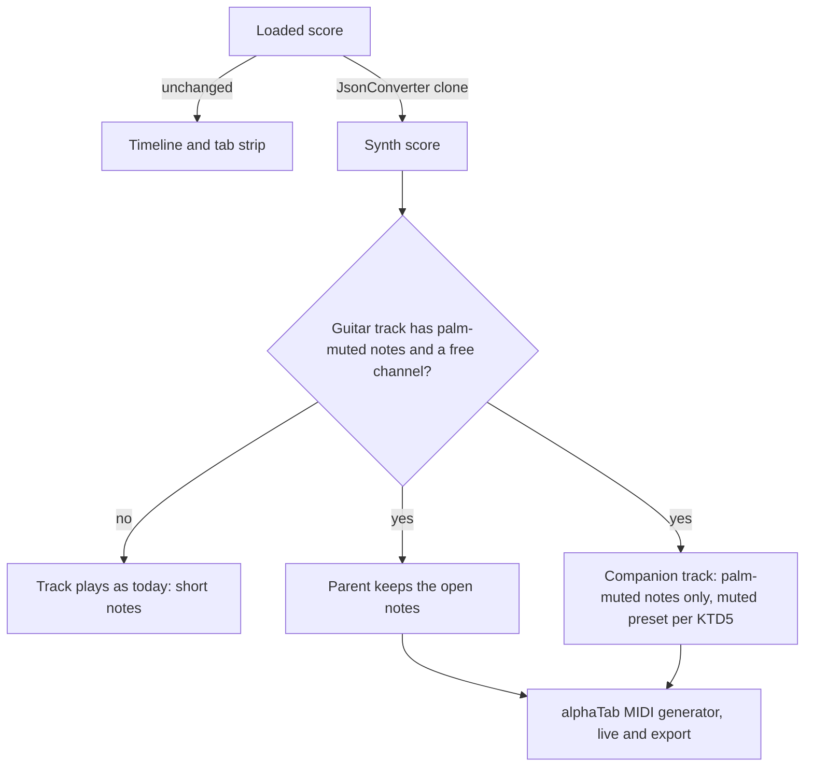

# Realistic Guitar Sounds - Plan

## Goal Capsule

- **Objective:** With no recording loaded, a tab's guitars and bass sound like real instruments rather than General MIDI samples, chugs sound palm-muted, and the player can hear the synth with and without its effects.
- **Means:** Layered sound banks (MuseScore General, then a bundled guitar-and-bass bank, then the player's own) filtered so only mono guitar and bass presets take effect (KTD1, KTD2), palm-muted notes routed to companion parts in a synth-only copy of the score (KTD4), and a bypassable master chain (KTD7, KTD8).
- **Authority:** The Product Contract wins on behavior; the Planning Contract wins on mechanism. This plan covers the guitar sample upgrade and the master-chain cleanup only (U9, choosing the bank family from a Guitar Pro file's sound, was dropped on 2026-11-13); guitar-only amp/cab tone, other articulations, per-song tone profiles and the routing-hook replacement are not active scope (see How This Work Fits Together).
- **Stop conditions:** Stop and ask the user if:
  - No candidate bank passes U4's gate for a covered family. That family then keeps MuseScore General only with the user's agreement.
  - A candidate's licence is GPL, share-alike, non-commercial or of unclear sample provenance.
  - Re-encoding or converting a bank needs a tool that is not installed.
  - The bundled banks would push the first web load past about 70 MB.
  - U9's survey finds no real Guitar Pro file whose sound path disagrees with its MIDI program. U9 then stops and is dropped.
  - U9 needs a zip library and the user has not approved installing one.
- **Execution profile:** Code in the existing Vite/React/alphaTab app. U4 is a decision gate that needs the user's ears; every other unit is ordinary code with unit tests.
- **Tail ownership:** Whoever runs `ce-work` finishes the units and the local checks. Committing, pushing, opening a PR and deploying (a push to `main` deploys the site) each need the user's approval, per `CLAUDE.md`.

Product Contract preservation: requirements, decisions and IDs unchanged. Dependencies / Assumptions and Outstanding Questions were updated in place because research verified the palm-mute assumption and planning resolved most deferred questions. Added 2026-11-13 at the user's request: R16, R17, AE7, KTD11 and U9 (choosing the bank from a Guitar Pro file's own sound). Existing IDs unchanged. Dropped the same day at the user's direction after U9's survey found no file it would change; the IDs are kept and marked dropped.

---

## Product Contract

### Summary

Guitars and bass play from a bundled, freely licensed guitar bank of at most about 30 MB, covering electric (clean, crunch, distortion, muted), acoustic and bass, and a player can load their own SF2/SF3 bank in its place. Palm-muted notes play a real muted sample. The synth's effects gain an on/off switch for comparison, a ceiling that leaves normal levels alone, and export reverb tails that are no longer cut off.

### Problem Frame

The player's complaint is that tab playback "just sounds fake" and they want it more authentic to the track. An outside audit of the desktop build (`TabHighway-audio-review.md`, `Tab Highway  More Realistic Synth Playback.md`, `TabHighway-static-audit.json` at the repo root) listed many possible causes. Checked against the source, the largest are the General MIDI guitar samples in MuseScore General and palm mutes that play as the normal sample cut short. The master chain adds smaller problems: it cannot be switched off, so there is no fair A/B. Its tanh ceiling (`src/audio/synth-effects.ts`) is not drive, but it lifts quiet signals about 3 dB before the makeup gain and squashes peaks, colouring the whole band slightly. Its offline render keeps the input length, so the room tail is cut off at the end of an export.

A synth will not sound like the original recording. Playing along to the recording is already covered by backing tracks and YouTube play-along; this work makes the tab alone sound like a convincing band.

### Key Decisions

- **Guitar samples are the focus, with the master-chain cleanup folded in.** (session-settled: user-directed — chosen over master-chain-only, articulations-first and guitar-only amp tone: "fake" comes mostly from the samples, and the cleanup is needed for a fair comparison.) Governs R1, R11 to R13.
- **Bundle a free bank and let players load their own.** (session-settled: user-directed — chosen over bundle-only and load-your-own-only: free banks cap the default's quality, and a bank you own never leaves your device.) Governs R2, R7 to R10.
- **Electric, muted, acoustic and bass are all covered.** (session-settled: user-directed — chosen over electric-only coverage: every plucked part sits together in the mix.) Governs R1.
- **Palm mutes are pulled forward from the articulation work.** (session-settled: user-directed — chosen over deferring them to an articulation brainstorm: chugs are where a fake guitar is most obvious.) Governs R5, R6.
- **The bundled bank adds at most about 30 MB.** (session-settled: user-directed — chosen over a 10 MB cap, no cap, and a bigger desktop-only bank: room for multi-velocity guitars while first load stays under about 70 MB.) Governs R2.
- **One muted sound for every tone when the bundled bank has no tone-matched mutes.** (session-settled: user-approved — chosen over leaving palm mutes unsampled for those tones: distorted palm-mute samples are rare in free banks.) Governs R6.
- **Every bank is levelled, including one the player loads.** (session-settled: user-approved — chosen over keeping today's fixed per-program gains: those were measured against MuseScore General only.) Governs R4, R10.
- **The ceiling is a clipping guard, not a sound.** It only acts on peaks, so switching effects off changes EQ and room, not loudness. Governs R11, R12.
- **Guitar Pro's own sound picks the bank family; Guitar Pro's engine is not used.** (session-settled: user-directed, 2026-11-13 — chosen over playing Guitar Pro's Realistic Sound Engine, which is proprietary, licensed with Guitar Pro, has no API and cannot be redistributed, and over decoding its amp and effect chain, whose parameters are unlabelled 0–1 values.) Governs R16, R17.
- Carried forward from `docs/plans/2026-10-09-0823-feat-realistic-band-synth-plan.md`: everyone gets the same bundled sound on web and desktop, and the exported audio matches live playback.

### Requirements

**Guitar and bass sound**

- R1. Electric clean, crunch, distortion and muted guitar, steel and nylon acoustic, and fingered and picked bass play from a bank that sounds noticeably more realistic than MuseScore General; every other instrument keeps MuseScore General.
- R2. The bundled bank adds at most about 30 MB to the first load, is licensed for redistribution in the public web app and the desktop app, and is recorded in `THIRD_PARTY_NOTICES.md`.
- R3. Every bundled sound plays in alphaTab without silent or broken notes, and any covered program the bank cannot play falls back to MuseScore General.
- R4. Guitar and bass from the new bank sit at the same level in the mix as today's levelled sounds, and switching Clean, Crunch or Distortion does not jump in loudness.

**Palm mutes**

- R5. A palm-muted note in a clean, crunch or distortion guitar track plays a muted sample instead of the track's normal sample cut short.
- R6. The muted sample matches the track's tone where the active bank has one, and otherwise is one shared muted sound.

**Your own bank**

- R7. A player can load an SF2 or SF3 file from their device, and its guitar and bass sounds replace the bundled ones for the programs it covers.
- R8. A loaded bank stays on the player's device, is still active after the app is reopened, and can be removed to return to the bundled sounds.
- R9. A file that cannot be loaded, or that has no usable guitar or bass sounds, leaves playback on the bundled sounds and tells the player why.
- R10. A loaded bank is levelled per R4.

**Master effects**

- R11. The player can switch the synth's effects off and on during playback, and the change is heard immediately.
- R12. At normal playing levels the effects add no saturation or level change; the ceiling acts only on peaks that would otherwise clip.
- R13. Exported audio keeps the room's tail after the last note instead of cutting it off.

**Live and export together**

- R14. Exported audio uses the same bank, palm-mute samples and effects setting as live playback.
- R15. The tone override, in-song instrument changes, solo, mute, seek, loop and slowed playback work as they do today with the new bank and with a loaded bank.

**Guitar Pro sounds** (dropped 2026-11-13 with U9: the survey found Guitar Pro already writes a matching MIDI program; see the Appendix)

- R16. In a Guitar Pro 7/8 (`.gp`) file, a guitar or bass track whose Guitar Pro sound names a family (clean electric, overdriven or distorted electric, steel or nylon acoustic, bass) plays from that family even when its MIDI program is outside it. Where the program is already in the family, it is kept. The written tone shown in the app matches what plays.
- R17. In-song sound changes follow R16 where they can be matched to alphaTab's instrument changes. Any file, track or sound change that cannot be read or matched plays as it does today, with no message and no failure to open.

### Acceptance Examples

- AE1. **Covers R5, R6.** Given a distortion track with palm-muted chugs and a bundled bank with no distorted muted sample, when it plays, then the chugs use the shared muted sound and the unmuted notes use the distortion sound.
- AE2. **Covers R6, R7.** Given the player has loaded a bank with a distorted palm-mute preset, when the same track plays, then the chugs use that distorted muted sample.
- AE3. **Covers R9.** Given the player loads a bank that contains only pianos, when loading finishes, then they are told it has no guitar or bass sounds, and playback still uses the bundled guitars.
- AE4. **Covers R8.** Given a loaded bank, when the app is closed and reopened, then that bank is still active; when the player removes it, then the bundled sounds return.
- AE5. **Covers R11, R14.** Given effects are switched off, when the player exports, then the exported audio has no EQ or room, matching what they heard.
- AE6. **Covers R13.** Given a song ending on a ringing chord, when it is exported with effects on, then the room's decay is heard after the chord instead of stopping abruptly.
- AE7. **Covers R16, R17.** Given a `.gp` file whose lead track's Guitar Pro sound is "Distortion Guitar" but whose MIDI program is 27 (clean), when it plays, then it uses the distortion sound and the tone control shows Distortion. Given a `.gp5` or MusicXML file, or a `.gp` file with an unreadable `score.gpif`, the tab opens and plays as it does today.

### Success Criteria

- On tabs covering clean picking, distorted palm-muted chugs, acoustic strumming and a bass line, the player judges the new build more authentic than the current build, compared at matched loudness with effects off in both.
- First load on the web, with no cache, stays under about 70 MB in total.

### Scope Boundaries

- Guitar-only amp and cabinet processing.
- Bends, slides, legato, vibrato, harmonics and picking dynamics; only palm mutes are in scope.
- Per-song tone and mix profiles.
- Replacing the private alphaTab routing hook used for live effects.
- Instruments other than guitar and bass.
- Recording playback and stems, which are unchanged.
- Playing Guitar Pro's Realistic Sound Engine, its sound banks, or anything derived from them.
- Reading Guitar Pro's amp, pickup and effect-chain settings (`<RSE>` inside each sound) as tone. U9 reads only the sound's name and path.
- Guitar Pro 6 (`.gpx`) and earlier formats. `.gpx` uses a compressed container whose reader alphaTab does not export; GP3–5 and MusicXML carry no Guitar Pro sound path.

### Deferred to Follow-Up Work

- A reverb tail on loop-range exports. They are cut from the full render and end where the loop ends (KTD9).
- Upgrading alphaTab past 1.8.4. Several mechanisms here read alphaTab behavior verified only in 1.8.4 (see Risks & Dependencies).
- Playing the audio a Guitar Pro 8 file can embed. alphaTab reads it into `score.backingTrack` and can play it in sync (`PlayerMode.EnabledBackingTrack`), but nothing in `src/` uses it. It belongs with backing tracks, not this plan.

<!-- ce-section: work-relationships -->
### How This Work Fits Together

This plan covers better guitar and bass samples plus the master-chain cleanup. The other areas below are the current understanding from the audit, not a committed roadmap.

- Articulation realism (bends, slides, legato, vibrato, picking dynamics). Shares the companion-part routing U6 introduces. Can proceed independently of this plan.
- Guitar-only amp and cabinet tone, rendering guitars separately from the band. Depends on R11 and R12 for a dry baseline to compare against. Still to decide whether it is worth the re-render cost on tempo changes (noted in the 2026-10-09 plan's U5).
- Per-song tone and mix profiles. Shares the saved-song setup from RACE-001 (`docs/races/RACE-001-song-library.md`).
- Replacing the private routing hook. Can proceed independently; no change to the sound.

### Dependencies / Assumptions

- alphaTab 1.8.4 loads only mono samples. Stereo-linked samples are skipped and their regions play silence (`node_modules/@coderline/alphatab/dist/alphaTab.core.mjs`, `loadPresets`). MuseScore General's stereo pianos are already substituted in `src/audio/font-substitutes.ts`.
- Verified: alphaTab plays a palm-muted note as the track's normal program with a fixed short duration. Velocity and program are unchanged (`MidiFileGenerator._getNoteDuration`).
- Today's guitar gains in `src/audio/track-balance.ts` were measured against MuseScore General, for programs 24 to 31 only; bass is not levelled.
- The synth effects are always on live (`installLiveEffects(api)` in `src/audio/synth-bridge.ts`), and `renderWithEffects` in `src/audio/synth-effects.ts` renders only the input's length.
- Verified (2026-11-13, alphaTab 1.8.4 `GpifParser._parseSound`): alphaTab reads each `.gp` sound's name, path and role into an internal `GpifSound` and keeps only its MIDI program and bank on `track.playbackInfo`. The name and path never reach the public model, and the `<RSE>` block inside a sound is not parsed. The track-level `<RSE><ChannelStrip>` gives only volume and balance.
- Verified on `dev/local/ozzy.gp` (Guitar Pro 8.1.3): a `.gp` file is a zip holding `Content/score.gpif`. Each track's `<Sounds><Sound>` has `<Name>`, `<Path>` (e.g. `Stringed/Electric Guitars/Distortion Guitar`, `Stringed/Basses/Clean Bass`), `<Role>` and `<MIDI><Program>`. In-song changes are `<Automation><Type>Sound</Type>` with `<Bar>`, `<Position>` and a value of `path;name;role`. In that file every guitar and bass program already matched its path, so it shows no gain from R16.
- Assumption: Guitar Pro's factory sound paths for other families follow the same `Stringed/<group>/<sound>` shape. U9's survey confirms or corrects the path table.
- Assumption: candidate banks are FreePats CC0 banks (clean electric "small", clean bass finger and pick, distorted electric re-encoded to fit). No clean-licence bank with tone-matched palm mutes was found, so R6's shared muted sound is expected for the bundled bank.

### Outstanding Questions

**Resolve Before Planning**

- None.

**Resolve Before U9**

- Resolved 2026-11-13 (user-directed): unzip with `fflate`'s synchronous `unzipSync`, so `openTabBytes` stays synchronous and `src/app/App.tsx` needs no change. Pinned to exactly `0.8.3`: 0.8.0–0.8.2 can loop forever on a malformed ZIP64 archive in `unzipSync` (GHSA-px8p-9vwx-vf98). Read only `Content/score.gpif`, through `unzipSync`'s `filter`, and refuse it above a size cap before inflating. Moot since U9 was dropped: `fflate` was uninstalled the same day, and the dev survey uses Node's `zlib`.

**Deferred to Implementation**

- Which candidate banks pass U4's gate for each family, and their final encoded sizes.
- The full path-to-family table, from the paths U9's survey finds.
- Whether loading your own bank becomes a Pro feature. Pro gating is off for now (`src/app/tier.ts`), so this waits for that decision.

### Sources / Research

- Audit inputs: `TabHighway-audio-review.md`, `Tab Highway  More Realistic Synth Playback.md`, `TabHighway-static-audit.json` (repo root, untracked).
- Prior synth plan and its effects gate result: `docs/plans/2026-10-09-0823-feat-realistic-band-synth-plan.md`.
- alphaTab 1.8.4 source, read directly: bank priority (`TinySoundFont._getPresetIndex` scans from the end), `resetSoundFonts`, `exportAudio` reusing live presets, `api.midiLoad` not firing for export, `JsonConverter.scoreToJsObject` / `jsObjectToScore`.
- alphaTab multiple sound banks: https://www.alphatab.net/docs/guides/multiple-soundfonts/
- FreePats CC0 banks: https://freepats.zenvoid.org/ElectricGuitar/clean-electric-guitar.html, https://freepats.zenvoid.org/ElectricGuitar/distorted-electric-guitar.html, https://freepats.zenvoid.org/ElectricGuitar/clean-electric-bass.html. The steel acoustic bank (https://freepats.zenvoid.org/Guitar/steel-acoustic-guitar.html) is GPLv3+ with an exception and needs the user's licence decision. GeneralUser GS has a custom licence with a sample-provenance disclaimer; treat it as risky.
- Guitar Pro sound data in alphaTab 1.8.4: `GpifParser._parseSounds`, `_parseSound`, `_parseRSE`, `_parseAutomation` (`case "Sound"`) and `_parseBackingTrackNode` in `node_modules/@coderline/alphatab/dist/alphaTab.core.mjs`; `PlaybackInformation`, `Automation` and `BackingTrack` in `alphaTab.d.ts`.

---

## Planning Contract

### Key Technical Decisions

- KTD1. **Banks layer in a fixed order: MuseScore General, then the bundled guitar banks, then the player's bank.** alphaTab resolves a bank/program from the last-loaded bank, so this order gives R1, R3 and R7 with no merge step. Every source's bytes are fetched first. All `loadSoundFont` calls (append false, then true) are then posted back to back before `renderScore` loads the score's MIDI. That gives one ready event covering every bank: in alphaTab 1.8.4 each load after the MIDI is in rebuilds the presets and fires ready again. Adding or removing the player's bank rebuilds the synth session through the existing retry path in `src/app/App.tsx`, rather than calling `resetSoundFonts` on a live player. Governs R1, R3, R7, R8.
- KTD2. **Every bank after MuseScore General is filtered before loading.** The filter writes a copy of the bytes with three kinds of preset:
  - **Kept:** presets at bank 0, programs 24 to 34, whose zones all reference mono samples. They stay where they are.
  - **Muted candidates:** presets whose name matches KTD5's rule and whose zones are all mono. Each moves to a bank number reserved for its layer, unique across the bundled files and the player's bank. Its bank and program are recorded in the filter report, and for bundled files in the manifest.
  - **Disabled:** every other preset is moved off bank 0 and its preset bags are emptied, so it can neither shadow MuseScore General nor make alphaTab decode its samples. alphaTab decides what to decode by program number alone, ignoring the bank.
  - alphaTab does not export its SoundFont parser, so this needs a small parser of our own. It reads the preset headers, bags and generators, and the `sampleType` field of the sample headers. The same report also lists what the bank covers, for R9's message.
  - Governs R3, R6, R7, R9.
- KTD3. **Bundled banks ship as small files, one per family, described by a manifest.** The manifest lists each file, the programs it covers, its muted preset per tone, and its measured levels. Files are Vite `?url` asset imports in `assets/soundfont/`, like MuseScore General. The SoundFont cache prunes only entries not in the current list of bundled URLs; today any other key is deleted. Governs R2, R3.
- KTD4. **Palm mutes play from companion parts in a synth-only copy of the score.** (session-settled: user-approved — chosen over rewriting MIDI in `api.midiLoad`, which export never fires, and patching alphaTab's private channel choice: both live playback and export generate MIDI from the score alphaTab holds.)
  - The synth gets a clone of the loaded score, made with alphaTab's `JsonConverter`. The timeline and the tab strip keep the original.
  - Each guitar track with palm-muted notes gets a companion track holding only those notes. The parent stops sounding them.
  - The companion starts as a full copy of the parent track; its open notes are then removed, and the palm-muted notes are removed from the parent. Bars, beats and tempo stay identical, so the two cannot drift. Beats left empty play as rests.
  - The companion's `playbackInfo` program and bank, and every Instrument and Bank automation copied from the parent, are rewritten to the muted preset for that segment's program per KTD5. Its written sound is therefore the muted one, and in-song instrument changes carry over.
  - Channels are allocated after alphaTab's `Score.finish`. Each companion gets one unused channel as both its primary and secondary channel, never a parent's channel, drawn from 0 to 15, excluding 9 (drums) and any channel the score already uses. alphaTab's metronome channel (16) is never used.
  - When no free channel is left, the remaining parts keep today's shortened palm mutes.
  - Companions are appended after all real tracks, so track indices used by tones, balance and the play-along silent track stay valid.
  - One parent index map drives everything index-based to the companions: the tone override, the play-along silent track, and `exportAudio`'s `onlyTrack` and silent-track volumes.
  - A companion's level gain comes from KTD6's table for its own preset, as `applyBalance` and `exportAudio` already compute from `playbackInfo.program`; only the file's own track volume follows the parent.
  - Governs R5, R6, R14, R15.
- KTD5. **The muted preset comes from the active bank, and only for the three tones.**
  - When the companion's segment is on a tone program (27, 29 or 30, per `toneOfProgram`), it plays the muted candidate recorded for that tone at its reserved bank and program (KTD2).
  - Candidates come from the player's bank first, then the bundled manifest. A player's preset is a candidate for a tone when its name contains "mute" or "palm" plus the tone's word: clean; crunch or overdrive; dist.
  - With no candidate for that tone, it plays program 28 at bank 0, which per KTD1 comes from the highest bank that covers it.
  - Any other parent program (nylon, steel, jazz, harmonics) plays the parent's own program, so those palm mutes sound as they do today.
  - Governs R5, R6, R15.
- KTD6. **Levels are measured by rendering one fixed reference riff through each covered program.** The riff is played alone and its RMS is targeted to the level `src/audio/track-balance.ts` uses today.
  - Bundled banks: a dev script measures the levels and the manifest stores them, the way the current table was made.
  - A player's bank: measured once when loaded and stored with the bank. The riff's MIDI is rendered through alphaTab's worker audio exporter (`uiFacade.createWorkerAudioExporter`) with MuseScore General plus that filtered bank as its `soundFonts`, independent of the song being played.
  - Bass (programs 32 to 34) is levelled from now on.
  - Governs R4, R10.
- KTD7. **The effects switch is a bypass inside the chain, not a reinstall.** The chain gains a dry path and a processed path with gains crossfaded over a few milliseconds, so toggling during playback neither clicks nor rebuilds the graph. The choice persists like `src/app/neck-cues-setting.ts`. Export follows it, while alignment keeps passing `effects: false`. Governs R11, R14.
- KTD8. **The ceiling is linear below a knee and soft-clips only above it.** Below the knee, output equals input. The makeup gain is retuned so the effects-on and effects-off paths match in loudness on a normal mix. Governs R12.
- KTD9. **Exports end with the room's tail.** alphaTab's exporter stops every voice at the sequence end. So the full-song export renders from the synth score with one empty bar appended, letting the last notes' release ring, and is trimmed to the tab length plus `roomSeconds`. `renderWithEffects` then renders that whole length. The full-song audio export keeps the extra length. The video export extends by the same length and holds the last frame, while loop-range exports still cut from the full render and end at the loop. (session-settled: user-approved — chosen over fading the audio at the tab's end: a fade still cuts the room.) Governs R13.
- KTD10. **A player's bank is stored in IndexedDB on web and desktop, using the pick-photo store pattern.** The record holds the original file's name and bytes, plus the filter report and measured levels, so neither is recomputed on reopen. Files over 512 MB are refused with a message, and the desktop shell needs no Rust change. Governs R8, R9.
- KTD11. **A `.gp` file's sound paths correct the loaded score's programs at open, by family only.**
  - We read `Content/score.gpif` from the file bytes ourselves, since alphaTab discards the sound path. A pure reader in `src/model/gp-sounds.ts` returns, per track in file order, its sounds (name, path, program) and its Sound automations (bar, position, value). It does not import alphaTab.
  - A path maps to a family through one table: clean electric {26, 27}, overdriven or distorted electric {29, 30}, steel acoustic {25}, nylon acoustic {24}, bass {32, 33, 34}. A family's default is its first tone program (27, 30, 25, 24) or, for bass, 34 when the name contains "pick" and otherwise 33. Unknown paths, drums and non-guitar sounds are ignored.
  - If a track's program is already in its sound's family, nothing changes, so a picked bass whose path is "Clean Bass" keeps 34. Otherwise `playbackInfo.program` is set to the family default.
  - In-song changes: each matching alphaTab Instrument automation (same bar, same position, file order) is corrected the same way. If the counts or positions do not line up for a track, that track's automations stay as written (R17).
  - This runs on the score before `buildTimeline`, so the timeline, the tone control, the synth copy (KTD4) and export all see one program. `substituteUnplayablePrograms` runs after it, as today.
  - Any failure (not a zip, no `score.gpif`, malformed XML) returns no corrections; the file opens exactly as today.
  - Governs R16, R17.

### High-Level Technical Design

How bank bytes reach the synth, live and in export alike:

How palm mutes reach a muted preset:

The diagrams illustrate KTD1, KTD2 and KTD4; the KTD text is authoritative.

### Implementation Constraints

- Nothing under `src/render` imports alphaTab, and `src/model` stays the only wrapper of alphaTab output for the UI. The synth-only score copy lives in `src/audio`.
- User files stay on the device. The app makes no requests to Songsterr and never downloads YouTube audio.
- Pro gating stays forced on in `src/app/tier.ts`.
- Installing a tool, such as Polyphone or an SF2 converter, needs the user's approval first.

### Risks & Dependencies

| Risk | Mitigation |
|---|---|
| Several mechanisms depend on alphaTab 1.8.4 internals: last-bank-wins, `exportAudio` reusing live presets, and the private output context. `package.json` allows `^1.8.4`. | Pin `@coderline/alphatab` to exactly 1.8.4 in this work. Tests in U1 and U6 assert the behavior, so an upgrade fails loudly. |
| No bundled distorted bank fits 30 MB at better quality than MuseScore General. | U4 stops and asks. Distortion keeps MuseScore General with the user's agreement. |
| A song uses all 16 MIDI channels. | KTD4 falls back to today's behavior per part. U6 tests the fallback. |
| Stacked banks slow every MIDI reload, since alphaTab re-decodes the used programs on each load. | U4 records load and reload times on the desktop app. Filtering limits each extra bank to programs 24 to 34. |
| Desktop installer grows by up to 30 MB. | U4 checks the size against the budget. |
| With no bundled muted bank, the shared muted sound is MuseScore General's General MIDI muted guitar, which may still sound fake under a distorted parent. | U4's listening check includes palm-muted distortion. If the result fails by ear, stop and ask before shipping the palm-mute change. |
| The `JsonConverter` clone drops something alphaTab's MIDI generator reads, or is slow on large scores. | U6 tests compare MIDI generated from the original and from a clone with no palm mutes, which must be event-for-event identical, and time the clone on the largest fixture. |
| An unusual SoundFont crashes our parser. | The parser rejects anything it does not understand, and a rejected file is reported per R9 rather than loaded. |
| R16 changes nothing in practice, because Guitar Pro already writes a matching MIDI program for its sounds. | U9 starts with a survey of real files and stops if none disagree. |
| A wrong path match swaps a part to the wrong family, which is worse than today. | Corrections apply only across families, never within one; unknown paths are ignored; the tone control still lets the player override. |
| Reading the zip slows opening a large file. | `score.gpif` is the only entry read; U9 times it on the largest `.gp` fixture. |

### System-Wide Impact

- **Export paths:** the audio export, the video export, loop-range exports and the alignment render all go through `SynthClock.exportAudio`. The effects setting, the tail, and companion mapping change. The per-track alignment render (`onlyTrack`) must keep the viewed track's companions audible, and alignment stays effects-off.
- **Session rebuilds:** song switching from RACE-001 and retry both rebuild the synth session. The synth-score copy and bank list have to be rebuilt the same way.
- **Play-along:** the silent track for the player's part must silence its companion too, or the player hears their own palm mutes.
- **First-load size and caching** on GitHub Pages and in the desktop webview.

---

## Implementation Units

### U1. Layered bank loading and cache

- **Goal:** The synth session loads an ordered list of banks, with combined progress, and the cache keeps every current bundled file.
- **Requirements:** R2, R3, R7; KTD1, KTD3.
- **Dependencies:** None.
- **Files:**
  - `src/audio/soundfont-cache.ts`
  - `src/audio/synth-bridge.ts` (`SynthOptions`, `createSynthSession`)
  - `src/audio/bank-manifest.ts` (new)
  - `src/app/App.tsx` (`connectAudio`)
  - `package.json` (pin alphaTab)
  - `tests/audio/soundfont-cache.test.ts`
  - `tests/audio/synth-banks.test.ts` (new)
- **Approach:**
  1. Replace the single `soundFontUrl` with an ordered list of bank sources (URL or bytes).
  2. Fetch all sources, then post the loads in order per KTD1 (MuseScore General with `append` false, the rest with `append` true) before calling `renderScore`.
  3. Report progress across all URL sources, weighted by bytes.
  4. Change pruning to delete only cache keys not in the list of current bundled URLs.
  5. Start the manifest with MuseScore General alone, so behavior is unchanged until U4 adds files.
- **Patterns to follow:** `loadSoundFontBytes` and its injected `SoundFontEnv`; the fake api in `tests/audio/synth-tones.test.ts`.
- **Test scenarios:**
  - Two bundled URLs are cached; loading the first does not evict the second.
  - An old build's URL not in the list is pruned.
  - Sources are passed to `loadSoundFont` in list order, with `append` false then true, all before `renderScore`.
  - `ready` resolves only after the last source is loaded, not after MuseScore General alone.
  - A failed second source rejects `ready` and the existing Retry notice appears.
  - Progress reaches 100% only when every URL source has downloaded.
- **Verification:** With only MuseScore General in the manifest, playback and export are unchanged and every existing test passes.

### U2. Bank inspection and filtering

- **Goal:** A pure function reads SF2/SF3 bytes, reports which guitar and bass programs it can play and with what preset names, and returns filtered bytes per KTD2.
- **Requirements:** R3, R7, R9; KTD2.
- **Dependencies:** None.
- **Files:**
  - `src/audio/soundfont-inspect.ts` (new)
  - `tests/audio/soundfont-inspect.test.ts` (new)
  - `tests/fixtures/soundfonts.ts` (new: builds tiny synthetic SF2 byte arrays in code)
- **Approach:**
  1. Walk the RIFF chunks, then read preset headers, preset bags and generators down to the instruments' sample IDs, and the sample headers' `sampleType`.
  2. Treat SF3 (Ogg-flagged) mono samples as mono.
  3. Write a copy with kept, muted-candidate and disabled presets per KTD2. Only the preset headers and preset bags change; sample data is untouched.
  4. Return a report: covered programs, rejected programs with the reason (stereo, missing), preset names, and each muted candidate's tone and reserved address.
- **Patterns to follow:** `isWholeSoundFont` in `src/audio/soundfont-cache.ts` for RIFF checks.
- **Test scenarios:**
  - A bank with mono presets at programs 27 and 33 reports both as covered and leaves them at bank 0.
  - A stereo-only preset at program 30 is reported as rejected (stereo) and moved off bank 0.
  - A piano at program 0 and a drum kit at bank 128 are moved off bank 0 and bank 128, and no sample-ID generator is reachable from them in the copy.
  - A mono preset named "Dist Palm Mute" becomes a distortion muted candidate at its layer's reserved bank; a stereo one of the same name is rejected.
  - A piano-only bank reports no covered programs. Covers AE3.
  - Truncated or non-RIFF bytes return a failure, not an exception.
  - The filtered copy still passes the RIFF size check, and its sample data is byte-identical.
  - Integration: filtered bytes load into a real alphaTab synth in node, which plays the kept program and not the moved ones, if the synth can run in node. Otherwise this check moves to U4's dev page.
- **Verification:** The report matches what Polyphone shows for one real FreePats bank, checked by hand in U4.

### U3. Effects switch and transparent ceiling

- **Goal:** The player can turn the synth's effects off and on during playback, the ceiling leaves normal levels alone, and export follows the setting.
- **Requirements:** R11, R12, R14; KTD7, KTD8.
- **Dependencies:** None.
- **Files:**
  - `src/audio/synth-effects.ts`
  - `src/audio/synth-bridge.ts`
  - `src/app/effects-setting.ts` (new)
  - `src/app/App.tsx` (switch in the existing More menu)
  - `tests/audio/synth-effects.test.ts`
  - `tests/audio/synth-export-effects.test.ts`
  - `tests/app/effects-setting.test.ts` (new)
  - `dev/soundfont-compare.ts`
- **Approach:**
  1. The chain exposes a setter that crossfades its dry and processed gains.
  2. `installLiveEffects` returns that setter alongside the remover.
  3. The ceiling curve is identity below the knee and soft-clips above it.
  4. Add an effects on/off toggle and an RMS readout to `dev/soundfont-compare.ts`. Use them to retune the shipped makeup default in `DEFAULT_EFFECTS` (today −3 dB, which offset the old curve's lift) so effects-on matches effects-off on a normal mix.
  5. `exportAudio` defaults its effects option from the setting; alignment's explicit `false` stays.
  6. The More menu control is a label-wrapped checkbox with `role="switch"`, named "Synth EQ and room", so the menu stays open for repeated A/B flips (`Menu` closes only on buttons and links). Add it to the menu's `ariaLabel`.
- **Patterns to follow:** `src/app/neck-cues-setting.ts`; `FakeContext` in `tests/audio/synth-effects.test.ts`.
- **Test scenarios:**
  - The ceiling curve returns its input unchanged below the knee and stays under full scale for any input.
  - Toggling off ramps the processed gain to 0 and the dry gain to 1 over the crossfade, without rebuilding nodes.
  - The setting reads 'on' by default, survives a reload, and a failed write leaves the toggle working for the session.
  - Toggling the More menu switch does not close the menu.
  - With effects off, export skips `renderWithEffects`. Covers AE5.
  - Alignment export stays effects-off when the setting is on.
- **Verification:** In the dev page, toggling during playback is click-free and loudness is matched by ear.

### U4. Bank audition gate and bundling

- **Goal:** The user picks the bundled bank for each family by ear, and the chosen files ship with notices, inside the size budget.
- **Requirements:** R1, R2, R3; KTD3; Success Criteria.
- **Dependencies:** U1, U2, U3, U5.
- **Files:**
  - `dev/soundfont-compare.ts` and `dev/soundfont-compare.html` (layered sets, effects off)
  - `dev/measure-bank-levels.ts` (run on each candidate)
  - `scripts/` (re-encode helper only if a tool is approved)
  - `assets/soundfont/` (chosen files and licence files)
  - `src/audio/bank-manifest.ts`
  - `THIRD_PARTY_NOTICES.md`
- **Approach:**
  1. Measure today's no-cache first-load total from `npm run build` output. The bank budget is the smaller of 30 MB and 70 MB minus that baseline; current assets suggest about 23 MB. Record both figures.
  2. Extend the dev compare page to play the same passage through "MuseScore General" and "MuseScore General + candidate bank", using U3's effects-off toggle. Level each candidate with U5's measurement, so the A/B is at matched loudness.
  3. Fetch candidates into the gitignored `dev/local/`.
  4. For each family, check licence, mono status with U2's report, encoded size and sound, and record the result and timings as a "U4 gate result" note in an `## Appendix` of this plan, as the 2026-10-09 plan did for its gate.
  5. Stop per the Goal Capsule on licence, tooling or size.
  6. Add the chosen files, their muted-candidate addresses and their measured levels to the manifest, with one notice entry per file.
- **Execution note:** This is a listening and packaging gate. Prove it with the user's A/B judgement, a web build size check, and a desktop build smoke run, not unit tests.
- **Test expectation:** none beyond U1's manifest tests. This unit adds assets and data.
- **Verification:**
  - The user prefers each bundled family over MuseScore General.
  - `npm run build` output keeps the total first load under about 70 MB.
  - Clean to Distortion on a bundled bank has no loudness jump, by ear.
  - The desktop build plays a tab with the new banks.

### U5. Levelling every bank

- **Goal:** Guitar and bass from any bank sit at today's mix level, and tone switches do not jump.
- **Requirements:** R4, R10; KTD6.
- **Dependencies:** U1. U4 then uses this unit to level candidates and fill the manifest.
- **Files:**
  - `src/audio/track-balance.ts`
  - `src/audio/bank-levels.ts` (new: reference riff and RMS measurement)
  - `dev/measure-bank-levels.ts` (new)
  - `src/audio/bank-manifest.ts`
  - `tests/audio/track-balance.test.ts`
  - `tests/audio/bank-levels.test.ts` (new)
- **Approach:**
  1. `programGain` takes a level table supplied by the active banks, highest bank first, instead of the fixed table.
  2. MuseScore General keeps today's numbers.
  3. The reference riff is a fixed short score built in code.
  4. Measurement renders it per program and returns RMS.
- **Patterns to follow:** the existing `GUITAR_LEVELS` comments; `applyBalance` in `src/audio/synth-bridge.ts`.
- **Test scenarios:**
  - With only MuseScore General levels, gains equal today's values for programs 24 to 31.
  - A player's bank covering 30 overrides the bundled level for 30 only.
  - Bass programs 32 to 34 get a gain from the table, and others stay 1.
  - Gains stay clamped to 0.3 to 4.
  - The RMS of a known sine buffer matches the expected value.
- **Verification:** Measuring MuseScore General with `dev/measure-bank-levels.ts` reproduces today's table for programs 24 to 31 within rounding.

### U6. Palm-mute companion parts

- **Goal:** Palm-muted notes in clean, crunch and distortion guitar tracks play a muted preset, live and in export.
- **Requirements:** R5, R6, R14, R15; KTD4, KTD5.
- **Dependencies:** U1, U2, U5.
- **Files:**
  - `src/audio/synth-score.ts` (new: clone, companions, channel allocation, parent mapping)
  - `src/audio/synth-bridge.ts` (`createSynthSession`, `setTrackPrograms`, `setSilentTrack`, `applyBalance`, `exportAudio`)
  - `src/audio/guitar-tone.ts` (muted preset per tone)
  - `tests/audio/synth-score.test.ts` (new)
  - `tests/audio/synth-tones.test.ts`
  - `tests/audio/synth-play-along-tones.test.ts`
- **Approach:**
  1. Build the synth score once per session from the loaded score.
  2. Run `substituteUnplayablePrograms` on the copy, not the original.
  3. Build companions and allocate their channels per KTD4.
  4. Route the tone override, silent track and `exportAudio`'s `onlyTrack` and silent-track volumes to companions through the parent index map. Companions are never reset to a written parent sound by `setTrackPrograms`.
  5. Whenever tones change, re-derive each companion's program and bank per KTD5 from its parent's new program.
- **Execution note:** Start with real-alphaTab MIDI generation tests from the `TECHNIQUES` fixture (`tests/fixtures/fixtures.ts`, `5.3{pm}`), before wiring the session.
- **Test scenarios:**
  - Covers AE1. A distortion track with palm-muted notes yields a parent without them and a companion on a new channel playing the shared muted preset; open notes stay on the parent at 30.
  - Covers AE2. With a player's bank naming a distorted palm-mute preset, the companion plays that preset.
  - Switching the parent from Distortion to Clean re-sets the companion to the clean muted preset or the shared one.
  - A track with no palm mutes gets no companion.
  - A chord beat mixing palm-muted and open strings splits so each note sounds exactly once, open notes on the parent and muted notes on the companion, at the same tick.
  - A score with no palm mutes generates MIDI identical to the original's.
  - Setting the parent as the play-along silent track silences its companion, live and in export.
  - An `onlyTrack` export of a palm-muted track records its companion at non-zero volume.
  - A Guitar Pro fixture whose guitar track has a beat-1 Instrument automation and a mid-song change from clean to distortion gives a companion playing the clean muted preset, then the distortion one.
  - A parent with a bent note and palm mutes keeps the bent note on its own program and channel.
  - A steel-acoustic (25) track's palm mutes keep program 25.
  - A distortion parent's companion gets the muted preset's level gain, not the distortion gain.
  - A score with no unused channel in 0 to 15 (excluding 9) gets no companions and keeps today's short notes.
  - The original score's tracks and notes are untouched, so the timeline is unchanged.
  - `exportAudio` sees the companion: the export spy records it with its program.
- **Verification:** On the dev page, chugs audibly use the muted sample in both live playback and the exported WAV.

### U7. Load your own bank

- **Goal:** A player loads an SF2/SF3 file, it replaces the bundled guitar and bass it covers, persists across restarts, and can be removed.
- **Requirements:** R7, R8, R9, R10; KTD1, KTD2, KTD6, KTD10.
- **Dependencies:** U1, U2, U5, U6.
- **Files:**
  - `src/app/user-bank-store.ts` (new)
  - `src/app/UserBankControl.tsx` (new, in the More menu)
  - `src/app/App.tsx`
  - `tests/app/user-bank-store.test.ts` (new)
  - `tests/audio/user-bank.test.ts` (new: inspection-to-session flow with fakes)
- **Approach:**
  1. On pick, inspect and filter (U2); measure levels (U5); store bytes, report and levels; rebuild the session (KTD1).
  2. On remove, clear the store and rebuild.
  3. Messages appear in the header notice area with Dismiss, like the library notice. They name what the bank covers by sound family (e.g. "Clean electric, Picked bass"), or why it was refused: unreadable, no guitar or bass, too large.
  4. A stored bank that fails to load at startup is skipped but not deleted. Its notice names the file, says bundled sounds are playing, and offers "Remove it" and Dismiss.
  5. The More menu control has four states. Idle shows "Guitar sounds: Bundled" and a label-wrapped "Load your own SF2/SF3…" file input. Loaded shows the file name, its covered families and a "Use bundled sounds" button. Processing disables the input and shows "Checking your sound bank…". Failed shows "could not be loaded" with the same remove action.
  6. A load or remove pauses playback, keeps the playhead position, and shows the existing "Loading sound…" notice during the rebuild.
- **Patterns to follow:** `src/app/pick-photo-store.ts` and its in-memory test backend; the file input in `src/app/NeckCalibration.tsx`.
- **Test scenarios:**
  - Covers AE3. A piano-only bank is refused with a "no guitar or bass sounds" message, nothing is stored, and the session is not rebuilt.
  - A bank covering 27 and 33 is stored, and the next session's bank list ends with it.
  - Covers AE4. After a restart (a new store instance on the same backend) the bank is active, and remove restores the bundled list.
  - A file over 512 MB is refused before it is read in full.
  - With no IndexedDB available, loading still works for the session, and the player is told it won't be remembered.
  - Truncated bytes in the store at startup give a skipped-bank message, and bundled playback continues; choosing "Remove it" clears the store.
  - Loading a bank while playing pauses, rebuilds, and resumes from the same playhead position.
- **Verification:** On the desktop app, loading a real SF2 survives an app restart.

### U8. Export reverb tail

- **Goal:** Exported audio, and the video's audio, end with the room's tail.
- **Requirements:** R13; KTD9.
- **Dependencies:** U3, U6 (the synth score copy).
- **Files:**
  - `src/audio/synth-effects.ts` (`renderWithEffects`)
  - `src/audio/synth-bridge.ts` (`exportAudio`)
  - `src/audio/synth-score.ts`
  - `src/export/exporter.ts`
  - `src/export/audio.ts`
  - `tests/audio/synth-effects.test.ts`
  - `tests/export/export-tail.test.ts` (new; follow the exporter setup in `tests/export/per-panel-track.test.ts`)
- **Approach:**
  1. Render the full song from the synth score with one empty bar appended, trim to the tab length plus `roomSeconds`, then apply `renderWithEffects` at that length (KTD9).
  2. The full-song audio export keeps it.
  3. The video export's target length adds the same tail and repeats the last frame.
  4. Loop-range slicing is unchanged.
- **Test scenarios:**
  - Covers AE6. A 2-second input renders to 2 s plus `roomSeconds`.
  - The synth score's export for a tab ending on a long note has non-zero dry signal just after the tab's end, not an instant drop to zero.
  - With effects off, the length is unchanged.
  - The video export length equals the tab length plus the tail, and its last frames repeat the final frame.
  - A loop-range export still has exactly the loop's length.
- **Verification:** An exported WAV and MP4 of a song ending on a chord ring out instead of stopping.

### U9. Bank family from the Guitar Pro sound

- **Status: dropped 2026-11-13** (user-directed). Step 1's survey found no sound whose MIDI program disagreed with its path (Appendix, "U9 survey result"), so steps 2 and 3 were not built. Only `dev/survey-gp-sounds.ts` remains; `fflate` was uninstalled. The text below is kept as the record of what was planned.
- **Goal:** A `.gp` track whose Guitar Pro sound and MIDI program disagree plays the sound's family, and everything else opens as today.
- **Requirements:** R16, R17; KTD11.
- **Dependencies:** `fflate` 0.8.3 (installed 2026-11-13). Its benefit is heard through U4's bundled banks, which are done.
- **Files:**
  - `src/model/gp-sounds.ts` (new: unzip `score.gpif`, read sounds and Sound automations)
  - `src/audio/gp-sound-family.ts` (new: path-to-family table, corrections on the alphaTab score)
  - `src/app/open-file.ts` (`openTabBytes`)
  - `package.json` (`fflate` pinned to 0.8.3)
  - `tests/model/gp-sounds.test.ts` (new)
  - `tests/audio/gp-sound-family.test.ts` (new)
  - `tests/fixtures/gp-files.ts` (new: builds tiny `.gp` zips in code)
  - `dev/survey-gp-sounds.ts` (new, dev only)
- **Approach:**
  1. **Survey gate.** `dev/survey-gp-sounds.ts` lists, for every `.gp` in `dev/local/`, each track's sound paths, names and programs, and flags where a program is outside its path's family. Run it on files the user supplies, including some using Guitar Pro's factory guitar sounds. Record the paths found and the count of disagreements in this plan's Appendix as "U9 survey result". If there are no disagreements, stop per the Goal Capsule.
  2. Fill the path table from the survey.
  3. Write the reader, then the corrections per KTD11, and call them from `openTabBytes` before `buildTimeline`.
- **Patterns to follow:** `substituteUnplayablePrograms` in `src/audio/font-substitutes.ts` for rewriting programs and Instrument automations; `isWholeSoundFont` for defensive byte checks.
- **Test scenarios:**
  - Covers AE7. A track with path `Stringed/Electric Guitars/Distortion Guitar` and program 27 opens at program 30, and the timeline's track program is 30.
  - A path of `Stringed/Basses/Clean Bass`, name "Electric Bass (pick)" and program 34 stays at 34.
  - A bass path with program 27 becomes 33, or 34 when the name contains "pick".
  - An unknown path, a drum kit and a strings sound change nothing.
  - A track with a Sound automation from clean to distortion at bar 8, whose alphaTab Instrument automation at bar 8 says 27, is corrected to 30 there.
  - A track whose Sound automations cannot be matched to its Instrument automations keeps them as written, while its first program is still corrected.
  - Non-zip bytes, a zip with no `score.gpif`, and malformed XML return no corrections and do not throw.
  - A `.gp5` fixture and a MusicXML fixture open with programs identical to today's.
  - `substituteUnplayablePrograms` still runs after the correction.
- **Verification:** A surveyed file with a disagreement plays the corrected family on the dev page and in the app, and its tone control shows it.

---

## Verification Contract

| Gate | Command | Applies to |
|---|---|---|
| Focused tests | `npx vitest run tests/<area>/<file>.test.ts` | Each unit, while working |
| Full suite | `npm test` | Every unit |
| Typecheck | `npm run typecheck` | Every unit |
| Build and size | `npm run build`, then check `dist/assets` bank sizes | U1, U4 |
| Desktop smoke | per `docs/desktop-packaging.md` | U4, U7 |
| Listening | `dev/soundfont-compare.html` A/B with effects off, at matched loudness; tabs with clean picking, palm-muted distortion, acoustic strumming and bass | U3, U4, U5, U6 |
| Survey | `dev/survey-gp-sounds.ts` over `.gp` files in `dev/local/` | U9 |

## Definition of Done

- R1 to R15 hold, or the user agreed in U4 to a family staying on MuseScore General.
- R16 and R17 hold, or U9's survey found no disagreeing files and U9 was dropped.
- `npm run typecheck`, `npm test` and `npm run build` pass.
- The user's listening check meets the Success Criteria.
- `THIRD_PARTY_NOTICES.md` names every bundled bank with its licence, source and size.
- alphaTab is pinned to 1.8.4.
- No experimental or abandoned code from the audition or palm-mute work is left in the diff. Dev helpers that U4 and U5 use stay under `dev/`.

## Appendix

### U4 gate result (2026-11-10)

- **Chosen by the user's A/B ("bundle all four"):** FreePats Electric Guitar FSBS clean bridge small (27), FSBS dist2 bridge (30), Finger Bass YR (33), Picked Bass YR (34). All CC0 1.0.
- **Prepared with `scripts/prepare-bank.ts`** into mono SF3, each covering only its program with no stereo rejections: clean 1.05 MiB, distortion 2.91 MiB (mixed to mono, alphaTab velocity layers, 10 s max), finger bass 0.43 MiB, picked bass 0.39 MiB; 4.67 MiB together. The basses' samples stop near A2, so `--extend-keys` stretches the outer samples over every key.
- **Levels, layered over MuseScore General** (`dev/measure-bank-levels.ts`, 3.9 s): 27 0.1929 (was 0.1875), 30 0.1225 (was 0.0185, about 16 dB hotter), 33 0.1680 (was 0.1338), 34 0.1248 (was 0.1204). A/B level matching took 2.6 s in the browser.
- **Build:** `.sf3` assets 43 MB in total (MuseScore General 39.9 MB plus 4.9 MB FreePats), within the ~30 MB budget.
- **Not covered, stay on MuseScore General:** crunch/overdrive (29), muted guitar (28), nylon and steel acoustic (24, 25; steel candidate is GPL and the user kept MuseScore General), acoustic bass (32).
- **Not yet checked:** desktop smoke test of the packaged app.

### U9 survey result (2026-11-13)

- **Outcome: U9 dropped** at the user's direction. Two files, 28 sounds, 0 disagreements. Files using Guitar Pro's factory guitar presets were not surveyed; if one turns up with a disagreement, re-run the survey and reopen U9.
- Script: `node dev/survey-gp-sounds.ts` (all `.gp` in `dev/local/`, or the files given). It uses a provisional family table in the script.
- `ozzy.gp` (Guitar Pro 8.1.3): 13 sounds, all role "User" except the drum kit ("Factory"). Lead and rhythm guitar `Stringed/Electric Guitars/Distortion Guitar` at 30, bass `Stringed/Basses/Clean Bass` "Electric Bass (pick)" at 34. **0 disagreements.** One in-song sound change (the drum kit's at bar 0).
- `Metallica-Master of Puppets-11-08-2026.gp` (Guitar Pro 8.1.3, 2026-11-13): 15 sounds across 13 tracks, 8 in-song sound changes. Guitars: Distortion Guitar at 30 (×4), Clean Guitar "Electric Guitar (clean)" at 27, Overdrive Guitar "Overdriven Guitar" at 29. Bass: Clean Bass "Electric Bass (finger)" at 33 (×2). **0 disagreements.** All non-drum sounds are role "User". The two bass sounds carry an `<RSE>` block anyway: patch "Pre-Bass" with effects `A10_StackClassic`, `E31_EqBEq`, `M07_DynamicClassicDynamic`. No guitar sound carries one.
- Running total: 2 files, 28 sounds, 0 disagreements. Both files appear to be from the same source (Guitar Pro 8.1.3, General MIDI names, role "User"), where Guitar Pro writes a MIDI program matching the path.
